# EAP — Estrutura Analítica do Projeto Gestor de Portarias

> **Artefato 2 da Entrega 2. Atualizado em 15/11/2026** (quatro níveis, entrada unificada, entrega 4.8 de estatísticas e relatórios, pacote 5.5 de percursos por cliques). A EAP decompõe **todo o trabalho necessário** para desenvolver e entregar o Gestor de Portarias — inclusive as fases ainda não iniciadas (levantamento, implementação, homologação e implantação). A descrição de cada pacote está no [Dicionário da EAP](Dicionario-da-EAP.md).

## 1. Convenções

- **Nível 1:** projeto (`0`). **Nível 2:** fases (`1` a `9`). **Nível 3:** entregas (`x.y`). **Nível 4:** pacotes de trabalho (`x.y.z`).
- **Situação:** **C** concluído com evidência no projeto · **P** pendente · **Pr** parcial · **D** diferido para lançamento posterior (L2/L3).
- Os códigos T01–T20, J01–J12 e D01–D24 são os do plano v3.2; D25–D28, M01–M32 e C01–C12 são do plano de estatísticas v1.2.

## 2. Representação visual

Fonte também em [`Diagramas/eap.mmd`](Diagramas/eap.mmd).

```mermaid
flowchart TB
    P0["0 Gestor de Portarias — IFC Campus Videira"]
    P0 --> F1["1 Gerenciamento"]
    P0 --> F2["2 Levantamento institucional"]
    P0 --> F3["3 Concepção e requisitos"]
    P0 --> F4["4 Design de interface"]
    P0 --> F5["5 Protótipo navegável e avaliação"]
    P0 --> F6["6 Implementação L1"]
    P0 --> F7["7 Implementação L2 e L3"]
    P0 --> F8["8 Qualidade e homologação"]
    P0 --> F9["9 Documentação e implantação"]

    F1 --> F11["1.1 Iniciação"]
    F1 --> F12["1.2 Planejamento"]
    F1 --> F13["1.3 Decisões institucionais"]
    F1 --> F14["1.4 Encerramento"]

    F2 --> F21["2.1 SIG/SIPAC e integrações"]
    F2 --> F22["2.2 Séries e acervo"]
    F2 --> F23["2.3 Lacunas da fonte"]

    F3 --> F31["3.1 Perfis e níveis"]
    F3 --> F32["3.2 Arquitetura de informação"]
    F3 --> F33["3.3 Jornadas J01–J12"]
    F3 --> F34["3.4 Modelo de informação e ciclo de vida"]

    F4 --> F41["4.1 Fundamentos e componentes"]
    F4 --> F42["4.2 Acesso — Interface A"]
    F4 --> F43["4.3 Recuperação — Interface B"]
    F4 --> F44["4.4 Início e menu — Interface C"]
    F4 --> F45["4.5 Telas operacionais T04–T20"]
    F4 --> F46["4.6 Adaptação móvel"]
    F4 --> F47["4.7 Landing page"]
    F4 --> F48["4.8 Estatísticas, relatórios e acompanhamento"]

    F5 --> F51["5.1 Navegação e transições"]
    F5 --> F52["5.2 Verificações estruturais"]
    F5 --> F53["5.3 Revisões visuais"]
    F5 --> F54["5.4 Teste de usabilidade"]
    F5 --> F55["5.5 Percursos por cliques reais"]

    F6 --> F61["6.1 Autenticação e contas"]
    F6 --> F62["6.2 Consulta e solicitação"]
    F6 --> F63["6.3 Elaboração e validação"]
    F6 --> F64["6.4 Assinatura, publicação e e-mail"]
    F6 --> F65["6.5 Pendências e vigências"]

    F7 --> F71["7.1 L2 — LDAP, relatórios e painel (implementação)"]
    F7 --> F72["7.2 L3 — melhorias e SIPAC"]

    F8 --> F81["8.1 Testes funcionais e de falhas"]
    F8 --> F82["8.2 Acessibilidade e privacidade"]
    F8 --> F83["8.3 Homologação institucional"]

    F9 --> F91["9.1 Documentação de design"]
    F9 --> F92["9.2 Documentação acadêmica"]
    F9 --> F93["9.3 Implantação e capacitação"]

    classDef ok fill:#e6f2ea,stroke:#23633b,color:#0f2e1b;
    classDef pend fill:#fdf3d8,stroke:#805800,color:#3d2a00;
    classDef foco fill:#e6f2ea,stroke:#23633b,stroke-width:3px,color:#0f2e1b;
    class F11,F12,F31,F32,F33,F34,F41,F45,F46,F48,F51,F52,F53,F91,F92 ok;
    class F42,F43,F44 foco;
    class F13,F14,F21,F22,F23,F47,F54,F55,F61,F62,F63,F64,F65,F71,F72,F81,F82,F83,F93 pend;
```

Legenda: verde = concluído (borda grossa: interfaces obrigatórias desta entrega); amarelo = pendente.

## 3. Estrutura hierárquica

| ID | Elemento | Nível | Situação |
|---|---|---|---|
| **0** | **Gestor de Portarias — IFC Campus Videira** | 1 | — |
| **1** | **Gerenciamento do projeto** | 2 | Pr |
| 1.1 | Iniciação | 3 | C |
| 1.1.1 | Documento-fonte de regras de negócio | 4 | C |
| 1.1.2 | Identificação de usuários, papéis e requisitos | 4 | C |
| 1.2 | Planejamento | 3 | C |
| 1.2.1 | Plano de interface v1–v3.2 | 4 | C |
| 1.2.2 | Auditoria e pareceres independentes do plano | 4 | C |
| 1.2.3 | Backlog de especificação B01–B13 | 4 | C |
| 1.2.4 | Plano de estatísticas e relatórios v1.0–v1.2 | 4 | C |
| 1.3 | Decisões institucionais | 3 | Pr |
| 1.3.1 | Registro das decisões D01–D24 com hipóteses | 4 | C |
| 1.3.2 | Decisões de quatro níveis de acesso (11/11/2026) e entrada unificada (15/11/2026) | 4 | C |
| 1.3.3 | Homologação das decisões de prioridade Alta | 4 | P |
| 1.4 | Encerramento | 3 | P |
| 1.4.1 | Aceite das áreas usuárias | 4 | P |
| 1.4.2 | Lições aprendidas | 4 | P |
| **2** | **Levantamento institucional (Etapa 0)** | 2 | P |
| 2.1 | SIG/SIPAC e integrações (D23, D10, D15) | 3 | P |
| 2.1.1 | Cobertura do SIG/SIPAC no campus | 4 | P |
| 2.1.2 | LDAP, base de pessoal e serviço de assinatura | 4 | P |
| 2.2 | Séries de numeração e acervo (D09) | 3 | P |
| 2.2.1 | Séries em uso e último número | 4 | P |
| 2.2.2 | Leitura da planilha de registro (B12) | 4 | P |
| 2.3 | Lacunas da fonte | 3 | P |
| 2.3.1 | Texto completo da frase truncada (D19) | 4 | P |
| **3** | **Concepção e requisitos** | 2 | C |
| 3.1 | Perfis, permissões e níveis | 3 | C |
| 3.2 | Arquitetura de informação e inventário T01–T20 | 3 | C |
| 3.3 | Jornadas J01–J12 | 3 | C |
| 3.4 | Modelo de informação, ciclo de vida e situações | 3 | C |
| **4** | **Design de interface (Figma)** | 2 | Pr |
| 4.1 | Fundamentos e componentes | 3 | C |
| 4.1.1 | Variáveis de cor, tipografia, espaçamento e raio | 4 | C |
| 4.1.2 | Biblioteca de componentes e estados | 4 | C |
| 4.1.3 | Componentes específicos de acesso (Campo `208:128`, Botão `208:201`) | 4 | C |
| 4.1.4 | Selo de nível de acesso (`228:19`) | 4 | C |
| 4.2 | **Interface A — Acesso por usuário e senha (T01)** | 3 | C |
| 4.2.1 | Entrada unificada (níveis 1 a 4): vazio, preenchido e erro | 4 | C |
| 4.2.2 | Acesso demonstrativo com quatro contas fictícias | 4 | C |
| 4.2.3 | Amostras de largura (1920, 1440, 1366, 1024, 768, 375, 360) | 4 | C |
| 4.3 | **Interface B — Recuperação de senha (T02)** | 3 | C |
| 4.3.1 | Recuperar acesso (pedido do link) | 4 | C |
| 4.3.2 | Confira seu e-mail e reenvio | 4 | C |
| 4.3.3 | Definir nova senha e conclusão | 4 | C |
| 4.3.4 | Orientação para conta institucional (LDAP) | 4 | P |
| 4.3.5 | Recuperação e redefinição próprias da conta externa (11/11; não reverificadas na entrada unificada) | 4 | Pr |
| 4.4 | **Interface C — Início com menu (T03)** | 3 | C |
| 4.4.1 | Menu lateral (computador) e recolhido (celular) | 4 | C |
| 4.4.2 | Início por perfil: Gabinete, docente, DEPE, Direção-Geral, Vice, administrador | 4 | C |
| 4.4.3 | Identificação da conta e do nível (escala 1–4, só depois do login) | 4 | C |
| 4.4.4 | Ambiente de consulta externa (nível 1) | 4 | C |
| 4.5 | Telas operacionais T04–T20 | 3 | C |
| 4.6 | Adaptação móvel | 3 | C |
| 4.7 | Landing page de apresentação | 3 | P |
| 4.8 | Estatísticas, relatórios e acompanhamento (protótipo) | 3 | C |
| 4.8.1 | Painel e estatísticas administrativas (M01–M32, C01–C12, filtros) | 4 | C |
| 4.8.2 | Relatórios R1–R5 e por período, com prévia A4 | 4 | C |
| 4.8.3 | Notificações e acompanhamento de projetos | 4 | C |
| 4.8.4 | Abas persistentes Texto, Participações e Prévia | 4 | C |
| **5** | **Protótipo navegável e avaliação** | 2 | Pr |
| 5.1 | Navegação, condições e transições | 3 | C |
| 5.2 | Verificações estruturais automatizadas | 3 | C |
| 5.3 | Revisões visuais independentes | 3 | C |
| 5.4 | Teste de usabilidade exploratório | 3 | P |
| 5.5 | Percursos por cliques reais das mudanças de 15/11/2026 | 3 | P |
| **6** | **Implementação — Lançamento 1** | 2 | P |
| 6.1 | Autenticação local, contas, papéis e cadastros | 3 | P |
| 6.2 | Consulta, detalhe e solicitação | 3 | P |
| 6.3 | Elaboração, documento, validação e aceite | 3 | P |
| 6.4 | Assinatura com verificação, publicação e e-mail | 3 | P |
| 6.5 | Pendências, vigências e alertas | 3 | P |
| **7** | **Implementação — Lançamentos 2 e 3** | 2 | D |
| 7.1 | L2: LDAP, relatórios, painel, assistentes, notificações (o desenho está em 4.8) | 3 | D |
| 7.2 | L3: comparação de versões, XLSX, acervo, SIPAC | 3 | D |
| **8** | **Qualidade e homologação** | 2 | P |
| 8.1 | Testes funcionais, de permissões e de falhas | 3 | P |
| 8.2 | Acessibilidade (WCAG 2.2 AA e eMAG 3.1) e privacidade | 3 | P |
| 8.3 | Homologação institucional | 3 | P |
| **9** | **Documentação e implantação** | 2 | Pr |
| 9.1 | Documentação de design e entregas | 3 | C |
| 9.2 | Documentação acadêmica (Entrega 2) | 3 | C |
| 9.3 | Implantação e capacitação por perfil | 3 | P |

Totais: 9 fases, 37 entregas de nível 3 e 36 pacotes de nível 4. Entregas sem subdivisão funcionam como pacotes de trabalho.

## 4. Fases e resultados esperados

| Fase | Resultado esperado | Objetivos |
|---|---|---|
| 1 Gerenciamento | Decisões registradas, homologadas e aceite final | Todos |
| 2 Levantamento | Respostas da TI e do Gabinete para D23, D09, D10, D19 | OE-04, OE-07 |
| 3 Concepção | Requisitos, perfis, jornadas e ciclo de vida coerentes | Todos |
| 4 Design | Telas de alta fidelidade para todas as famílias e larguras | OE-01 a OE-08 |
| 5 Protótipo | Navegação verificada por cliques e avaliada com usuários | OE-01 a OE-08 |
| 6 Implementação L1 | Operação mínima utilizável sozinha | OE-01, OE-02, OE-04 a OE-06, OE-08 |
| 7 Implementação L2/L3 | Atendimento integral à fonte e melhorias | OE-01, OE-07 |
| 8 Qualidade | Evidência de funcionamento, acessibilidade e privacidade | OE-08 |
| 9 Documentação e implantação | Sistema em uso e equipes capacitadas | Todos |

## 5. Relação com o plano do projeto

| Etapa do plano (Artefato 1, §14) | Elementos da EAP |
|---|---|
| Fonte | 1.1 |
| Planejamento | 1.2, 1.3.1 |
| 0 — Levantamento | 2 |
| 1 — Consolidar domínio | 1.3.3 |
| 2 — Arquitetura e fluxos | 3 |
| 3 e 4 — Wireframes e sistema visual | 4.1 a 4.6, 4.8 |
| 5 — Protótipo e teste | 5 |
| 6 — Implementação | 6, 7 |
| 7 — Homologação | 8 |
| 8 — Implantação | 9.3, 1.4 |

Marcos: M1 → 1.1.1; M2 → 1.2.1; M3 → 4.5 e 5.1; M4 → 4.2; M5 → 4.4.3 e 4.4.4; M6 → 9.2; M6a → 1.2.4 e 4.8; M6b → 4.2.1, 4.2.2 e 4.8; M7 → 2 e 1.3.3; M8 → 5.4 e 5.5; M9 → 6; M10 → 8.3 e 9.3.
