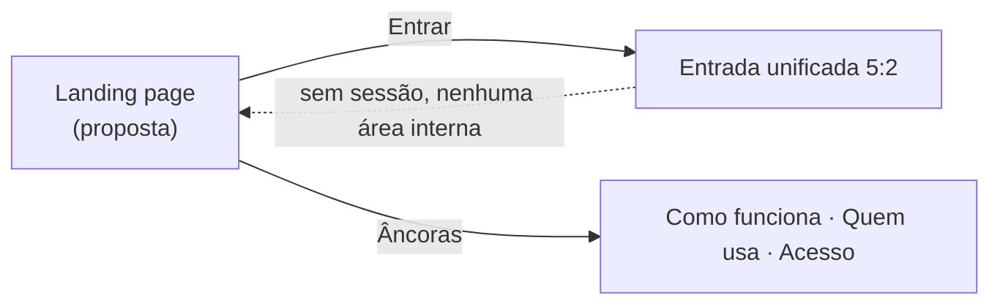

# Landing Page de Apresentação — Gestor de Portarias

> **Artefato 9 da Entrega 2.** Atualizado em 15/11/2026 para a entrada unificada (uma única entrada para os quatro níveis).
>
> **Situação: PENDENTE — não existe landing page no projeto.** A busca em todos os documentos, scripts e capturas da pasta `Figma portaria` não encontrou página pública de apresentação, nem no plano v3.2, nem no inventário de telas T01–T20, nem no arquivo Figma descrito pelos registros de entrega. O que existe é a **área de apresentação dentro da tela de acesso** (seção 2).
>
> As seções 3 em diante são uma **especificação proposta por esta documentação**, sem aprovação do responsável nem da instituição. Nada aqui deve ser lido como funcionalidade implementada ou prototipada.

## 1. Por que a landing page não existe e o que isso implica

- O plano v3.2 trata o Gestor como **ambiente de trabalho autenticado** (RN1). A divulgação pública dos atos é feita nos canais oficiais (Boletim de Serviço, DOU, portal do SIG), não no sistema (plano §7.7 e §10).
- A consulta pública de portarias sem login está **fora do escopo** (plano §2.2).
- Uma página de apresentação **não contraria** a RN1 se não exibir portarias, números, assuntos, documentos ou dados pessoais. Ela apenas explica o sistema e encaminha às entradas.
- Publicar uma página pública do IFC envolve a Comunicação institucional e a TI (identidade visual D22, domínio, hospedagem). Por isso, a criação da landing page deve ser registrada como **decisão pendente** antes do protótipo.

## 2. Elemento existente: apresentação na tela de acesso

A tela de entrada (Interface A) já cumpre parte da função de apresentação:

| Elemento | Conteúdo real | Captura |
|---|---|---|
| Cabeçalho institucional | Marca oficial do IFC Campus Videira, divisória verde e "Gestão institucional de portarias" | [A01](../07-Interfaces-do-Sistema/Capturas/A01-entrada-unificada-computador.png) |
| Título | "Gestor de Portarias" (Inter Extra Bold, verde escuro), com linha verde acima | A01 |
| Finalidade | "Solicitação, emissão e acompanhamento dos atos do Campus Videira." | A01 |
| Fotografias | Biblioteca ("Biblioteca - Campus Videira") e refeitório, em recortes diagonais | A01 |
| Grupo de camadas | "Apresentação do Gestor de Portarias" / "Apresentação e acesso" (nomes das camadas no Figma) | `reference-login-2026-11-11.js` |
| Acesso demonstrativo | "Apresentação com dados demonstrativos" e **Ver usuários demonstrativos**, com quatro contas fictícias (desde 15/11/2026) | [A03](../07-Interfaces-do-Sistema/Capturas/A03-acesso-demonstrativo-computador.png) |

As orientações da referência visual de 11/11/2026 determinaram que a área inferior da entrada **não** tenha os elementos "Solicite portarias", "Emita atos" e "Acompanhe o andamento", ficando apenas a composição decorativa. A especificação abaixo respeita essa decisão: a explicação das etapas fica na landing page, não na tela de acesso.

## 3. Objetivo da página (proposta)

Apresentar o Gestor de Portarias a servidores do Campus Videira e a consultores externos habilitados, explicando **para que serve**, **como funciona o ciclo da portaria** e **como entrar**, sem expor nenhum dado de portaria.

## 4. Identidade visual (proposta, reutilizando o que existe)

| Elemento | Proposta | Origem |
|---|---|---|
| Marca | Marca oficial horizontal do IFC Campus Videira, sem redesenho | `assets/institucional/marca-ifc-videira.png` |
| Paleta | Tokens `auth-*` da entrada (verde escuro, verde, verde-claro, papel branco) | `DESIGN.md` |
| Tipografia | Inter nos títulos e Roboto no corpo, como na entrada | `DESIGN.md` |
| Fotografias | Biblioteca e refeitório já autorizados no projeto, com créditos | `assets/institucional/FONTES.md` |
| Formas | Recortes diagonais e ondas vetoriais da entrada | `DESIGN.md` |
| Restrição | Sujeita à decisão D22 (DSGov × identidade própria) | plano §9.1 |

## 5. Estrutura proposta

### 5.1 Cabeçalho

- Esquerda: marca do IFC Campus Videira + divisória + "Gestão institucional de portarias".
- Direita: botão **Entrar** (entrada unificada para todos os níveis).
- Link oculto "Ir para o conteúdo" como primeiro elemento focável.
- Sem menu de navegação extenso: a página é curta e as âncoras internas bastam ("Como funciona", "Quem usa", "Acesso").

### 5.2 Seção principal (hero)

- Título: "Gestor de Portarias".
- Texto: "Solicitação, emissão e acompanhamento dos atos do Campus Videira."
- Ação: **Entrar** (primária). Não há entradas separadas por tipo de conta (decisão de 15/11/2026).
- Composição com as duas fotografias em recortes diagonais, como na entrada.

### 5.3 Apresentação do problema

Texto curto, derivado da fonte (cap. 2): a gestão das portarias envolve solicitação, elaboração, validação, assinatura, publicação, acompanhamento da vigência e arquivamento; sem um sistema, essas etapas ficam dispersas e difíceis de acompanhar.

### 5.4 Descrição da solução — o ciclo da portaria

Trilha de etapas (sem dados reais):

1. **Solicitar** — o servidor indica assunto, membros, horas e vigência.
2. **Elaborar** — Gabinete ou CGP compõem a portaria sobre o modelo institucional.
3. **Validar** — diretores conferem as participações do próprio departamento.
4. **Assinar** — Direção-Geral ou Vice-Diretor autorizado.
5. **Publicar e comunicar** — registro no canal oficial e e-mail aos membros.
6. **Acompanhar** — vigência, alertas, renovação ou encerramento.

### 5.5 Funcionalidades em destaque

| Destaque | Texto proposto | Requisito |
|---|---|---|
| Solicitação guiada | Campos mínimos e acompanhamento das devoluções | RF-013 |
| Validação por departamento | Cada diretoria confere seus servidores | RF-015 |
| Assinatura verificada | A portaria só conta como assinada após verificação | RF-016 |
| Vigências sob controle | Alertas antes do vencimento | RF-020 |
| Minhas participações | Consulta das portarias e horas de cada servidor | RF-019 |
| Histórico preservado | Versões e documentos anteriores consultáveis | RF-027 |

### 5.6 Benefícios por público

| Público | Benefício |
|---|---|
| Servidores docentes e técnicos | Solicitar e acompanhar portarias e consultar suas participações e horas |
| Gabinete e CGP | Elaboração padronizada, pendências organizadas, comunicação aos membros |
| Diretorias (DEPE, DAP) | Validação restrita ao próprio departamento |
| Direção-Geral e Vice | Fila de assinatura com versão congelada |
| Consultores externos | Consulta das portarias publicadas com conta habilitada |

### 5.7 Como acessar

| Perfil | Caminho | Observação |
|---|---|---|
| Servidor, Gabinete/CGP e Direção (níveis 2 a 4) | **Entrar** → entrada unificada | O nível vem do perfil e só aparece depois do login |
| Conta externa (nível 1) | **Entrar** → entrada unificada | Conta habilitada pela administração; não há autocadastro |
| Esqueceu a senha | Link da própria entrada | Conta institucional: serviço de identidade do IFC (RN3) |

### 5.8 Botões de ação

| Botão | Destino | Estilo |
|---|---|---|
| Entrar | Entrada unificada (`5:2`) | Primário, verde escuro |
| Ir para o conteúdo | Âncora do conteúdo principal | Visível ao receber foco |

Não haverá botão "Criar conta" (RN-011; plano §2.2).

### 5.9 Navegação

### 5.10 Rodapé

- "Instituto Federal Catarinense — Campus Videira · Gestão institucional de portarias".
- Links propostos: Acessibilidade (página exigida pelo plano §10), Política de privacidade e canal de dados pessoais (a definir em D16), contato da TI do campus (a definir).
- Créditos das fotografias (fonte em `FONTES.md`).

## 6. Responsividade (proposta)

| Largura | Composição |
|---|---|
| ≥ 1280 px | Hero em duas colunas (texto e fotografias); etapas em linha |
| 768–1279 px | Hero em coluna; fotografias abaixo do texto; etapas em duas colunas |
| < 768 px | Uma coluna; botões de largura total (48 px); etapas em lista vertical; sem rolagem horizontal |

Mesmas regras da entrada: rolagem vertical natural, legenda das fotos em linha própria, enquadramento do refeitório preservado.

## 7. Requisitos relacionados

| Tipo | IDs | Relação |
|---|---|---|
| Regras de negócio | RN-001, RN-010, RN-011 | Nenhuma portaria sem login; entrada unificada; sem autocadastro |
| Requisitos funcionais | RF-001, RF-004 | Destinos das ações |
| Requisitos não funcionais | RNF-004, RNF-007, RNF-008, RNF-015 | Privacidade, acessibilidade, responsividade, idioma |
| EAP | 4.7 | Pacote pendente |

## 8. Critérios de aceitação

Definidos no [Artefato 4](../04-Criterios-de-Aceitacao/Criterios-de-Aceitacao.md#5-landing-page): **CA-027** (apresentação sem dados de portarias), **CA-028** (chamadas para as entradas), **CA-029** (responsividade) e **CA-030** (acessibilidade). Todos **pendentes**.

## 9. Passos para tirar a landing page da condição de pendente

1. Registrar a decisão de criar a página com Gabinete, Comunicação e TI (inclusive domínio e hospedagem).
2. Aprovar o conteúdo textual desta especificação.
3. Prototipar no mesmo arquivo Figma, reutilizando a coleção "Acesso IFC · referência aprovada" e as famílias Campo `208:128` e Botão `208:201`.
4. Revisar com os critérios CA-027 a CA-030.
5. Incluir a página no teste de usabilidade (tarefa: "Descubra para que serve o sistema e entre como consultor externo").
