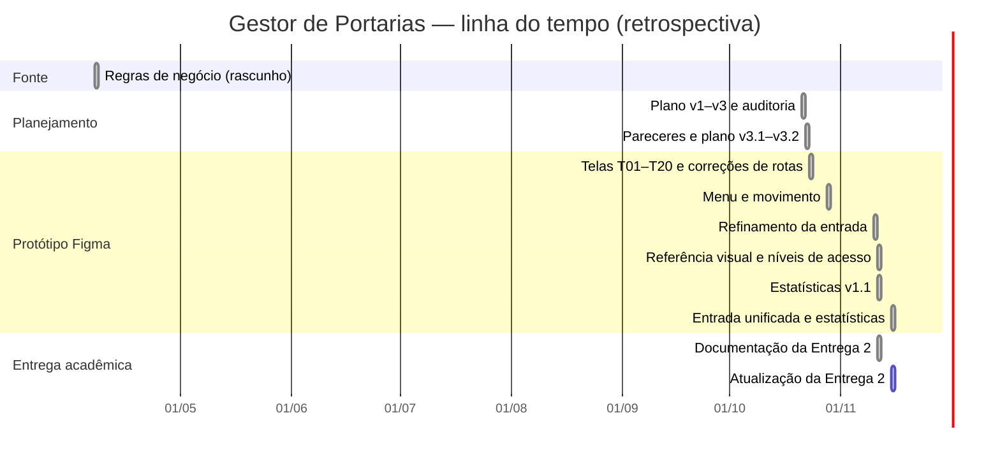

# Plano de Projeto — Gestor de Portarias (IFC Campus Videira)

> **Artefato 1 da Entrega 2.** Este plano descreve o projeto tal como ele se encontra na pasta `Figma portaria` em 15/11/2026 (primeira versão: 11/11/2026; atualizado com os quatro níveis de acesso, a entrada unificada e o módulo de estatísticas e relatórios): um documento-fonte de regras de negócio, um plano de interface revisado em quatro versões e um **protótipo navegável no Figma**. Não existe, até esta data, aplicação web implementada, backend ou banco de dados. Toda afirmação sobre funcionamento refere-se ao protótipo, salvo indicação em contrário.

## Sumário

1. [Identificação do projeto](#1-identificação-do-projeto)
2. [Resumo executivo](#2-resumo-executivo)
3. [Contextualização](#3-contextualização)
4. [Problema](#4-problema)
5. [Justificativa](#5-justificativa)
6. [Objetivos](#6-objetivos)
7. [Público-alvo](#7-público-alvo)
8. [Escopo e exclusões](#8-escopo-e-exclusões)
9. [Principais funcionalidades](#9-principais-funcionalidades)
10. [Tecnologias e ferramentas](#10-tecnologias-e-ferramentas)
11. [Metodologia de desenvolvimento](#11-metodologia-de-desenvolvimento)
12. [Partes interessadas](#12-partes-interessadas)
13. [Recursos necessários](#13-recursos-necessários)
14. [Etapas de execução](#14-etapas-de-execução)
15. [Cronograma de desenvolvimento](#15-cronograma-de-desenvolvimento)
16. [Marcos e entregas](#16-marcos-e-entregas)
17. [Riscos e mitigação](#17-riscos-e-estratégias-de-mitigação)
18. [Premissas e restrições](#18-premissas-e-restrições)
19. [Indicadores de sucesso](#19-indicadores-de-sucesso)
20. [Critérios para encerramento](#20-critérios-para-encerramento)
21. [Relação com os demais artefatos](#21-relação-com-os-demais-artefatos)
22. [Fontes consultadas](#22-fontes-consultadas)

---

## 1. Identificação do projeto

| Campo | Informação | Fonte |
|---|---|---|
| Nome | **Gestor de Portarias** — Instituto Federal Catarinense, Campus Videira | `PRODUCT.md` |
| Natureza | Aplicação web cliente-servidor (prevista); nesta fase, protótipo navegável em Figma | Fonte de regras, cap. 4; `ENTREGA_ACESSOS_FIGMA_2026-11-11.md` |
| Instituição demandante | Instituto Federal Catarinense — Campus Videira (Videira/SC) | Fonte de regras, cap. 2 |
| Documento-fonte | "Gestor de Portarias (Regras de Negócio)", 07/04/2026, status **Rascunho** | `referencias/gestor portaria, regras de negocio.txt` |
| Referência funcional | Plano de criação da interface, versão 3.2 (22/10/2026), incluindo a alteração X08 | `PLANO_INTERFACE_GESTOR_PORTARIAS_v3.2.md` |
| Arquivo de design | Arquivo Figma Design `yHEP1gOormT6A2nBhLhT3b` | `ENTREGA_FIGMA.md` |
| Integrantes da equipe | **Não registrados** nos arquivos do projeto | ver Artefato 3 |
| Plano complementar | Plano técnico da Central de Estatísticas e Relatórios, versão 1.2 (15/11/2026) | `PLANO_ESTATISTICAS_RELATORIOS_v1.2.md` |
| Situação em 15/11/2026 | Protótipo de interface concluído no escopo descrito, com validação parcial da etapa de 15/11 (sem cliques reais); decisões institucionais D01–D24 e D25–D28 pendentes; implementação não iniciada | `PRODUCT.md`, plano §12–§13, `ENTREGA_IMPLEMENTACAO_VALIDACAO_FIGMA_2026-11-15.md` |

## 2. Resumo executivo

O Gestor de Portarias digitaliza o ciclo de vida das portarias do Campus Videira: **solicitação** por qualquer servidor, **elaboração** pelo Gabinete ou pela Coordenação de Gestão de Pessoas (CGP), **validação** pelos diretores, **assinatura** pelo Diretor-Geral ou Vice-Diretor autorizado, **publicação** no canal exigido, **comunicação** aos membros, **acompanhamento da vigência** e **encerramento**, com histórico preservado.

O projeto encontra-se na fase de **design e prototipação**. O plano de interface passou por uma auditoria e dois pareceres independentes (versões v2 → v3 → v3.1 → v3.2), e o protótipo Figma, auditado com 497 quadros na etapa dos quatro níveis (11/11/2026), está organizado em vinte famílias de telas (T01–T20) e doze jornadas (J01–J12), ampliadas em 11/11 e 15/11/2026 com estatísticas, relatórios por período, notificações e acompanhamento. As três interfaces exigidas nesta entrega — acesso por usuário e senha, recuperação de senha e Início com menu — estão prototipadas para computador e celular.

Duas decisões confirmadas pelo responsável orientam o protótipo atual: o **modelo de quatro níveis de acesso** (11/11/2026) — nível 1 para consulta externa; nível 2 para docentes, técnicos, DEPE, DAP e administrador técnico; nível 3 para Gabinete e Gestão de Pessoas; nível 4 para Direção-Geral e Vice-Diretor autorizado, com acesso total — e a **entrada unificada** (15/11/2026), sem indicação de nível antes do login e com uma área opcional de contas demonstrativas. Ambas substituíram versões anteriores do mesmo dia 11/11 (três níveis; entrada de servidores com acesso externo separado; quatro logins por nível).

O principal risco do projeto é institucional, não técnico: 24 decisões (D01–D24) dependem de levantamento com a TI e com as áreas usuárias, em especial a sobreposição com o SIG/SIPAC (D23), o mecanismo de assinatura (D10) e o canal oficial de publicação (D11).

## 3. Contextualização

O IFC Campus Videira oferece formação técnica, tecnológica, superior e de pós-graduação. Sua estrutura administrativa inclui a Direção-Geral (DG), a Diretoria de Administração e Planejamento (DAP), a Diretoria de Ensino, Pesquisa e Extensão (DEPE) e o Gabinete, responsável pela elaboração e pelo controle central das portarias (fonte, cap. 2).

A portaria é o documento de um ato administrativo usado para **designar trabalho** (comissões, núcleos, conselhos, colegiados), **normatizar procedimentos** e **definir lotação** de pessoas em setores. Pode estar vinculada a um ou mais memorandos que justificam sua criação, e seus membros podem ser servidores, alunos ou pessoas da comunidade externa.

O processo também é regulado por normas federais. O plano v3.2 conferiu no texto oficial o Decreto nº 12.002/2024 (redação, numeração, vigência, publicação no DOU e divulgação de atos normativos) e a Lei Complementar nº 95/1998, e cita a LGPD, a LAI, a Lei nº 14.063/2020 (assinaturas eletrônicas), o eMAG 3.1 e a WCAG 2.2.

## 4. Problema

A fonte define o problema como "a gestão das portarias", que compreende um fluxo que começa na solicitação e termina após o vencimento, com a conclusão da atividade designada. Os problemas secundários são de elaboração, composição, validação, acompanhamento e arquivamento.

| Dimensão | Manifestação | Resposta proposta |
|---|---|---|
| Solicitação informal | Pedidos chegam por comunicação oficial, sem padronização dos dados mínimos | Formulário com assunto, membros, horas e vigência obrigatórios (RN4) |
| Composição trabalhosa | Redação, numeração, membros, horas e presidência montados manualmente | Elaboração guiada com modelo institucional e editor de dispositivos |
| Validação difusa | Validação por "Gabinete, Diretor de Departamento e/ou CGP" sem registro | Fila de validação por departamento, com histórico |
| Vigência não acompanhada | Portarias vencem sem renovação ou encerramento registrado | Alertas e tela de vencimentos com ações |
| Falta de rastreabilidade | Difícil localizar portarias, versões e participações | Busca por servidor, assunto, número e período; histórico de estados |
| Ausência de indicadores | Não há relatórios de horas e situações | Relatórios e painel de acompanhamento |

## 5. Justificativa

- **Institucional:** concentra em um ambiente autenticado o que hoje depende de documentos dispersos e controle manual do Gabinete.
- **Normativa:** permite aplicar de forma consistente regras de redação, numeração, vigência e publicação exigidas pelo Decreto nº 12.002/2024.
- **Gestão de pessoas:** controla a carga horária atribuída a docentes em portarias administrativas, com o teto de 10 horas da RN7.
- **Transparência e privacidade:** separa o que é publicado do que é dado pessoal, minimizando a exposição de CPF, endereço e telefone.
- **Acadêmica:** aplica engenharia de requisitos, arquitetura de informação, design de interação, acessibilidade e prototipação a um problema real da própria instituição.

## 6. Objetivos

### 6.1 Objetivo geral

Projetar e validar, por meio de protótipo navegável, a interface de uma aplicação web que permita ao IFC Campus Videira solicitar, elaborar, validar, assinar, publicar, comunicar, acompanhar e consultar portarias, preservando histórico, competências e privacidade.

### 6.2 Objetivos específicos

Os identificadores abaixo são usados na [Matriz de Rastreabilidade](../Matriz-de-Rastreabilidade.md).

| ID | Objetivo específico | Base na fonte | Situação em 15/11/2026 |
|---|---|---|---|
| OE-01 | Garantir acesso autenticado de servidores e de contas externas | RF1, RF3, RN1 | Prototipado; LDAP não definido |
| OE-02 | Permitir a recuperação de acesso, distinguindo conta local e LDAP | RF2, RN2, RN3 | Prototipado para conta local e externa; orientação LDAP removida em 11/11/2026 |
| OE-03 | Oferecer Início (Home) e menu adequados a cada perfil e nível | RF8 (parcial); decisões de 11/11 e 15/11 | Prototipado com os quatro níveis |
| OE-04 | Digitalizar o fluxo da portaria, da solicitação à publicação | RF4, RN4–RN7 | Prototipado |
| OE-05 | Comunicar os membros após a publicação | RF5 | Prototipado |
| OE-06 | Permitir busca, consulta e histórico das portarias | RF6, RN1, RC7 | Prototipado |
| OE-07 | Acompanhar vigências e produzir relatórios e painel | RF7, RF8, RC8–RC10 | Prototipado: estatísticas M01–M32, gráficos C01–C12, relatórios R1–R5 e por período, notificações e acompanhamento; validação parcial; "tempo real" a definir (D18) |
| OE-08 | Gerir cadastros, contas, competências e dados pessoais | RC1, RC2, RC5; LGPD | Prototipado; política de dados pendente (D16) |

## 7. Público-alvo

| Público | Necessidade | Nível de acesso (decisão de 11/11/2026, vigente) |
|---|---|---|
| Servidores docentes e técnicos | Consultar portarias e participações, solicitar portarias | 2 |
| Gabinete e CGP | Elaborar, tramitar, publicar e comunicar | 3 |
| DEPE e DAP | Validar membros, horas e vigência do próprio departamento | 2 |
| Administrador técnico | Contas, configurações e auditoria, sem competência de negócio | 2 |
| Direção-Geral e Vice-Diretor autorizado | Todas as funções, inclusive elaboração, assinatura e administração | 4 |
| Conta externa habilitada / consultor | Consultar portarias publicadas e documentos de divulgação | 1 |
| Alunos e pessoas externas participantes | Constar como membros; **não** recebem login automaticamente | — |

## 8. Escopo e exclusões

### 8.1 Escopo do produto

Conforme o plano v3.2 (§2.2): autenticação, cadastros, solicitações, elaboração, validação, aceite, assinatura, publicação, consulta, acompanhamento, histórico, relatórios, alertas e administração — isto é, todos os RF1–RF8, RN1–RN7 e RC1–RC13. A entrega do produto foi dividida em lançamentos:

| Lançamento | Conteúdo resumido |
|---|---|
| L1 — operação mínima | Login local, recuperação, administração mínima, cadastros, solicitação, elaboração, validação, aceite, assinatura (modo externo), publicação, e-mail aos membros, busca, histórico, alertas com tratamento, pendências |
| L2 — atendimento integral | LDAP, relatórios RF7/RC9, painel RF8, assistentes de renovação/alteração/revogação, central de notificações |
| L3 — melhorias | Comparação de versões, exportação XLSX, carga horária acumulada, importação de acervo, integração SIPAC |

### 8.2 Escopo do trabalho realizado até 15/11/2026

- Plano de interface (v1 a v3.2) e registros de revisão.
- Plano de estatísticas e relatórios (v1.0 → v1.1 → v1.2).
- Protótipo Figma com fundamentos, componentes, telas T01–T20, adaptação móvel, documentos A4 e navegação; quatro níveis e entrada unificada; estatísticas, relatórios por período, notificações, acompanhamento e abas persistentes do editor.
- Documentação de design (`DESIGN.md`, `UX-CONTRACT.md`, `PRODUCT.md`) e relatórios de entrega.

### 8.3 Escopo desta entrega acadêmica

Os nove artefatos da Entrega 2, com ênfase nas interfaces de acesso, recuperação de senha e Início com menu.

### 8.4 Exclusões

| Item | Motivo | Fonte |
|---|---|---|
| Consulta pública de portarias sem login | Contraria a RN1 | Plano §2.2 |
| Aplicativo nativo, uso offline | Fora do escopo | Plano §2.3 |
| Criação de contas por qualquer visitante (autocadastro) | Fora do escopo | Plano §2.2; `ENTREGA_ACESSOS_FIGMA_2026-11-11.md` |
| Edição de memorandos | O sistema apenas referencia memorandos | Plano §2.2 |
| Compra de certificado digital | Fora do escopo | Plano §2.2 |
| Implementação de software (backend, banco, frontend web) | Não realizada nesta fase; o produto entregue é o protótipo Figma | `ENTREGA_ACESSOS_FIGMA_2026-11-11.md` |
| Landing page pública de apresentação | Não existe no projeto nem no plano; especificada como pendência no Artefato 9 | busca no projeto |

## 9. Principais funcionalidades

Detalhamento em [Requisitos Funcionais](../05-Requisitos/Requisitos-Funcionais.md).

| Família (plano) | Funcionalidade | Situação no protótipo |
|---|---|---|
| T01 Entrada | Login unificado por usuário e senha para os quatro níveis; acesso demonstrativo | Prototipado |
| T02 Recuperação | Pedido de link, confirmação, redefinição; orientação LDAP | Prototipado; orientação LDAP removida em 11/11/2026 |
| T03 Início | Visão inicial por perfil e nível, com menu | Prototipado |
| T04/T05 Solicitações | Lista, nova solicitação, devolução e correção | Prototipado |
| T06/T07 Consulta | Busca, detalhe com abas | Prototipado |
| T08 Elaboração | Etapas, editor de dispositivos, membros e horas | Prototipado |
| T09 Validação | Fila e análise por departamento | Prototipado |
| T10 Assinatura | Versão congelada, anexo e verificação | Prototipado |
| T11 Publicação | Registro por canal, comunicação aos membros | Prototipado |
| T12 Vencimentos | Abas por prazo, ações de encerrar e renovar | Prototipado |
| T13 Relatórios | Estatísticas administrativas (Panorama, Tramitação, Pendências, Servidores), relatórios R1–R5 e por período, prévias A4 | Prototipado; nenhum PDF é gerado |
| T14–T17 Cadastros e administração | Servidores, externos, referências, contas e níveis | Prototipado |
| T18 Notificações | Notificações e acompanhamento de projetos; Minha conta | Prototipado |
| T19 Documento | Minuta, versão para assinatura, assinado; modelos | Prototipado |
| T20 Pendências | Minhas tarefas, fila do papel, alertas | Prototipado |

## 10. Tecnologias e ferramentas

| Categoria | Ferramenta / padrão | Uso | Fonte |
|---|---|---|---|
| Design e prototipação | Figma Design (variáveis, componentes, auto layout, protótipo com condições e variáveis) | Telas, componentes, navegação e animações | `ENTREGA_FIGMA.md`, `DESIGN.md` |
| Automação do design | Scripts JavaScript da API de plugins do Figma (pasta `.design/`) | Construção e correção em lote de quadros, auditorias estruturais | `.design/*.js` |
| Registro de verificação | Arquivos JSON de auditoria e capturas PNG | Evidência de destinos, transbordamentos e cenários | `.design/*.json`, `.impeccable/review/` |
| Tipografia | Source Sans 3 (operação), Inter e Roboto (acesso), Carlito e Source Serif 4 (documentos) | Interface e espécimes documentais | `DESIGN.md` |
| Documentação | Markdown | Plano, contratos e esta entrega | — |
| Arquitetura prevista | Aplicação web cliente-servidor, autenticação local e LDAP, e-mail transacional, geração de PDF | A definir na implementação | Fonte cap. 4; plano §11 |
| Integrações previstas | SIG/SIPAC, base de pessoal (SIGRH), serviço de assinatura | Dependem de D23, D15 e D10 | Plano §11–§12 |
| Base visual recomendada | Design System gov.br (DSGov) e manual do IFC | Hipótese D22; a entrega usa identidade própria provisória | Plano §9.1 |

**Não há** linguagem de programação, framework, banco de dados ou servidor definidos para a implementação. O plano trata essas escolhas como dependentes do levantamento com a TI (Etapa 0).

## 11. Metodologia de desenvolvimento

A metodologia observada nos registros do projeto é **orientada a planejamento com revisões iterativas** e **design centrado no usuário**:

1. **Análise do documento-fonte** e separação explícita entre requisito da fonte, proposta de interface, hipótese de trabalho (H-Dxx) e divergência da fonte (plano §0, §1.1).
2. **Revisões independentes do plano**: auditoria da v2 (achados A01–A15), parecer da v3 (V3-01 a V3-10) e parecer da v3.1, cada uma incorporada em nova versão com registro de alterações (plano §0.2–§0.4).
3. **Prototipação em alta fidelidade no Figma**, com componentes e variáveis como fonte única de estilo, e navegação por jornada.
4. **Verificação estrutural automatizada** do arquivo Figma (destinos ausentes, transbordamentos, rotas proibidas) e **revisão visual independente** com veredito registrado ("ship" ou "fix").
5. **Incorporação de retornos do responsável** por imagens e textos de referência (23/10, 10/11, 11/11 e 15/11/2026).
6. **Próximos passos previstos** (plano §13): levantamento institucional, homologação das decisões, teste de usabilidade exploratório, implementação por lançamento e homologação.

Não há, no projeto, registro de cerimônias de um framework ágil específico; por isso este plano não afirma o uso de Scrum ou Kanban.

## 12. Partes interessadas

| Parte interessada | Interesse | Papel no projeto |
|---|---|---|
| Gabinete do Campus Videira | Elaborar e controlar portarias | Principal usuário; decide D04, D07, D09, D11 |
| Direção-Geral e Vice-Diretor | Assinar e acompanhar | Decide D02, D03, D10, D14 |
| Coordenação/Direção de Gestão de Pessoas (CGP/DGP) | Emitir portarias de pessoal; cadastro | Usuário emissor; decide D15, D20 |
| DEPE e DAP | Validar participações do departamento | Validadores; decidem D04, D06 |
| Servidores docentes e técnicos | Solicitar e consultar | Usuários finais |
| Administrador técnico | Contas e configurações | Usuário de administração |
| TI do campus | Integrações (LDAP, SIG/SIPAC, e-mail, assinatura) | Decide D10, D18, D23 |
| Comunicação institucional | Identidade visual | Decide D22 |
| Responsáveis por dados e arquivo; procuradoria | LGPD, guarda documental, publicação | Decidem D11, D16, D21 |
| Professores da disciplina | Avaliação acadêmica | Avaliadores desta entrega |
| Equipe do projeto | Desenvolver e entregar | Integrantes não registrados nos arquivos |

## 13. Recursos necessários

| Tipo | Recurso | Observação |
|---|---|---|
| Humanos | Papéis de análise de requisitos, UX/UI, desenvolvimento frontend e backend, banco de dados, testes, segurança e documentação | Ver Artefato 3 |
| Humanos (instituição) | Representantes do Gabinete, DG, CGP, DEPE, DAP, TI, Comunicação e área de dados | Para o levantamento e a homologação |
| Software | Figma; ambiente de desenvolvimento a definir | — |
| Ativos institucionais | Marca oficial do IFC Campus Videira; fotografias da biblioteca e do refeitório | Fontes em `assets/institucional/FONTES.md` |
| Dados | Acervo de portarias publicadas (Boletim de Serviço / SIG) e planilha de registro | A planilha ainda não foi lida (plano §16, item 6) |
| Infraestrutura futura | Servidor de aplicação, banco, serviço de e-mail, LDAP, serviço de assinatura | Depende de D10, D23 |

## 14. Etapas de execução

Adaptadas do plano v3.2 (§13), com a situação de cada etapa.

| Etapa | Trabalho | Entregáveis | Situação em 15/11/2026 |
|---|---|---|---|
| Fonte | Redação das regras de negócio | Documento de 07/04/2026 | Concluída (rascunho) |
| Planejamento | Plano de interface v1 a v3.2 com revisões | Plano v3.2 | Concluída |
| 0 — Levantamento | SIG/SIPAC, LDAP, assinatura, canais, séries, frase truncada, planilha | Respostas registradas | **Pendente** |
| 1 — Consolidar domínio | Aprovar hipóteses de prioridade Alta | Registro D01–D28 homologado | **Pendente** |
| 2 — Arquitetura e fluxos | Navegação e jornadas J01–J12 | Mapa de telas e fluxos | Concluída no plano e no Figma |
| 3 — Wireframes | Estrutura das telas e estados | — | Absorvida pela alta fidelidade |
| 4 — Sistema visual | Tokens e componentes | `DESIGN.md`, `UX-CONTRACT.md` | Concluída provisoriamente (D22 pendente) |
| 5 — Protótipo e teste | Protótipo e teste com usuários | Protótipo; relatório de teste | Protótipo concluído; validação de 15/11 parcial (sem cliques reais); **teste com usuários não realizado** |
| 6 — Implementação | L1, depois L2 e L3 | Software | **Não iniciada** |
| 7 — Homologação | Cenários reais, acessibilidade, privacidade | Aceite institucional | **Não iniciada** |
| 8 — Implantação | Operação e capacitação | Guias por perfil | **Não iniciada** |

## 15. Cronograma de desenvolvimento

O cronograma é **retrospectivo** até 15/11/2026, com datas extraídas dos próprios documentos do projeto. Para as etapas futuras não há datas aprovadas; o plano v3.2 (§13.1) recomenda **não estimar prazo fechado antes de responder D23, D10 e D11**.

| Data | Evento | Evidência |
|---|---|---|
| 07/04/2026 | Documento-fonte de regras de negócio (rascunho) | `referencias/gestor portaria, regras de negocio.txt` |
| 21/10/2026 | Plano v1/v2, auditoria da v2 e plano v3 | cabeçalho do plano; `AUDITORIA_…_v2.md` |
| 22/10/2026 | Pareceres v3 e v3.1; plano v3.1 e v3.2 | `PARECER_…_v3.md`, `PARECER_…_v3.1.md` |
| 23/10/2026 | Recebimento das imagens com login, recuperação e Home com menu; protótipo Figma e correções de navegação | `PRODUCT.md`; `ENTREGA_FIGMA.md` |
| 28/10/2026 | Correção do menu na nova solicitação e animações | `ENTREGA_FIGMA.md` |
| 10/11/2026 | Refinamento da entrada e traduções de camadas | `DESIGN.md` (registro histórico) |
| 11/11/2026 | Nova composição da entrada (referência fornecida); remoção do Acesso institucional; acesso externo; três níveis | `ENTREGA_REFERENCIA_…`, `ENTREGA_ACESSOS_…` |
| 11/11/2026 | Documentação da Entrega 2 (primeira versão) | esta pasta |
| 11/11/2026 | Quatro níveis e quatro logins | `ENTREGA_QUATRO_NIVEIS_FIGMA_2026-11-11.md` |
| 11/11/2026 | Plano de estatísticas v1.1 aplicado ao protótipo | `ENTREGA_ESTATISTICAS_RELATORIOS_2026-11-11.md` |
| 15/11/2026 | Entrada unificada, estatísticas ampliadas, relatórios por período, notificações e validação visual | `ENTREGA_IMPLEMENTACAO_VALIDACAO_FIGMA_2026-11-15.md` |
| 15/11/2026 | Atualização da Entrega 2 e plano de estatísticas v1.2 | esta pasta |

> A escala do gráfico é ilustrativa; as barras de um dia representam a data do registro, não a duração do trabalho, que não está documentada.

## 16. Marcos e entregas

| Marco | Entrega | Data | Situação |
|---|---|---|---|
| M1 | Documento-fonte de regras de negócio | 07/04/2026 | Concluído |
| M2 | Plano de interface v3.2 aprovado para orientar o protótipo | 22/10/2026 | Concluído |
| M3 | Protótipo Figma com T01–T20 e J01–J12 | 23/10/2026 | Concluído |
| M4 | Nova entrada conforme referência visual | 11/11/2026 | Concluído |
| M5 | Níveis de acesso (quatro níveis) | 11/11/2026 | Concluído |
| M6 | Documentação da Entrega 2 | 11/11/2026, atualizada em 15/11/2026 | Concluído |
| M6a | Estatísticas e relatórios no protótipo (v1.1) | 11/11/2026 | Concluído |
| M6b | Entrada unificada, estatísticas ampliadas e notificações | 15/11/2026 | Concluído com validação parcial |
| M7 | Levantamento da Etapa 0 e decisões de prioridade Alta | — | Pendente |
| M8 | Percursos por cliques reais e teste de usabilidade exploratório | — | Pendente |
| M9 | Implementação do L1 | — | Pendente |
| M10 | Homologação e implantação | — | Pendente |

## 17. Riscos e estratégias de mitigação

| ID | Risco | P | I | Mitigação | Situação |
|---|---|---|---|---|---|
| R01 | O SIG/SIPAC já cobrir parte do fluxo (D23) e tornar módulos redundantes | Alta | Alta | Responder D23 antes de detalhar assinatura e publicação; manter no Gestor o que lhe é próprio | Aberto |
| R02 | Sem mecanismo de assinatura verificável (D10), o sistema não pode afirmar que a portaria está assinada | Média | Alta | Modo externo com anexo e verificação; nunca confirmar assinatura sem evidência | Mitigado no desenho |
| R03 | Canal oficial de publicação indefinido (D11), com possível exigência de DOU | Média | Alta | Registro por canal e classificação material do ato | Aberto |
| R04 | Hipóteses adotadas no protótipo serem tomadas como regra de produção | Média | Alta | Marcar hipóteses e variantes; homologação antes da implementação | Mitigado na documentação |
| R05 | Exposição de dados pessoais (CPF, endereço) em listas, e-mails e documentos | Média | Alta | Mascaramento, CPF fora de e-mails e exportações, log de exibição (D16, D21) | Mitigado no desenho |
| R06 | Protótipo aprovado visualmente sem teste com usuários | Alta | Média | Teste exploratório previsto no plano §13.3 | Aberto |
| R07 | Acessibilidade não comprovada (o Figma não verifica teclado nem leitor de tela) | Alta | Alta | Mapeamento WCAG 2.2/eMAG critério a critério na implementação (B09) | Aberto |
| R08 | Texto da fonte truncado ("As p…") esconder regra perdida (D19) | Baixa | Média | Pedir o texto completo ao autor | Aberto |
| R09 | Ausência de responsável institucional formal pelas decisões | Média | Alta | Registrar responsável, data e evidência para cada decisão (B01) | Aberto |
| R10 | Equipe e prazo de implementação desconhecidos | Alta | Alta | Não fixar prazo antes de D23, D10 e D11 | Aberto |
| R11 | Números do cenário demonstrativo serem lidos como dados reais do campus | Média | Média | Marca "Dados demonstrativos" em toda tela e prévia; base e data de cálculo visíveis | Mitigado no desenho |
| R12 | Mudanças de 15/11 aceitas sem percurso por cliques | Alta | Média | Executar os percursos pendentes antes do teste com usuários | Aberto |

P = probabilidade; I = impacto.

## 18. Premissas e restrições

**Premissas**

- O Gabinete continuará como centro de controle das portarias.
- O IFC disponibilizará representantes para o levantamento e a homologação.
- Haverá serviço de e-mail institucional para o RF5.
- O acervo de portarias publicadas poderá ser consultado para definir modelos e séries de numeração.

**Restrições**

- O documento-fonte é um **rascunho**; nenhuma hipótese vale como regra de produção antes da homologação.
- RN1: toda consulta exige login.
- O protótipo usa **dados fictícios** e entradas predefinidas; não executa autenticação, assinatura, publicação nem envio de e-mail.
- Conformidade com LGPD, Decreto nº 12.002/2024 e LC nº 95/1998.
- A identidade visual oficial depende da Comunicação institucional (D22).

## 19. Indicadores de sucesso

| ID | Indicador | Meta | Valor observado | Fonte |
|---|---|---|---|---|
| IS-01 | Quadros do protótipo sem destinos de navegação ausentes | 100% | 497 de 497 quadros (quatro níveis); 94 + 92 (estatísticas); 132 + 142 telas alteradas em 15/11, todos sem destino ausente | `four-levels-audit-*`, `statistics-audit-*`, `.design/nov15/audit-delivery-*` |
| IS-02 | Verificações de navegação aprovadas | 100% | 138 de 138 (quatro níveis); 1.370 de 1.370 interpretadas (15/11), sem cliques reais | `four-levels-navigation-tests-2026-11-11.json`; `ENTREGA_IMPLEMENTACAO_VALIDACAO_FIGMA_2026-11-15.md` |
| IS-03 | Requisitos da fonte (RF1–RF8, RN1–RN7) com tela correspondente no protótipo | 100% | 14 de 15: a RN3 (orientação de recuperação LDAP) perdeu sua representação em 11/11/2026 | Matriz de Rastreabilidade; Artefato 5 |
| IS-04 | Decisões institucionais homologadas | 28 de 28 antes do L1 | Nenhuma homologada; decisões de projeto confirmadas pelo responsável: quatro níveis (11/11) e entrada unificada (15/11) | `PRODUCT.md` |
| IS-05 | Tarefas críticas sem erro crítico no teste de usabilidade | 100% | Não medido (teste não realizado) | plano §13.3 |
| IS-06 | Tempo mediano da solicitação à publicação | Redução em relação ao processo atual | Não medido (sistema não implantado) | plano §13.4 |
| IS-07 | Comunicações por resultado (e-mail enviado, alternativa, exceção) | Registro integral | Não medido | plano §13.4 |

## 20. Critérios para encerramento

Pelo plano v3.2 (§16), a interface só é considerada completa quando:

1. todas as capacidades RF1–RF8, RN1–RN7 e RC1–RC13 tiverem telas e comportamentos **implementados** (fim do L2);
2. as decisões D01–D24 estiverem homologadas;
3. os testes de acesso, fluxo, documentos, dados, falhas, privacidade e acessibilidade tiverem sido executados;
4. o aceite das áreas usuárias estiver registrado.

Para o **encerramento da fase de prototipação**, propõe-se adicionalmente: teste de usabilidade exploratório concluído sem erro crítico pendente (plano §13.3) e pacote de handoff entregue (plano §13.2). Em 15/11/2026, nenhuma dessas condições estava cumprida, exceto a existência do protótipo.

## 21. Relação com os demais artefatos

| Este plano define… | …detalhado em |
|---|---|
| Etapas e marcos | [EAP](../02-EAP-do-Projeto/EAP.md) e [Dicionário](../02-EAP-do-Projeto/Dicionario-da-EAP.md) |
| Recursos humanos | [Mapeamento de Talentos](../03-Mapeamento-de-Talentos/Mapeamento-de-Talentos.md) |
| Funcionalidades e qualidade | [Requisitos Funcionais](../05-Requisitos/Requisitos-Funcionais.md), [Não Funcionais](../05-Requisitos/Requisitos-Nao-Funcionais.md) |
| Regras do domínio | [Regras de Negócio](../06-Regras-de-Negocio/Regras-de-Negocio.md) |
| Critérios de encerramento | [Critérios de Aceitação](../04-Criterios-de-Aceitacao/Criterios-de-Aceitacao.md) |
| Objetivos OE-01 a OE-03 | [Interfaces](../07-Interfaces-do-Sistema/Documentacao-das-Interfaces.md), [Prototipação](../08-Prototipacao/Prototipacao-Funcional.md), [Landing Page](../09-Landing-Page/Documentacao-Landing-Page.md) |

## 22. Fontes consultadas

- `C:\Users\User\Downloads\gestor portaria, regras de negocio.txt` (documento-fonte, 07/04/2026).
- `PLANO_INTERFACE_GESTOR_PORTARIAS_v3.2.md`, `AUDITORIA_PLANO_INTERFACE_GESTOR_PORTARIAS_v2.md`, pareceres v3 e v3.1.
- `PRODUCT.md`, `DESIGN.md`, `UX-CONTRACT.md`, `ENTREGA_FIGMA.md`, `ENTREGA_REFERENCIA_FIGMA_2026-11-11.md`, `ENTREGA_ACESSOS_FIGMA_2026-11-11.md`, `assets/institucional/FONTES.md`.
- Scripts e registros em `.design/` (especialmente `screens.js`, `access-levels-*.js`, `levels-final-audit-*.json`, `levels-navigation-tests-2026-11-11.json`) e capturas em `.design/previews/` e `.impeccable/review/`.
- O arquivo Figma **não foi aberto** durante esta documentação (não havia acesso ao Figma nesta sessão); as informações sobre ele vêm dos registros locais acima.
