# Interfaces do Sistema — Gestor de Portarias

> **Artefato 7 da Entrega 2.** Documentação das três interfaces exigidas:
>
> - **A.** Interface inicial de acesso (usuário e senha) — **prototipada** no Figma (família T01), como entrada unificada desde 15/11/2026.
> - **B.** Interface de recuperação de senhas — **prototipada** no Figma (família T02), com uma lacuna: a orientação para conta institucional (LDAP) foi removida em 11/11/2026.
> - **C.** Interface Início (Home) com menu de acesso — **prototipada** no Figma (família T03 e menu global), com os quatro níveis de acesso.
>
> E uma interface complementar, acrescentada ao protótipo em 11/11 e 15/11/2026:
>
> - **D.** Estatísticas, relatórios, notificações e acompanhamento.
>
> Todas existem como **protótipo navegável**, não como software. Nenhuma executa autenticação, envio de e-mail, geração de PDF ou controle de sessão reais.
>
> **Atualizado em 15/11/2026.** Esta versão substitui a descrição de 11/11/2026, que mostrava três níveis, uma entrada de servidores e uma entrada externa separada.

## Sobre as capturas

| Item | Informação |
|---|---|
| Origem | Exportações do próprio arquivo Figma, feitas pelo projeto e guardadas em `.design/previews/` e `.impeccable/review/`; copiadas, sem alteração, para [Capturas](Capturas). Origem de cada arquivo em [_origem-das-capturas.txt](Capturas/_origem-das-capturas.txt) |
| Geração nesta documentação | **Nenhuma captura nova foi gerada** pela documentação: as imagens vêm das validações do projeto (a de 15/11/2026 tem 217 capturas, catalogadas em `VALIDACAO_VISUAL_FIGMA_2026-11-15.md`) |
| Prefixos | **A** acesso · **B** recuperação · **C** Início e menu · **E** estatísticas, relatórios e acompanhamento |
| Histórico | Capturas de 11/11/2026 que não representam mais o protótipo estão em [Capturas/historico-2026-11-11](Capturas/historico-2026-11-11) |
| Dados exibidos | Fictícios (Marina Costa, Eduardo Almeida, Sofia Ribeiro, André Souza, Patrícia Ramos, Helena Martins; portarias 128/2026, 129/2026; projetos P01–P21) |
| Imagens reais | Marca do IFC Campus Videira, biblioteca e refeitório (fontes em `assets/institucional/FONTES.md`) |

| Arquivo | Data da captura | Representa o estado atual? |
|---|---|---|
| A01 a A04 | 15/11/2026 | Sim |
| B02, B03 | 23/10/2026 | Texto e ações sim; a composição visual pode diferir da atual, porque as telas de entrada foram recompostas em 10, 11 e 15/11/2026 |
| C01 a C03, C05 a C07 | 15/11/2026 | Sim |
| C04 | 11/11/2026, 11h07 (escala 1–4) | Sim |
| E01 a E07 | 15/11/2026 | Sim |
| historico-2026-11-11/* | 11/11/2026 | **Não**: mostram a entrada de servidores com Acesso externo, os três níveis, o selo "Nível 3" da Direção e o bloco de conta institucional já removido |

---

## A. Interface inicial de acesso (usuário e senha)

### A.1 Identificação

| Item | Valor |
|---|---|
| Família | T01 — Entrada |
| Quadros | Computador `5:2`; celular `8:1663`; amostras `211:1345` (1920×1080), `211:1491` (1366×768), `211:1637` (1024×768); tablet `211:3173` (768×1024); celular `211:3308` (375×812) e `23:1085` (360). Os IDs dos quadros de acesso demonstrativo estão em `.design/nov15/state-final.json` (`auth`) |
| Situação | Prototipada (entrada unificada de 15/11/2026) |
| Requisitos | RF-001, RF-002, RF-003, RF-004, RF-009, RF-034 |
| Regras | RN-001, RN-009, RN-010, RN-026 |
| Critérios | CA-001 a CA-008, CA-049 |

### A.2 Objetivo

Permitir que qualquer conta habilitada, dos níveis 1 a 4, entre no Gestor de Portarias informando **Usuário** e **Senha**, sem escolher nível antes do login. A tela também apresenta o sistema e a instituição e oferece, de forma discreta, contas fictícias para apresentações.

### A.3 Público-alvo

Servidores do Campus Videira (níveis 2, 3 e 4) e contas externas habilitadas (nível 1), todos pela mesma entrada. O acesso demonstrativo serve a quem apresenta o protótipo.

### A.4 Capturas

| Entrada unificada (computador) | Entrada unificada (celular) |
|---|---|
| 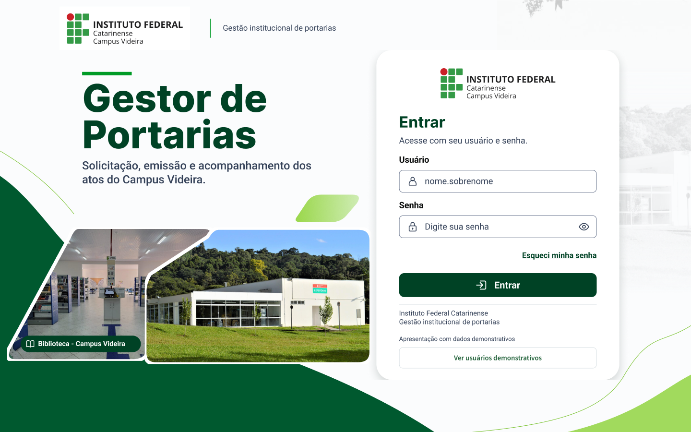 | 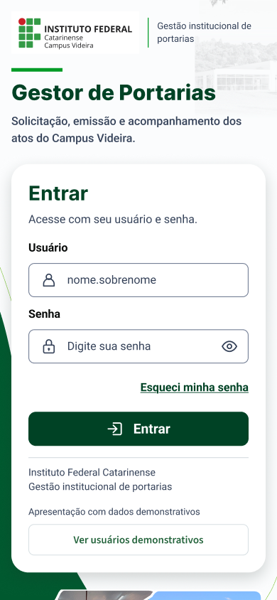 |

| Acesso demonstrativo (computador) | Acesso demonstrativo (celular) |
|---|---|
| 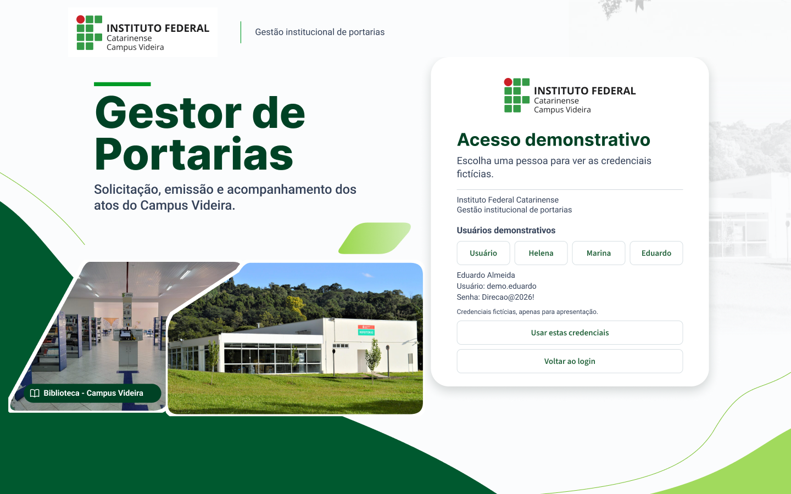 | 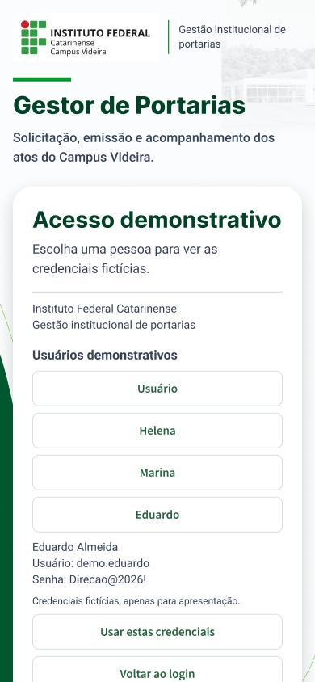 |

### A.5 Elementos visuais

**Área de apresentação (esquerda no computador; topo no celular)**

- Cabeçalho institucional: marca oficial do IFC Campus Videira, divisória vertical verde e "Gestão institucional de portarias".
- Linha verde curta acima do título **"Gestor de Portarias"** (Inter Extra Bold, verde escuro).
- Finalidade: "Solicitação, emissão e acompanhamento dos atos do Campus Videira."
- Duas fotografias com recortes diagonais: biblioteca (com etiqueta "Biblioteca - Campus Videira") e refeitório.
- Elementos decorativos vetoriais: onda verde escura inferior esquerda, curva verde clara inferior direita, linha curva fina, forma verde clara acima das fotos, arquitetura e folhagem desaturadas ao fundo.

**Cartão de acesso (direita no computador; após o título no celular)**

- Cartão branco com raio de 36 px e sombra suave (base de 1586 × 992 px).
- Marca do IFC no topo do cartão (omitida no celular, onde já aparece no cabeçalho).
- Título **"Entrar"** (Inter Bold) e subtítulo "Acesse com seu usuário e senha."
- Rodapé do cartão com divisória e "Instituto Federal Catarinense / Gestão institucional de portarias".
- Abaixo do rodapé, "Apresentação com dados demonstrativos" e o botão **Ver usuários demonstrativos**.
- **Nenhum selo de nível** aparece na entrada.

### A.6 Campos e componentes

| Componente | Família Figma | Conteúdo | Observações |
|---|---|---|---|
| Usuário | Campo de acesso (`208:128`) | Rótulo "Usuário"; exemplo `nome.sobrenome`; ícone de pessoa | Entrada de 52 px na base (48 px no celular) |
| Senha | Campo de acesso (`208:128`) | Rótulo "Senha"; "Digite sua senha"; ícone de cadeado; olho para exibir/ocultar | Variantes Padrão, Foco, Erro, Desabilitado |
| Esqueci minha senha | Texto com ação | Verde, sublinhado, alinhado à direita, abaixo da senha | — |
| Aviso de erro | Aviso | "Não foi possível entrar" | Estado de erro |
| Acesso demonstrativo | Cartão | "Acesso demonstrativo — Escolha uma pessoa para ver as credenciais fictícias."; botões Usuário, Helena, Marina e Eduardo; nome, usuário e senha fictícios; "Credenciais fictícias, apenas para apresentação." | Não concede permissões (RN-026) |

### A.7 Botões e ações

| Elemento | Estilo | Destino |
|---|---|---|
| **Entrar** | Botão de acesso, verde escuro, ícone de entrada, largura total, 55 px na base | Estado preenchido → Início do perfil; estado vazio → erro (demonstração) |
| Olho da senha | Ícone | Alterna mascarado/visível |
| Esqueci minha senha | Link | Recuperação (`5:92`) |
| **Ver usuários demonstrativos** | Botão secundário de contorno | Área "Acesso demonstrativo" |
| **Usar estas credenciais** | Botão secundário | Preenche a entrada com a conta fictícia escolhida |
| **Voltar ao login** | Botão secundário | Entrada vazia |

Removidos ao longo do projeto: **Acesso institucional** (11/11/2026), **Acesso externo** com entrada própria (substituído em 15/11/2026) e a tela **Escolha seu acesso** com quatro logins por nível (11/11 a 15/11/2026).

### A.8 Comportamento esperado

1. O usuário vê a entrada com campos vazios e nenhum nível.
2. Ao preencher, os campos passam ao estado preenchido; o olho alterna a senha.
3. **Entrar** com credenciais válidas abre o Início do perfil; perfil e nível aparecem só nesse momento.
4. Com credenciais inválidas, aparece o aviso de erro no topo do cartão e a orientação junto ao campo.
5. **Ver usuários demonstrativos** mostra as quatro contas fictícias; escolher uma mostra as credenciais; **Usar estas credenciais** preenche a entrada.
6. Sessão expirada leva a "Sua sessão expirou", com "Entrar novamente" e a informação de que o último rascunho salvo foi preservado.

### A.9 Validações

| Validação | Onde | Situação |
|---|---|---|
| Usuário e senha obrigatórios | Cliente e servidor | Especificada; no protótipo, demonstrada por estado de erro predefinido |
| Credenciais corretas | Servidor | Implementação |
| Conta habilitada e nível do perfil | Servidor | Implementação (plano §7.1: "conta não habilitada") |
| Serviço de autenticação disponível | Servidor | Implementação (plano §7.1: "serviço indisponível") |
| Origem da conta (local ou LDAP) | Servidor | Implementação (D23, RF3) |
| Área demonstrativa fora de produção | Configuração | Implementação (RN-026) |

### A.10 Mensagens de erro

| Situação | Mensagem | Origem |
|---|---|---|
| Credenciais inválidas | "Não foi possível entrar" — "Confira o usuário e a senha. Se o problema continuar, recupere o acesso." e, no campo, "Revise este campo para continuar." | `screens.js`; `reference-login-2026-11-11.js` |
| Conta não habilitada; serviço indisponível | Previstas no plano §7.1, **sem texto definido** no protótipo | Pendência |
| Sessão expirada | "Sua sessão expirou — Entre novamente para continuar com segurança." | `screens.js` |

### A.11 Regras de navegação

- Todas as contas usam a mesma entrada; não há troca de entrada por tipo de conta.
- **Sair**, em qualquer tela interna, volta à entrada sem a sessão de gestão.
- Nenhum quadro do ambiente externo leva a módulo interno (auditoria de 11/11/2026: `externalInternalRoutes` vazio; escopo das notificações verificado em 15/11/2026).

### A.12 Requisitos e critérios associados

| Requisitos | Regras | Critérios |
|---|---|---|
| RF-001, RF-002, RF-003, RF-004, RF-009, RF-034 | RN-001, RN-009, RN-010, RN-026 | CA-001 a CA-008, CA-049 |

### A.13 Responsividade e acessibilidade

- **Computador:** duas áreas (apresentação e cartão). Amostras de 1920 a 1024 px escalam a composição com piso de 44 px para controles.
- **Tablet e celular:** uma coluna com rolagem vertical; ordem marca → título e finalidade → cartão → fotografias; campos e botões de 48 px; no celular, a marca não se repete dentro do cartão.
- **Acessibilidade demonstrada no design:** rótulos persistentes (o exemplo não substitui o rótulo); foco azul (3 px em botões, 2 px em campos); erro em texto; alvos de 44 px ou mais; contraste do verde escuro sobre branco.
- **Não comprovado:** ordem de tabulação, nomes acessíveis, anúncio de erro por leitor de tela, `prefers-reduced-motion` — dependem da implementação (`UX-CONTRACT.md`).

---

## B. Interface de recuperação de senhas

### B.1 Identificação

| Item | Valor |
|---|---|
| Família | T02 — Recuperação |
| Quadros | Recuperar acesso `5:92` · Confira seu e-mail `5:118` · Defina uma nova senha `5:143` · Conclusão `5:167`; celular a partir de `8:1753` |
| Quadros da recuperação externa (11/11/2026) | `236:1694` · `236:1721` · `236:1753` · `236:1784` — criados quando havia entrada externa própria; o caminho a partir da entrada unificada não foi reverificado |
| Situação | Prototipada; orientação para conta institucional **removida** em 11/11/2026 |
| Requisitos | RF-005, RF-006, RF-007, RF-008 |
| Regras | RN-002, RN-003 |
| Critérios | CA-009 a CA-014 |

### B.2 Objetivo

Permitir que quem esqueceu a senha de uma **conta local** recupere o acesso por um link enviado ao e-mail cadastrado (RF2, RN2), sem revelar se a conta existe, e orientar quem usa **conta institucional** a recorrer ao serviço de identidade do IFC (RN3).

### B.3 Público-alvo

Servidores e contas externas com conta local; servidores com conta institucional (orientação).

### B.4 Capturas

| Confira seu e-mail (computador, 23/10) | Confira seu e-mail (celular, 23/10) |
|---|---|
| 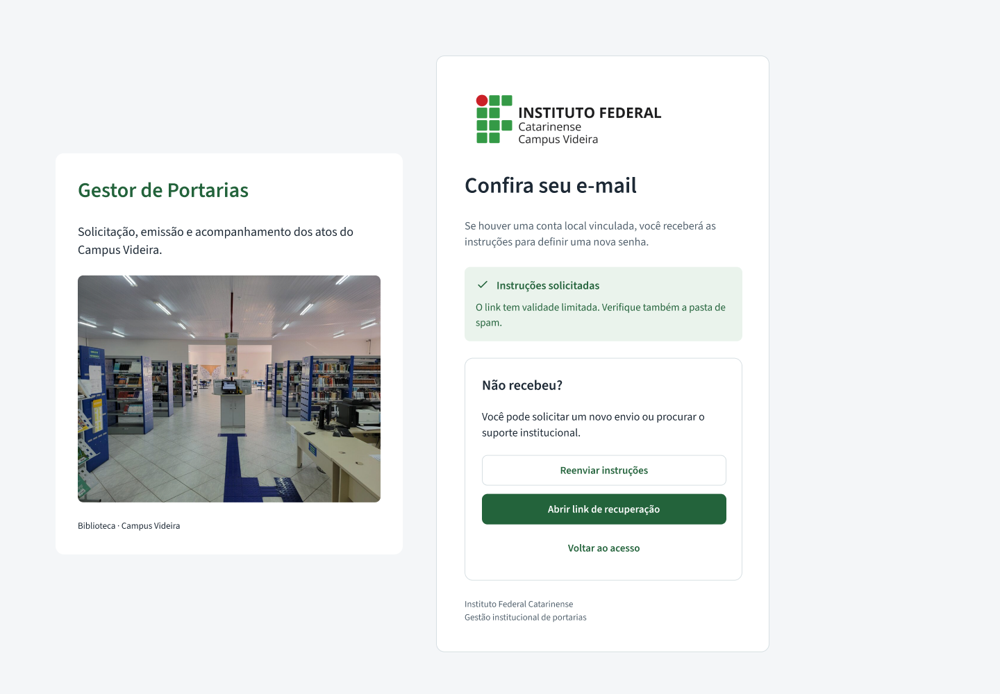 |  |

A captura de "Recuperar acesso" de 11/11/2026, com o bloco de conta institucional já removido, está em [historico-2026-11-11/B01](Capturas/historico-2026-11-11/B01-recuperar-acesso-celular.png). Não há captura local das telas "Defina uma nova senha", da conclusão nem das telas de recuperação externa.

### B.5 Elementos visuais

- Identificação institucional (marca do IFC) e, no celular, faixa verde com "Gestor de Portarias" e a finalidade.
- Cartão com título, texto de apoio, campo e ações empilhadas; rodapé "Instituto Federal Catarinense / Gestão institucional de portarias".
- Na confirmação: aviso verde com ícone de verificação "Instruções solicitadas" e cartão "Não recebeu?".
- No computador (captura B02): painel à esquerda com "Gestor de Portarias", a finalidade e a foto da biblioteca.

### B.6 Campos e componentes

| Tela | Componente | Conteúdo |
|---|---|---|
| Recuperar acesso | Campo **E-mail institucional** | Exemplo `marina.costa@ifc.edu.br` |
| Confira seu e-mail | Aviso | "Instruções solicitadas — O link tem validade limitada. Verifique também a pasta de spam." |
| Confira seu e-mail | Cartão | "Não recebeu? — Você pode solicitar um novo envio ou procurar o suporte institucional." |
| Defina uma nova senha | Campos **Nova senha** e **Confirme a senha** | Ajuda: "Os requisitos de senha seguem a política de acesso homologada pela instituição." |

### B.7 Botões e ações

| Tela | Ação | Destino |
|---|---|---|
| Recuperar acesso | **Enviar instruções** (primário) | Confira seu e-mail (`5:118`) |
| Recuperar acesso | Voltar ao acesso (discreto) | Entrada (`5:2`) |
| Confira seu e-mail | **Reenviar instruções** (secundário) | Mesma tela, com "Instruções reenviadas" |
| Confira seu e-mail | **Abrir link de recuperação** (primário) | Defina uma nova senha (`5:143`) — atalho de demonstração que substitui o clique no e-mail |
| Confira seu e-mail | Voltar ao acesso (discreto) | Entrada |
| Defina uma nova senha | **Salvar nova senha** | Conclusão (`5:167`) |

### B.8 Comportamento esperado

1. Na entrada, "Esqueci minha senha" abre "Recupere seu acesso".
2. O usuário informa o e-mail e envia.
3. O sistema mostra "Confira seu e-mail" com texto neutro: "Se houver uma conta local vinculada, você receberá as instruções para definir uma nova senha."
4. O usuário pode reenviar (a confirmação aparece na mesma tela) ou voltar.
5. O link do e-mail abre "Defina uma nova senha"; ao salvar, a conclusão é exibida e o usuário volta à entrada, sem assumir outro perfil.
6. **Comportamento esperado e ausente no protótipo atual:** para conta institucional, orientar a recuperação no serviço de identidade do IFC (RN3). O bloco que fazia isso ("Usa a conta institucional?" com "Ver orientação") foi removido em 11/11/2026 e não voltou na entrada unificada.

### B.9 Validações

| Validação | Onde | Situação |
|---|---|---|
| E-mail preenchido e com formato válido | Cliente | Especificada; não demonstrada no protótipo |
| Resposta idêntica para e-mail cadastrado ou não | Servidor | Texto demonstrado; comportamento na implementação |
| Link com prazo e uso único | Servidor | Prazo a definir com a TI (plano §7.1) |
| Nova senha conforme a política | Cliente e servidor | Política **não definida** |
| Confirmação igual à nova senha | Cliente | Especificada |
| Não alterar senha LDAP localmente | Servidor | RN3 |

### B.10 Mensagens de erro

O plano §7.1 prevê os estados "envio solicitado", "link inválido/expirado/usado" e "alteração concluída". No protótipo há os estados de envio, reenvio e conclusão; **não há** telas registradas para link inválido, expirado ou já usado, nem para senhas diferentes ou senha fora da política. São pendências de especificação.

### B.11 Regras de navegação

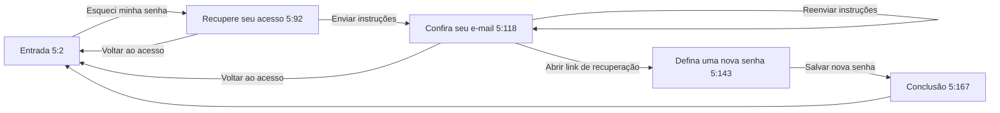

### B.12 Requisitos e critérios associados

| Requisitos | Regras | Critérios |
|---|---|---|
| RF-005, RF-006, RF-007, RF-008 | RN-002, RN-003 | CA-009 a CA-014 |

### B.13 Responsividade e acessibilidade

- Celular: uma coluna, campo e botões de largura total, ações empilhadas dentro do cartão (registrado em `ENTREGA_FIGMA.md`, 23/10/2026).
- As telas longas mantêm rolagem natural quando o conteúdo ultrapassa a altura (registro de 10/11/2026 em `DESIGN.md`).
- Rótulo persistente no campo de e-mail; mensagens em texto; ações com rótulos verbais específicos.
- **Não comprovado:** anúncio da confirmação por leitor de tela, foco após a troca de tela.

---

## C. Interface Início (Home) com menu de acesso

### C.1 Identificação

| Item | Valor |
|---|---|
| Família | T03 — Início (no plano: "Visão geral") e menu global |
| Quadros | Início do Gabinete `6:49`/`8:1874`; Direção-Geral `6:390`/`8:2014`; Vice `229:4439`/`229:4987`; transições `243:1710`/`243:1718` (computador) e `243:4089`/`243:4097` (celular); consulta externa `229:4207`/`229:4803`; Perfis e níveis `235:1690`/`235:3604` |
| Situação | Prototipada, com os quatro níveis |
| Requisitos | RF-010, RF-011, RF-012, RF-022, RF-023, RF-028 |
| Regras | RN-008, RN-009, RN-012, RN-020 |
| Critérios | CA-015 a CA-026 |

### C.2 Objetivo

Mostrar, logo após a entrada, o trabalho que depende do usuário e as vigências próximas, e dar acesso a todos os módulos permitidos ao perfil (plano §8.1).

### C.3 Público-alvo

Todos os perfis internos, com conteúdo próprio; a conta externa tem um ambiente reduzido ("Portarias publicadas", "Minha conta" e "Notificações").

### C.4 Capturas

| Gabinete — nível 3 (computador) | Direção-Geral — nível 4 (computador) | Direção-Geral — nível 4 (celular) |
|---|---|---|
| 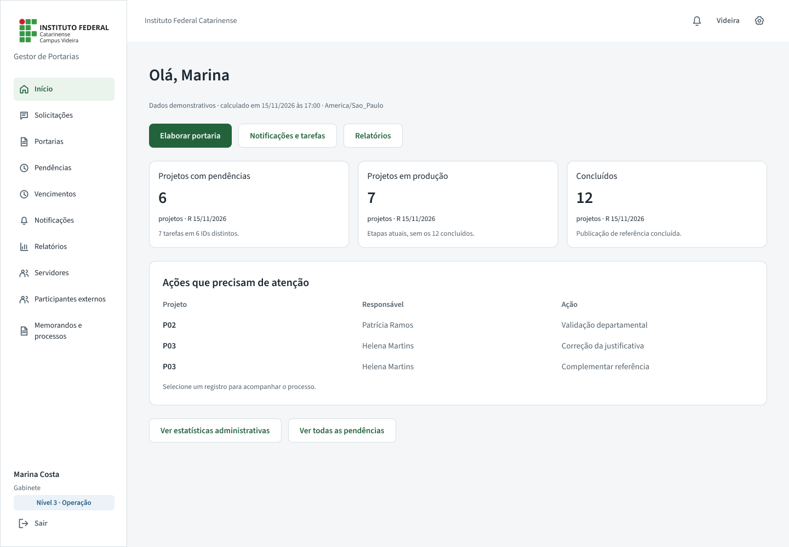 | 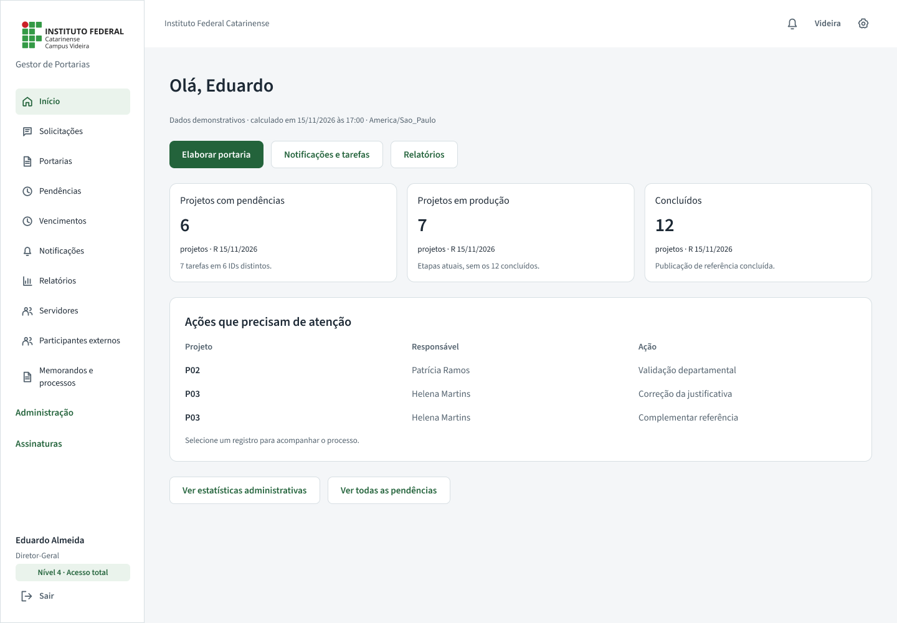 | 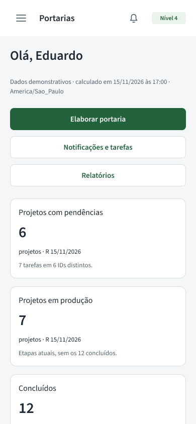 |

| Servidora docente — nível 2 (computador) | Contas e níveis (administrador) |
|---|---|
| 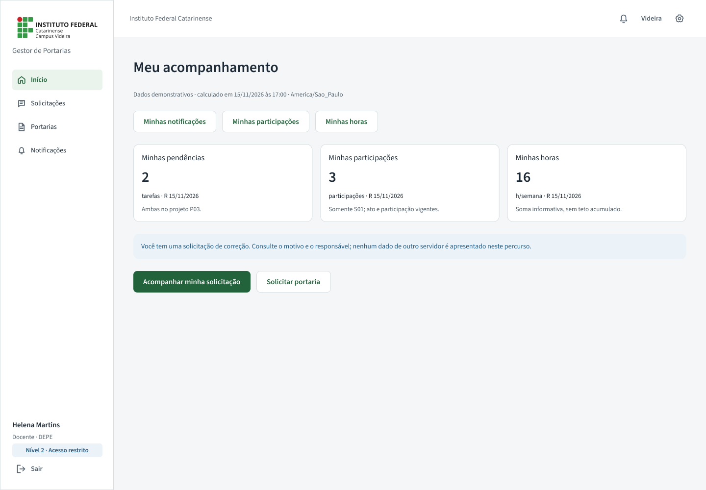 | 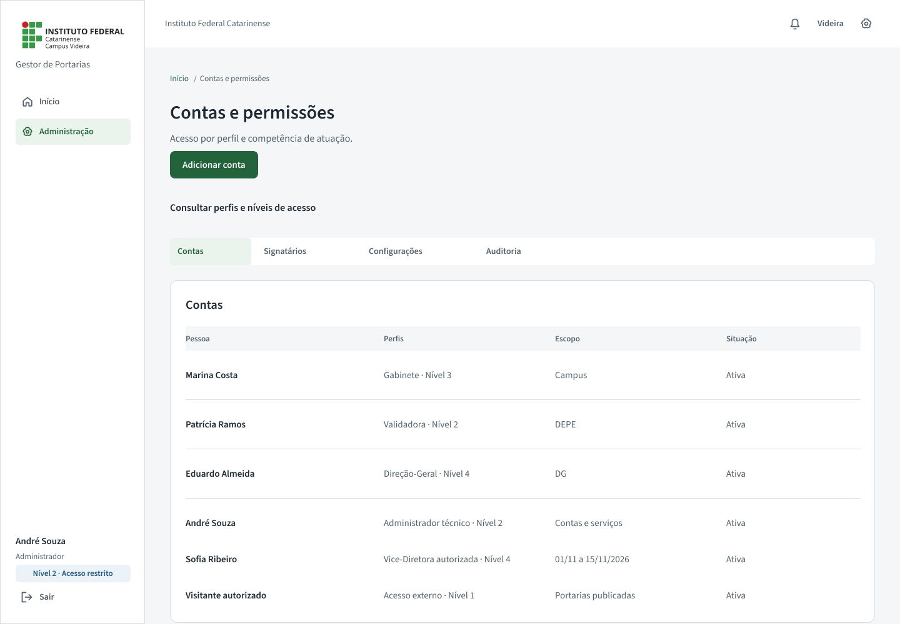 |

| Consulta externa — nível 1 (computador) | Consulta externa — nível 1 (celular) |
|---|---|
| 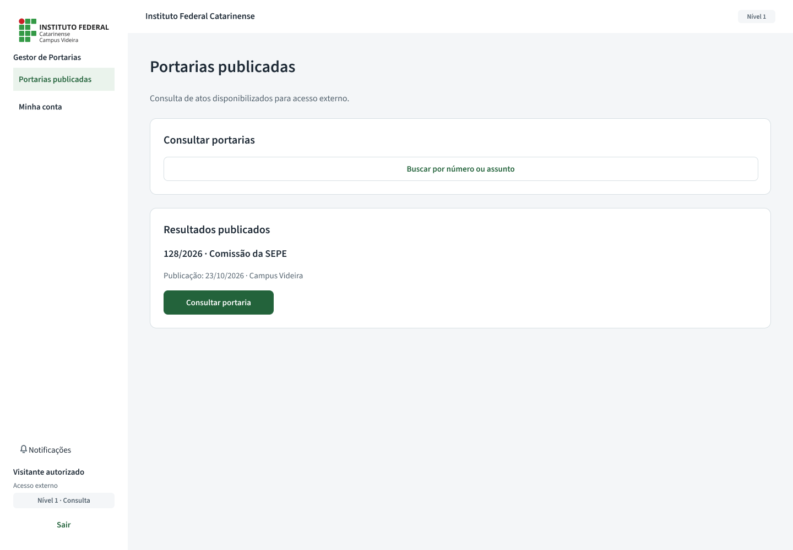 | 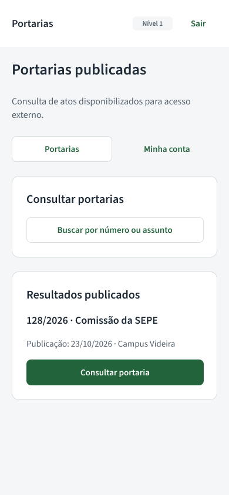 |

### C.5 Elementos visuais

- **Menu lateral** (computador, 232 px): marca do IFC Campus Videira, "Gestor de Portarias", itens com ícone linear e rótulo, item atual com fundo verde-claro; no rodapé, nome, papel, selo de nível e **Sair**.
- **Selos de nível** (família `228:19`, formatos Completo e Compacto): "Nível 1 · Consulta", "Nível 2 · Acesso restrito", "Nível 3 · Operação", "Nível 4 · Acesso total". Só aparecem depois do login.
- **Cabeçalho** (76 px no computador): "Instituto Federal Catarinense", sino de notificações, unidade "Videira" e ícone de configurações.
- **Área de trabalho:** trilha de navegação ("Início / Bom dia, Marina"), título, subtítulo, ações principais, avisos e tabelas.
- **Celular:** cabeçalho de 72 px com ícone de menu, nome do módulo, sino e selo de nível; conteúdo em uma coluna; tabelas viram registros empilhados.
- Tipografia Source Sans 3; verde institucional para ações; âmbar para avisos de atenção; selos de nível com rótulo textual.

### C.6 Componentes do menu

| Item | Servidor (2) | DEPE/DAP (2) | Admin. técnico (2) | Gabinete/CGP (3) | DG e Vice (4) | Externo (1) |
|---|:--:|:--:|:--:|:--:|:--:|:--:|
| Início | ✓ | ✓ | ✓ | ✓ | ✓ | — |
| Solicitações | ✓ | ✓ | — | ✓ | ✓ | — |
| Portarias | ✓ | ✓ | — | ✓ | ✓ | — |
| Pendências | — | ✓ | — | ✓ | ✓ | — |
| Vencimentos | — | conforme D17 | — | ✓ | ✓ | — |
| Notificações | ✓ | ✓ | — | ✓ | ✓ | ✓ (avisos públicos) |
| Relatórios (Estatísticas) | — | escopo H-D17 | — | ✓ | ✓ | — |
| Servidores | — | conforme D16 | — | ✓ | ✓ | — |
| Participantes externos | — | — | — | ✓ | ✓ | — |
| Memorandos e processos | — | — | — | ✓ | ✓ | — |
| Administração | — | — | ✓ | — | ✓ | — |
| Assinaturas | — | — | — | — | ✓ | — |
| Portarias publicadas | — | — | — | — | — | ✓ |
| Minha conta | via conta | via conta | via conta | via conta | via conta | ✓ |

Fonte: capturas C01, C02, C04, C05 e C06. O menu de DEPE/DAP não tem captura atual; as marcas "conforme D16/D17" indicam escopo ainda a homologar.

### C.7 Conteúdo e ações do Início por perfil

| Perfil | Título | Blocos | Ações |
|---|---|---|---|
| Gabinete (nível 3) | "Bom dia, Marina" — "Acompanhe o trabalho do Gabinete e as próximas ações. Atualizado às 12h05." | Aviso "3 pendências precisam de atenção"; tabela "Na sua mesa" (portaria/solicitação, próxima ação, responsável); "Vencimentos próximos" | **Nova portaria**, **Ver solicitações**, **Abrir pendências** |
| Servidora docente (nível 2) | "Meu acompanhamento" | Minhas pendências (2 tarefas), Minhas participações (3), Minhas horas (16 h/semana, soma informativa); aviso de solicitação de correção | **Acompanhar minha solicitação**, **Solicitar portaria**, Minhas notificações, Minhas participações, Minhas horas |
| DEPE | "Análises da DEPE" | "Aguardando sua análise" | Abrir validação |
| Direção-Geral / Vice (nível 4) | "Gestão da plataforma" — "Nível 4 · Todos os módulos, assinatura e administração." | "Sua assinatura" (documento, versão congelada, validação final) | **Elaborar portaria**, **Administração** |
| Administrador técnico (nível 2) | "Administração de acesso" | Contas e permissões; Signatários e substituições; Configurações e serviços; Registro de acesso | Abrir cada área |
| Conta externa (nível 1) | "Portarias publicadas" — "Consulta de atos disponibilizados para acesso externo." | "Consultar portarias" (busca por número ou assunto); "Resultados publicados" | **Consultar portaria** |

### C.8 Comportamento esperado

1. Após **Entrar**, o protótipo identifica o nível em condições de dois ramos: nível 4 vai a um quadro automático que escolhe Direção-Geral ou Vice; os demais vão ao Início do perfil.
2. Linhas das tabelas e atalhos abrem exatamente o objeto e a etapa.
3. O item ativo do menu acompanha o módulo; abas locais permanecem entre as vistas.
4. No celular, o menu abre lateralmente (240 ms) e **Fechar** retorna ao quadro de origem.
5. Navegação com dissolução de 220 ms.
6. Variáveis de demonstração mantêm nome, papel e nível da Direção ou do Vice nos módulos compartilhados.
7. Encaminhar um ato à assinatura com nível 3 abre "Aguardando assinatura da Direção"; com nível 4, passa por "Preparando o documento para assinatura".
8. **Sair** volta à entrada sem a sessão de gestão.

### C.9 Validações

| Verificação | Efeito |
|---|---|
| Nível da conta | Define o Início, os módulos do menu e o selo |
| Papel (DG ou Vice) no nível 4 | Mantém a identidade correta e o destino da assinatura |
| Competência para assinar | Níveis 2 e 3 veem espera; administrador não recebe ação de assinatura |
| Dados atualizados | "Atualizado às hh:mm" / "calculado em …" (proposta para o RF8; definição de "tempo real" em D18) |

### C.10 Mensagens

| Situação | Mensagem |
|---|---|
| Pendências abertas | "3 pendências precisam de atenção — Uma solicitação aguarda triagem e duas comunicações precisam de ação." |
| Encaminhamento de nível 3 | "Aguardando assinatura da Direção" |
| Preparação de nível 4 | "Preparando o documento para assinatura" |
| Acesso negado | "Você não tem acesso a esta ação — A competência atual não permite alterar este registro." |
| Avisos lidos | "Marcar avisos como lidos não conclui tarefas nem altera o andamento da portaria." |

### C.11 Regras de navegação

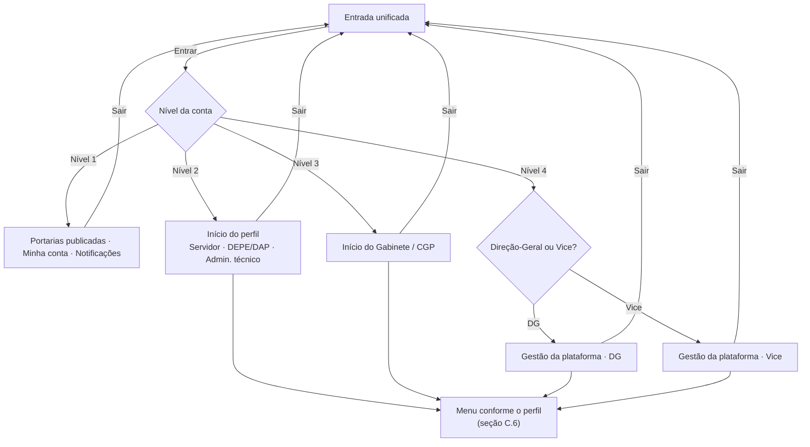

### C.12 Requisitos e critérios associados

| Requisitos | Regras | Critérios |
|---|---|---|
| RF-010, RF-011, RF-012, RF-022, RF-023, RF-028 | RN-008, RN-009, RN-012, RN-020 | CA-015 a CA-026 |

### C.13 Responsividade e acessibilidade

- **Computador (1440 px):** menu lateral fixo, cabeçalho de 76 px, área central rolável, ações de fluxo em rodapé fixo fora da área rolável.
- **Celular (390 e 360 px):** menu recolhido, cabeçalho de 72 px com selo de nível, uma coluna, registros empilhados.
- Ações da gestão com 44 px de altura e intervalo de 24 px até o painel seguinte (correção registrada em `levels-review-fix-2026-11-11.json`).
- Situações e níveis sempre com texto; ícones acompanham os rótulos, sem substituí-los.
- **Não comprovado:** "Ir para o conteúdo", atalhos de teclado, foco no menu móvel e anúncio de mudanças — previstos no plano §10 para a implementação.

---

## D. Estatísticas, relatórios, notificações e acompanhamento (interface complementar)

### D.1 Identificação

| Item | Valor |
|---|---|
| Origem | Plano de estatísticas v1.1 (aplicado em 11/11/2026) e pedido de 15/11/2026, consolidados no plano v1.2 (`PLANO_ESTATISTICAS_RELATORIOS_v1.2.md`) |
| Quadros principais | Estatísticas / Panorama `282:1848`/`282:10481`; Tramitação `318:5744`/`319:4985`; Servidores `318:5826`/`319:5002`; Relatórios semanal `7:6744`/`10:2795`, mensal `318:6728`/`319:5189`, intervalo `318:6810`/`319:5206`; Notificações `7:10597`/`11:2443`; acompanhamento `318:6646`/`319:5172`; demais IDs em `.design/nov15/state-final.json` |
| Situação | Prototipada; **validação parcial** (sem cliques reais) |
| Requisitos | RF-021, RF-022, RF-030, RF-031, RF-032, RF-033 |
| Regras | RN-007, RN-021 a RN-025 |
| Critérios | CA-039, CA-045 a CA-050 |

### D.2 Capturas

| Estatísticas — Panorama (computador) | Estatísticas — Panorama (celular) | Gráfico de pizza C01 |
|---|---|---|
| 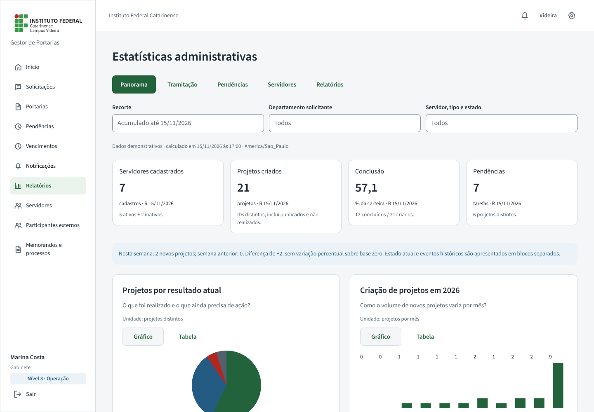 | 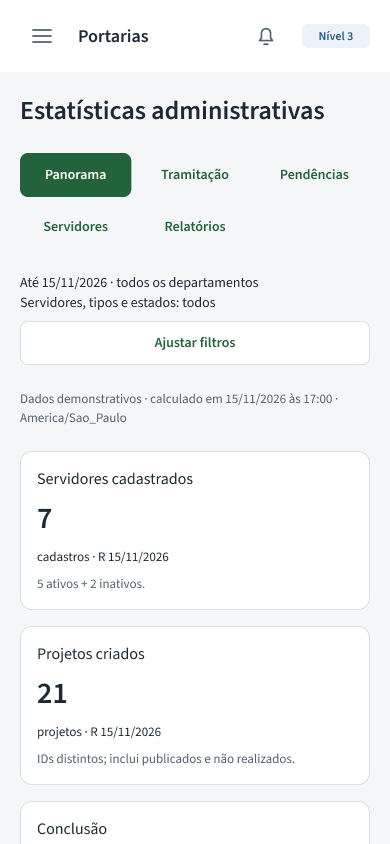 | 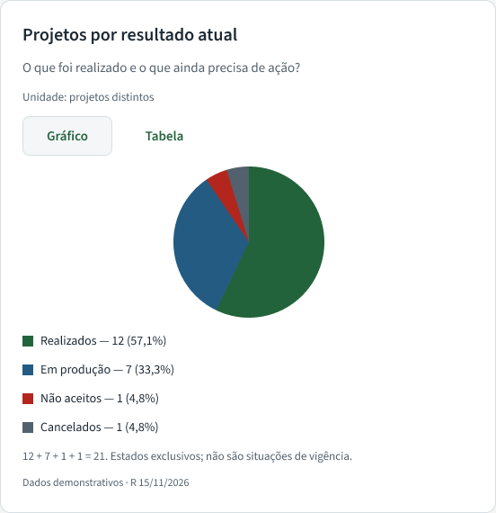 |

| Notificações e acompanhamento | Acompanhamento do projeto |
|---|---|
| 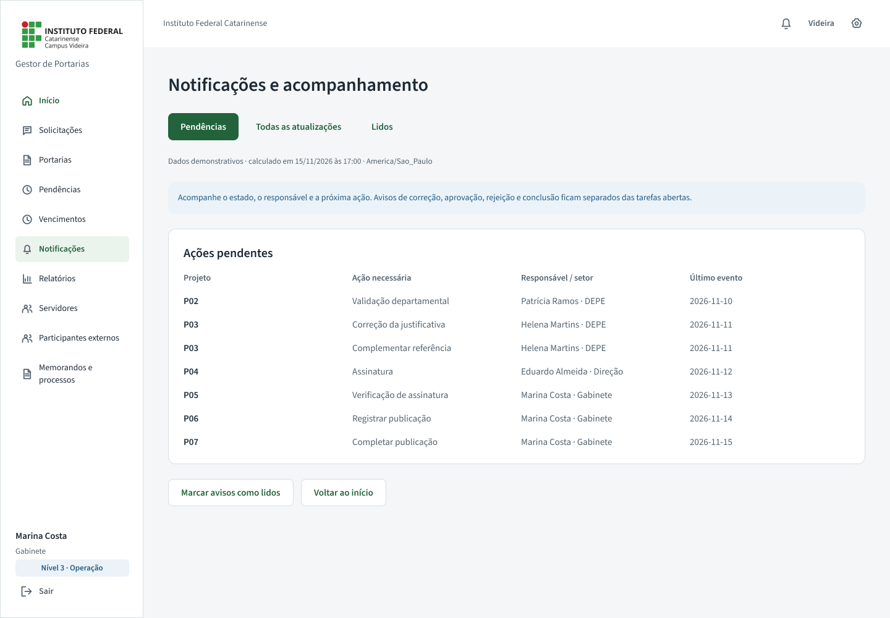 | 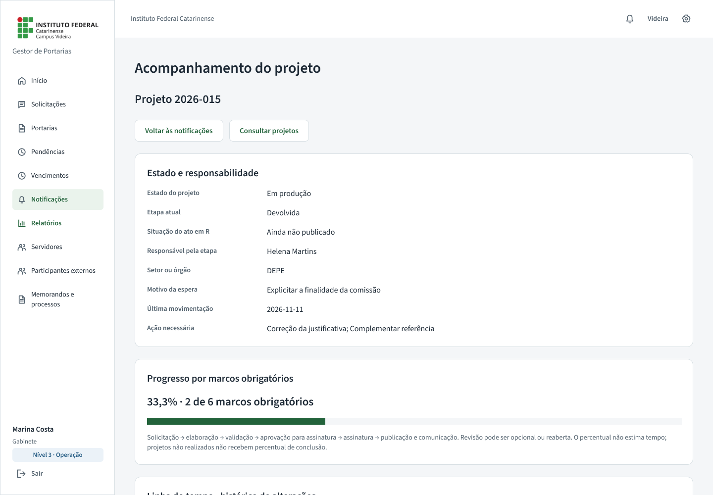 |

| Prévia do relatório semanal (página 1) | Editor — abas Texto, Participações e Prévia |
|---|---|
| 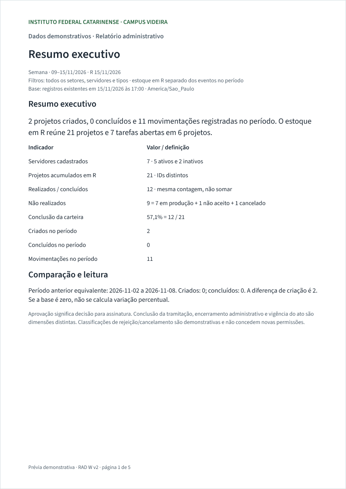 | 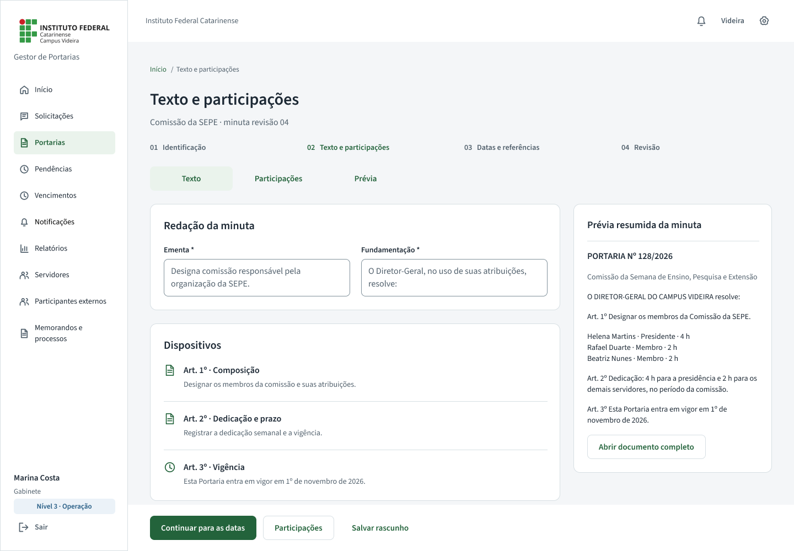 |

### D.3 Estrutura

- **Estatísticas administrativas** (item Relatórios do menu): abas Panorama, Tramitação, Pendências, Servidores e Relatórios; filtros "Recorte", "Departamento solicitante" e "Servidor, tipo e estado"; linha "Dados demonstrativos · calculado em 15/11/2026 às 17:00 · America/Sao_Paulo"; cartões de indicador com valor, unidade, data de referência e método; gráficos com pergunta, unidade e alternância Gráfico/Tabela.
- **Indicadores e gráficos:** dicionário M01–M32 e gráficos C01–C12 (barras verticais e horizontais, pizza, rosca, linhas, área, empilhadas, comparativo por período e progresso). Detalhes no plano v1.2 §17.
- **Relatórios:** períodos semanal, mensal e intervalo; nove recortes; prévia de cinco páginas A4; leitura ampliada no celular; aviso de que nenhum PDF é gerado. Os relatórios R1–R5 de 11/11 continuam na central de relatórios.
- **Notificações e acompanhamento:** abas Pendências, Todas as atualizações e Lidos; "Ações pendentes"; **Marcar avisos como lidos** sem concluir tarefas; acompanhamento com estado, etapa, responsável, setor, motivo, ação, progresso por seis marcos obrigatórios e linha do tempo.
- **Editor:** abas persistentes Texto, Participações e Prévia.
- **Contêiner de visualização** (`278:74`) com seis estados: Com dados, Sem registros, Carregando, Erro, Acesso restrito e Dados desatualizados.

### D.4 Comportamento esperado

1. O mesmo recorte dá o mesmo número no indicador, no gráfico, na tabela e na prévia.
2. Mudar o período do relatório preserva o recorte escolhido.
3. Base anterior zero mostra diferença absoluta, sem percentual.
4. Nenhum processo é rotulado como atrasado enquanto não houver prazos homologados (D26).
5. Servidor vê só os próprios dados; conta externa não tem estatísticas; DEPE/DAP mantêm o escopo de H-D17; administrador técnico não vê conteúdo de relatórios.
6. "Exportar PDF" informa que o protótipo não gera arquivo.

### D.5 Responsividade e acessibilidade

- No celular, as abas analíticas ficam em duas linhas, os filtros aparecem resumidos com "Ajustar filtros" e a geração do relatório vem antes dos indicadores; linhas e Gantt viram listas; a prévia A4 tem "Ler em texto ampliado" a 16 px.
- Cores de gráfico com contraste mínimo de 4,16:1; nenhuma informação só por cor; tabela equivalente em todo gráfico.
- **Não comprovado:** cliques reais, rolagem, teclado, leitor de tela e PDF acessível.
