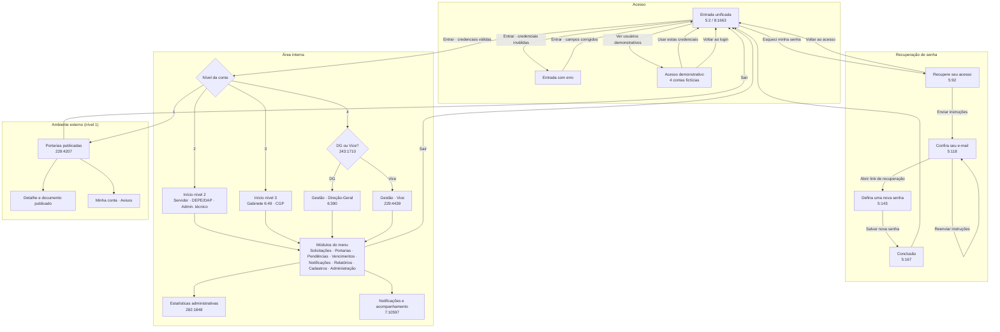
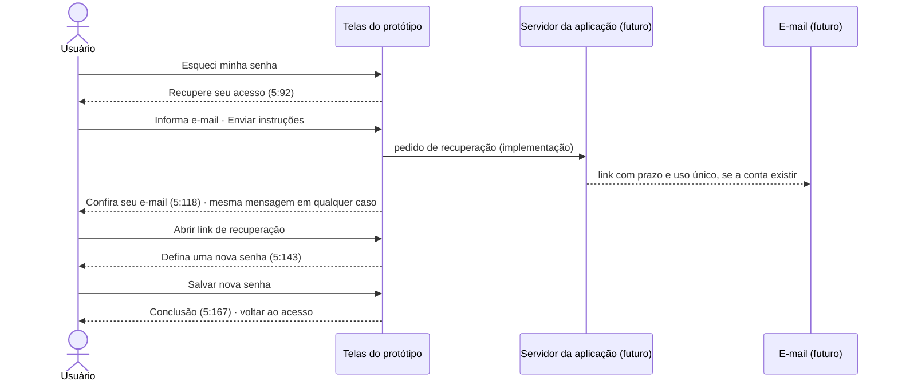
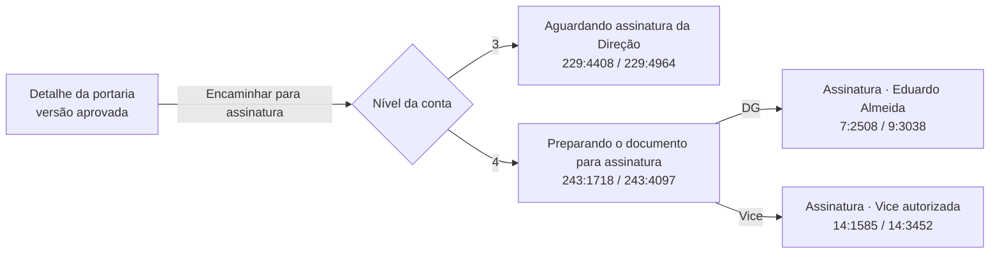

# Fluxos de Navegação — Gestor de Portarias

> **Artefato 8 (parte 2) da Entrega 2.** Fluxos FL-01 a FL-17 do protótipo Figma, com os quadros envolvidos e a evidência de cada um. Os IDs entre crases são os nós do arquivo Figma. Fontes dos diagramas também em [`Diagramas/`](../Diagramas/).
>
> **Atualizado em 15/11/2026:** entrada unificada, quatro níveis e os fluxos FL-13 a FL-17 (acesso demonstrativo, estatísticas, relatórios por período, notificações e abas do editor). Os fluxos de 15/11/2026 foram avaliados nas ações do Figma, **sem cliques reais**.

## 1. Diagrama geral

## 2. Autenticação

### FL-01 — Entrada unificada

| Passo | Quadro | Ação | Resultado |
|---|---|---|---|
| 1 | `5:2` | Usuário abre o protótipo | Entrada vazia, sem nível |
| 2 | `5:2` | Preenche os campos (ou usa uma conta demonstrativa, FL-13) | Campos preenchidos |
| 3 | `5:2` | **Entrar** | Condição de nível (FL-06); o nível aparece depois do login |

Requisitos: RF-001, RF-012 · Critérios: CA-001, CA-002, CA-005 · Evidência: capturas A01 e A02; verificações interpretadas de entrada e saída das quatro contas (`.design/nov15/functional-delivery-D/M.json`).

### FL-02 — Erro de entrada

| Passo | Quadro | Ação | Resultado |
|---|---|---|---|
| 1 | `5:2` | **Entrar** com campos vazios | Estado de erro com "Não foi possível entrar" |
| 2 | Erro | Corrige os campos e aciona **Entrar** | Volta ao estado preenchido, de onde segue a FL-01 (demonstração) |

Requisitos: RF-001 · Critério: CA-003 · Evidência: `screens.js`; `reference-login-2026-11-11.js`.

## 3. Recuperação

### FL-03 — Recuperação de conta local

Sequência: `5:2` → "Esqueci minha senha" → `5:92` → **Enviar instruções** → `5:118` → (**Reenviar instruções** permanece em `5:118` com "Instruções reenviadas") → **Abrir link de recuperação** → `5:143` → **Salvar nova senha** → `5:167` → entrada.

Requisitos: RF-005, RF-006 · Critérios: CA-009 a CA-012 · Evidência: cliques registrados em `ENTREGA_FIGMA.md` e `DESIGN.md`.

**Lacuna:** o ramo de conta institucional ("Usa a conta institucional?") não existe mais no protótipo (RF-007, CA-013).

## 4. Conta externa

### FL-04 — Consulta externa

Sequência: entrada unificada → credenciais da conta externa (ou "Usuário" no acesso demonstrativo) → **Entrar** → "Portarias publicadas" (`229:4207`) → **Consultar portaria** → lista (`229:4281`) → detalhe (`229:4325`) → documento publicado → "Minha conta"; Avisos com conteúdo público; **Sair** volta à entrada.

Requisitos: RF-004, RF-019 · Critérios: CA-006, CA-007, CA-020 · Evidência: capturas C06 e C07; cenários de lista, detalhe e documento externos aprovados nas duas classes (11/11/2026); escopo de avisos 12/12 (15/11/2026). Até 15/11/2026, a conta externa usava uma entrada própria (`5:182`), hoje substituída.

### FL-05 — Recuperação de conta externa

Sequência criada em 11/11/2026 em quadros próprios: `236:1694` → `236:1721` → `236:1753` → `236:1784` → entrada. O caminho a partir da entrada unificada de 15/11/2026 **não foi reverificado**.

Requisitos: RF-008 · Critério: CA-014 · Evidência: `levels-recovery-D/M-2026-11-11.json`.

## 5. Início e menu

### FL-06 — Início por nível

| Passo | Condição | Destino |
|---|---|---|
| 1 | Nível da conta = 1 | Portarias publicadas (`229:4207`) |
| 2 | Nível da conta = 2 | Início do perfil (servidor "Meu acompanhamento", DEPE, administrador técnico) |
| 3 | Nível da conta = 3 | Início do Gabinete/CGP (`6:49`) |
| 4 | Nível da conta = 4 | Quadro automático `243:1710` (1 ms) |
| 5 | No quadro automático: perfil DG | "Gestão da plataforma" da Direção-Geral (`6:390`) |
| 6 | No quadro automático: perfil Vice | "Gestão da plataforma" do Vice (`229:4439`) |

As condições têm apenas dois ramos porque o Figma não persistiu um terceiro ramo; por isso a escolha é feita em etapas encadeadas (`DESIGN.md`).

Requisitos: RF-010, RF-012 · Critérios: CA-015, CA-019 · Evidência: capturas C01–C03, C05, C06; 138/138 verificações dos quatro níveis (`four-levels-navigation-tests-2026-11-11.json`).

### FL-07 — Menu móvel

Sequência: qualquer tela no celular → ícone de menu → menu lateral (240 ms) → item do menu (navega) **ou** **Fechar** (volta ao quadro de origem).

Requisito: RF-011 · Critério: CA-017 · Evidência: clique registrado em 28/10/2026 (Solicitações → Nova solicitação → menu do Gabinete → Fechar → mesma solicitação).

## 6. Situações de controle

### FL-08 — Encaminhamento à assinatura

Requisitos: RF-016 · Critérios: CA-021, CA-022, CA-023 · Evidência: cenários aprovados em cada classe; selo da espera alinhado ao nível 3 (`four-levels-waiting-fix-2026-11-11.json`).

### FL-09 — Sessão expirada e acesso negado

- Sessão expirada → "Sua sessão expirou" → **Entrar novamente** → entrada preenchida.
- Ação sem competência → "Você não tem acesso a esta ação" → **Voltar ao início** ou **Consultar portarias**.

Requisito: RF-009 · Critério: CA-008 · Evidência: `screens.js` (`sessionExpired`, `denied`).

## 7. Fluxos operacionais relacionados ao Início

### FL-10 — Nova solicitação

Sequência: Início → Solicitações (`6:751`) → **Nova solicitação** → preenchimento → participação → (erro) → rascunho → revisão → envio; o perfil de origem (docente ou Gabinete) é preservado em todos os quadros.

Requisito: RF-013 · Critério: CA-036 · Evidência: clique registrado em 28/10/2026; capturas em `.impeccable/review/motion-fix/`.

### FL-11 — Pendências e abas locais

Sequência: Início → "Abrir pendências" → abas "Da minha unidade", "Minhas" e "Informações"; Informações é vista local de Pendências e não abre Notificações.

Requisito: RF-023 · Critério: CA-026 · Evidência: clique registrado em 23/10/2026.

### FL-12 — Vencimentos

Sequência: Início → "Vencimentos próximos" ou menu Vencimentos → abas "Em breve", "Vencidas", "Sem término", "Revogação futura" e "Em vigor" → ato selecionado (102/2025, 108/2025 ou 091/2025) → "Preparar renovação" / "Preparar prorrogação" ou conclusão administrativa. Desde 11/11/2026, a tela também oferece a visualização dos vencimentos (`282:2074`/`282:10577`).

Requisito: RF-020 · Critério: CA-038 · Evidência: clique nas cinco abas registrado em 23/10/2026.

## 8. Fluxos acrescentados em 15/11/2026

### FL-13 — Acesso demonstrativo

Sequência: entrada → **Ver usuários demonstrativos** → escolha entre Usuário, Helena, Marina e Eduardo → nome, usuário e senha fictícios → **Usar estas credenciais** → entrada preenchida → **Entrar** → Início do perfil; **Voltar ao login** retorna à entrada vazia.

Requisito: RF-034 · Critério: CA-049 · Evidência: capturas A03 e A04; verificações interpretadas (`.design/nov15/functional-delivery-D/M.json`).

### FL-14 — Estatísticas e filtros

Sequência: menu **Relatórios** → "Estatísticas administrativas" (Panorama `282:1848`) → abas Tramitação (`318:5744`), Pendências, Servidores (`318:5826`) e Relatórios → filtros predefinidos (departamento DEPE ou DAP, servidor, tipo, estado, combinação DEPE + em produção, vazio) → alternância Gráfico/Tabela em cada gráfico.

Requisito: RF-030 · Critérios: CA-045, CA-046 · Evidência: capturas E01, E02 e E03; 473 verificações interpretadas por classe.

### FL-15 — Relatório por período e prévia

Sequência: aba **Relatórios** → período semanal (`7:6744`), mensal (`318:6728`) ou intervalo (`318:6810`) → recorte (um dos nove) → gerar → prévia de cinco páginas (anterior/próxima) → editar recorte; trocar o período preserva o recorte; **Exportar PDF** mostra o aviso de que nenhum arquivo é gerado. No celular: **Ler em texto ampliado** → páginas em 16 px → retorno à mesma página A4.

Requisitos: RF-021, RF-031 · Critério: CA-048 · Evidência: captura E06; 276/276 verificações dos recortes × períodos e 136/136 da leitura móvel.

### FL-16 — Notificações e acompanhamento

Sequência: menu **Notificações** (`7:10597`) → abas Pendências, Todas as atualizações e Lidos → linha de "Ações pendentes" → "Acompanhamento do projeto" (`318:6646`): estado, etapa, responsável, motivo, ação, progresso por marcos e linha do tempo → **Voltar às notificações** ou **Consultar projetos**. **Marcar avisos como lidos** não conclui tarefas.

Requisitos: RF-028, RF-032 · Critério: CA-047 · Evidência: capturas E04 e E05; 12/12 verificações de escopo por perfil.

### FL-17 — Abas do editor

Sequência: minuta (revisão 04 ou 05) → **Texto** ↔ **Participações** ↔ **Prévia**, em qualquer ordem; cabeçalho e navegação permanecem; a revisão 05 mantém a presidência removida.

Requisito: RF-033 · Critério: CA-050 · Evidência: captura E07; correção F02 resolvida.

## 9. Quadro-resumo de rastreabilidade dos fluxos

| Fluxo | Interface | Requisitos | Critérios |
|---|---|---|---|
| FL-01 | A | RF-001, RF-012 | CA-001, CA-002, CA-005 |
| FL-02 | A | RF-001 | CA-003 |
| FL-03 | B | RF-005, RF-006, RF-007 | CA-009, CA-010, CA-011, CA-012, CA-013 |
| FL-04 | A / C | RF-004, RF-019 | CA-006, CA-007, CA-020 |
| FL-05 | B | RF-008 | CA-014 |
| FL-06 | C | RF-010, RF-012 | CA-015, CA-019 |
| FL-07 | C | RF-011 | CA-017 |
| FL-08 | C | RF-016 | CA-021, CA-022, CA-023 |
| FL-09 | A / C | RF-009 | CA-008 |
| FL-10 | C | RF-013 | CA-036 |
| FL-11 | C | RF-023 | CA-026 |
| FL-12 | C | RF-020 | CA-038 |
| FL-13 | A | RF-034 | CA-049 |
| FL-14 | D | RF-030 | CA-045, CA-046 |
| FL-15 | D | RF-021, RF-031 | CA-048 |
| FL-16 | D | RF-028, RF-032 | CA-047 |
| FL-17 | D | RF-033 | CA-050 |
