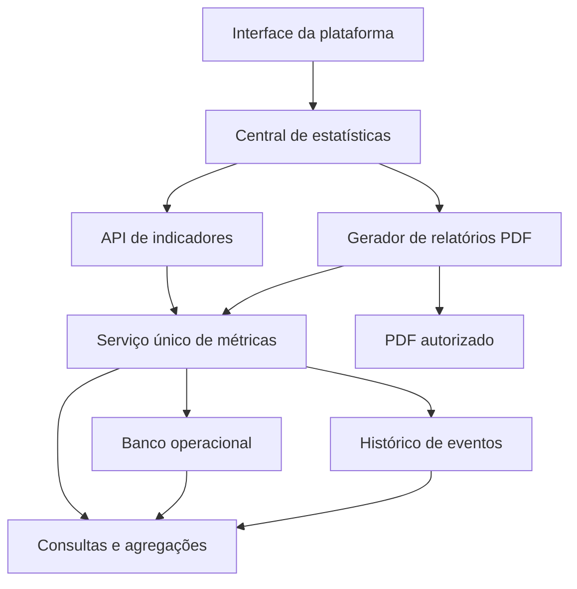

# Plano técnico — Central de Estatísticas e Relatórios

**Projeto:** Gestor de Portarias — Instituto Federal Catarinense (IFC), Campus Videira  
**Documento:** Planejamento funcional, visual e técnico  
**Versão:** 1.0  
**Data:** 11/11/2026  
**Situação:** Planejamento; interface existente apenas no Figma

---

## 1. Objetivo e contexto

Projetar uma **Central de Estatísticas e Relatórios** integrada ao Gestor de Portarias para acompanhar a tramitação de portarias, participação de servidores, distribuição de carga horária, prazos de vigência, atividades administrativas e conformidade institucional.

O módulo deverá responder, com informações verificáveis:

- Quantas portarias foram solicitadas, publicadas, alteradas, revogadas e encerradas?
- Quantas estão em tramitação e onde se encontram?
- Quais etapas acumulam maior tempo de espera?
- Quais servidores participam de cada portaria, em que função e com qual carga horária?
- Quais cargas horárias são simultâneas e quais precisam de atenção?
- Quais vigências estão próximas do término ou aguardando regularização?
- Como volumes, tempos e distribuições mudam entre períodos e departamentos?
- Os procedimentos observam as regras institucionais?

### 1.1 Premissas confirmadas

| Item | Situação |
|---|---|
| Plataforma | **Somente interface no Figma** |
| Backend | Não implementado integralmente; tecnologia ainda não definida |
| Banco de dados | Não definido / desconhecido |
| Histórico de movimentações | Disponibilidade não confirmada |
| Exportação solicitada | **PDF** |
| Prazos formais por etapa | **Precisam ser levantados** |
| Prioridades de funcionalidades | Não especificadas; propostas neste documento |
| Repositório | Não informado |

**Não presumir** que existam registros reais, APIs, métricas calculadas, auditoria ou integrações já funcionando. Qualquer dado usado no Figma será explicitamente identificado como **demonstrativo**. Não escolher stack nem banco apenas para prototipar gráficos.

### 1.2 Escopo obrigatório existente

A documentação da EAP e do Termo de Abertura prevê:

1. Relatório **Servidor × Portarias**;
2. Relatório de **carga horária por servidor**;
3. Relatório **anual de portarias por status**;
4. **Dashboard** para acompanhamento das portarias;
5. Histórico de estados, vigências e versões documentais;
6. Possibilidade de alertas de renovação/encerramento;
7. Controle de acesso e regras institucionais, incluindo limites de carga docente.

A integração efetiva com o SIPAC é **futura** e não deve ser tratada como pré-requisito desta entrega.

---

## 2. Estratégia, prioridades e fases

A ordem recomendada é:

1. Especificar indicadores, eventos e regras de contagem;
2. Projetar dashboards e relatórios no Figma com cenários coerentes;
3. Homologar com os responsáveis institucionais as regras ainda pendentes;
4. Definir banco, backend, serviços e contratos de API;
5. Implementar por prioridades;
6. Validar os resultados com registros conhecidos e testar permissões, desempenho e PDF.

### 2.1 Prioridades

| Prioridade | Módulo | Motivação |
|---|---|---|
| P0 | Visão Geral | Panorama institucional |
| P0 | Servidores × Portarias | Requisito explícito da EAP |
| P0 | Carga Horária | Requisito explícito da EAP e controle institucional |
| P0 | Relatórios PDF | Único formato solicitado; contemplar os requisitos da EAP |
| P1 | Tramitação e produtividade | Gargalos, tempos e filas |
| P1 | Vigências e alertas | Prevenção e regularização |
| P1 | Gestão institucional | Comparação entre setores e períodos |
| P2 | Governança e auditoria | Conformidade e rastreabilidade |
| P2 | Inteligência avançada | Tendências, coortes e projeções quando houver histórico adequado |

P0 não significa implementar backend de imediato: primeiro é preciso concluir o projeto funcional e visual no Figma.

---

## 3. Arquitetura da informação da interface

Criar uma seção própria denominada **Estatísticas e Relatórios**, integrada à navegação e ao design system existente no Figma.

### 3.1 Oito dashboards especializados

| Nº | Dashboard | Público principal | Missão |
|---|---|---|---|
| 1 | Visão Geral | Direção, Gabinete | Panorama das portarias |
| 2 | Tramitação e Produtividade | Gabinete, CGP, gestores | Tempos, filas e gargalos |
| 3 | Servidores e Participações | CGP, chefias | Participação nas comissões |
| 4 | Carga Horária | CGP, direção | Horas atribuídas e sobreposições |
| 5 | Vigências | Gabinete, gestores | Vencimentos e renovações |
| 6 | Gestão Institucional | Direção, DAP, DEPE | Volumes e tendências departamentais |
| 7 | Governança e Auditoria | Administradores e autorizados | Regras, validações e histórico |
| 8 | Inteligência e Qualidade | Gestores e administradores | Tendências e qualidade dos registros |

### 3.2 Onze telas funcionais principais

1. **Visão Geral:** KPIs, comparações temporais, status e alertas.
2. **Tramitação:** funil, duração por etapa, processos parados e devoluções.
3. **Servidores:** rankings, pesquisas, composição institucional e participações.
4. **Detalhe do servidor:** histórico, funções, portarias e carga horária.
5. **Carga Horária:** somatórios, faixas, distribuição e sobreposições.
6. **Vigências:** calendário, linha do tempo, expirações e renovações.
7. **Gestão:** comparação por unidade, tipo e período.
8. **Auditoria:** histórico de decisões, validações e inconsistências.
9. **Central de Relatórios:** catálogo, histórico e gerenciamento autorizado de PDFs.
10. **Configurar Relatório:** escolha do modelo, filtros, período e conteúdo.
11. **Prévia de PDF:** conferência de documento paginado antes de gerar/baixar.

A área de Inteligência pode ter uma tela dedicada adicional no desenvolvimento avançado, ou integrar uma subárea da Visão Geral/Gestão; a definição de **11 telas** corresponde ao escopo inicial de design.

### 3.3 Componentes reutilizáveis

- Cartão de KPI com valor, unidade, variação, período e explicação da métrica;
- Cabeçalho de seção, navegação interna e breadcrumbs;
- Filtro de data/período, unidade, tipo, situação, servidor e função;
- Legenda, tooltip, detalhes do gráfico, seletor de agrupamento;
- Tabela paginada e ordenável com pesquisa;
- Indicador de tendência com interpretação contextual;
- Alertas de vencimento, dados faltantes e inconsistências;
- Modal de filtros e configuração de relatório;
- Seletor de visualização e interação de drill-down;
- Controles de exportação PDF, visualização e impressão.

### 3.4 Estados obrigatórios dos componentes

Todos os gráficos devem prever pelo menos:

1. **Com dados**;
2. **Sem dados** (nenhum registro para os filtros);
3. **Carregando**;
4. **Erro** (falha técnica, com opção de nova tentativa);
5. **Acesso restrito**, quando houver permissões diferenciadas.

Para períodos sem dados, mostrar "Sem registros no período selecionado", não inventar números e não exibir gráficos vazios como se indicassem zero em todas as dimensões.

---

## 4. Catálogo de 56 visualizações

A quantidade é uma **proposta de design**, não uma exigência de mostrar todas as visualizações simultaneamente. Algumas poderão aparecer em abas, detalhes ou relatórios.

### 4.1 Dashboard 1 — Visão Geral (7)

| Gráfico | Tipo | Pergunta respondida |
|---|---|---|
| Evolução mensal | Linha | Como mudaram solicitações e publicações? |
| Distribuição por etapa | Barras | Onde estão as portarias em tramitação? |
| Tipos de portaria | Rosca | Quais categorias predominam? |
| Comparativo anual | Colunas | Como diferentes anos se comparam? |
| Volumes por unidade | Barras horizontais | Quais setores concentram solicitações? |
| Tendência de publicações | Área | Como varia o ritmo de publicações? |
| Calendário de movimentações | Calendário/heatmap | Em quais datas há maior movimentação? |

**KPIs principais:** total de portarias, novas solicitações, portarias em tramitação, publicadas, vigentes, vencimentos próximos, servidores participantes, tempo mediano de publicação.

### 4.2 Dashboard 2 — Tramitação e Produtividade (7)

| Gráfico | Tipo | Pergunta respondida |
|---|---|---|
| Fluxo pelas etapas | Funil | Quantos processos atingiram cada fase? |
| Duração por etapa | Barras | Onde se gasta mais tempo? |
| Distribuição da duração | Histograma | Qual a faixa mais comum de tempo? |
| Variabilidade dos tempos | Box plot | Quais processos são atípicos? |
| Gargalos por unidade/etapa | Heatmap | Onde se concentram filas? |
| Transições entre etapas | Sankey | Quais movimentos e retornos ocorrem? |
| Retrabalho ao longo do tempo | Linha | As devoluções aumentaram? |

**KPIs:** média, mediana e P90 de tempo de tramitação; tempo parado; pendências por etapa; taxa de retorno para correção; taxa de conclusão; cumprimento de prazos *somente após definição de SLAs*.

### 4.3 Dashboard 3 — Servidores e Participações (7)

| Gráfico | Tipo | Pergunta respondida |
|---|---|---|
| Participações por servidor | Ranking | Quem participa de mais portarias? |
| Participações por unidade | Barras | Como se distribuem entre setores? |
| Docentes × técnicos | Colunas | Como se distribuem por vínculo funcional? |
| Funções nas comissões | Rosca | Qual a distribuição de funções? |
| Evolução das participações | Linha | Como muda a participação ao longo do tempo? |
| Servidor × tipo de portaria | Heatmap | Quais padrões de participação existem? |
| Distribuição de vínculos | Histograma | Quantas portarias cada servidor acumula? |

**KPIs:** servidores distintos participantes, participações simultâneas, presidências, vice-presidências, média por servidor e participação departamental.

### 4.4 Dashboard 4 — Carga Horária (7)

| Gráfico | Tipo | Pergunta respondida |
|---|---|---|
| Horas por servidor | Ranking | Qual a carga atribuída a cada pessoa? |
| Distribuição de horas | Histograma | Há concentração de cargas? |
| Horas por unidade | Barras | Como se distribuem entre setores? |
| Limite de referência | Bullet chart | Qual a utilização do limite aplicável? |
| Evolução temporal | Área/linha | Como evolui a carga atribuída? |
| Sobreposição temporal | Gantt | Quais vínculos ocorrem simultaneamente? |
| Horas por função | Barras | Como se distribuem por presidência, vice e membros? |

**Atenção:** carga horária atual não é a soma de todas as cargas do histórico. Contar somente vínculos simultaneamente válidos no recorte selecionado.

### 4.5 Dashboard 5 — Vigências (7)

| Gráfico | Tipo | Pergunta respondida |
|---|---|---|
| Calendário de vencimentos | Calendário | Quais portarias terminam em cada dia? |
| Cronograma de vigências | Gantt | Quais períodos se sobrepõem? |
| Intervalos até vencimento | Barras | Quantas vencem nos próximos 7/15/30/60/90 dias? |
| Evolução das renovações | Linha | As renovações aumentaram? |
| Duração dos atos | Histograma | Quais vigências são mais comuns? |
| Vencimentos por unidade | Barras | Quais setores têm maior volume próximo do término? |
| Portarias vigentes no tempo | Linha/área | Quantas estavam vigentes em cada data? |

Os intervalos devem ser configuráveis; a elegibilidade à renovação ainda depende de regra institucional.

### 4.6 Dashboard 6 — Gestão Institucional (7)

| Gráfico | Tipo | Pergunta respondida |
|---|---|---|
| Solicitações por departamento | Ranking | Onde se originam mais solicitações? |
| Distribuição institucional | Treemap | Como o volume se reparte por unidade? |
| Tipos por unidade | Barras empilhadas | Quais atos predominam em cada setor? |
| Comparativo entre anos | Colunas | Qual a variação anual? |
| Sazonalidade | Heatmap mês × unidade | Em que períodos há picos? |
| Comissões por unidade | Barras | Como se distribuem responsabilidades? |
| Alterações e revogações | Linha/colunas | Como essas movimentações evoluem? |

É necessário diferenciar **unidade solicitante**, **unidade emissora** e **unidade responsável pela tramitação**.

### 4.7 Dashboard 7 — Governança e Auditoria (7)

| Gráfico | Tipo | Pergunta respondida |
|---|---|---|
| Histórico de eventos | Linha temporal | Quando ocorreram mudanças relevantes? |
| Principais inconsistências | Pareto | Quais problemas são mais frequentes? |
| Validações pendentes/concluídas | Barras empilhadas | Qual o estado das validações? |
| Motivos de devolução | Distribuição | Por que processos retornam? |
| Ações bloqueadas | Linha | Quais tentativas foram barradas por regras? |
| Completude cadastral | Indicador/barras | Qual a proporção de campos válidos? |
| Revisões documentais | Linha temporal | Como se sucederam as versões? |

Não confundir uma **tentativa bloqueada** com uma **violação concluída**. Exibir apenas os dados autorizados para cada perfil.

### 4.8 Dashboard 8 — Inteligência e Qualidade (7)

| Gráfico | Tipo | Pergunta respondida |
|---|---|---|
| Tendências históricas | Linhas | Qual a direção da demanda? |
| Análise de coortes | Heatmap | Como processos de diferentes meses evoluíram? |
| Projeção de solicitações | Linha com intervalo | Qual demanda futura é plausível? |
| Previsão de vencimentos | Colunas | Quando se concentram expirações futuras? |
| Qualidade dos cadastros | Série temporal | A consistência dos dados está melhorando? |
| Evolução dos tempos | Distribuição temporal | As durações mudaram por período? |
| Valores atípicos | Dispersão/ranking | Há registros que merecem revisão? |

**Condição:** previsões só poderão ser apresentadas com volume e qualidade suficientes de dados. Intervalos de incerteza e metodologia deverão acompanhar os resultados. Até lá, utilizar tendências descritivas.

---

## 5. Catálogo de 70 indicadores sugeridos

Os indicadores devem ser documentados em um **dicionário de métricas** único, compartilhado por dashboards, tabelas e PDFs.

| Categoria | Qtde. | Indicadores |
|---|---:|---|
| Volume e situação | 10 | Total de portarias; novas solicitações; publicações; vigentes; futuras; vencidas; encerradas; revogadas; alteradas; normativas |
| Produtividade e fluxo | 10 | Tempo total; tempo por etapa; mediana; P90; processos parados; pendências; taxa de conclusão; devolução; retrabalho; cumprimento de prazos |
| Servidores | 8 | Participantes distintos; participações totais; participações simultâneas; presidências; vice-presidências; média de participações; concentração por setor; sem vínculos vigentes |
| Carga horária | 8 | Horas atribuídas; horas simultâneas; média individual; máximo; distribuição por unidade; proximidade do limite; bloqueios por excesso; variação temporal |
| Vigência | 8 | Vencimentos próximos; vencidas sem encerramento; duração média; duração mediana; renovações; renovações no prazo; vigências futuras; sobreposições |
| Governança | 8 | Validações pendentes; assinaturas pendentes; conformidade de emissão; conformidade de assinatura; preenchimento incorreto; correções; inconsistências; ações bloqueadas |
| Gestão institucional | 6 | Volume por setor; tipo por setor; participação departamental; variação anual; demanda por semestre; distribuição de responsabilidades |
| Comunicações | 6 | Notificações geradas; enviadas; entregues; com falha; alertas tratados; alertas pendentes |
| Sistema e qualidade | 6 | Usuários ativos; acessos; buscas; latência da API; falhas operacionais; completude cadastral |
| **Total** | **70** | **Catálogo proposto; sujeito à disponibilidade de dados e às permissões** |

### 5.1 Fórmulas e definições-base

| Métrica | Definição |
|---|---|
| Total de portarias | `COUNT(DISTINCT portaria_id)` no escopo aplicável |
| Solicitações recebidas | Solicitações efetivamente enviadas durante o período escolhido |
| Publicações | Portarias cuja primeira publicação ocorreu no período, sem duplicar versões |
| Em tramitação | Solicitações não concluídas, não canceladas e não arquivadas, conforme fluxo aprovado |
| Vigentes | Portarias com vigência aplicável na data de referência, descontadas revogações efetivadas |
| Servidores participantes | `COUNT(DISTINCT servidor_id)` entre vínculos elegíveis |
| Participações | Contagem de vínculos lógicos entre servidor e portaria, sem duplicação por versão |
| Carga simultânea | Soma de horas de vínculos válidos na mesma data/período de referência |
| Tempo de tramitação | `data_primeira_publicacao - data_envio_solicitacao` |
| Tempo por etapa | `data_saida_etapa - data_entrada_etapa` (por passagem; somar ou separar revisitas conforme relatório) |
| Mediana de duração | Percentil 50 dos tempos observados no conjunto elegível |
| P90 de duração | Percentil 90 dos tempos observados no conjunto elegível |
| Taxa de conclusão | `solicitações_concluídas_da_coorte / solicitações_da_mesma_coorte × 100` |
| Taxa de retrabalho | `solicitações_com_devolução / solicitações_analisadas × 100` |
| Cumprimento de prazo | `concluídas_no_prazo / concluídas_elegíveis × 100` |
| Tempo parado | `data_referência - última_movimentação_relevante` |
| Renovação no prazo | `renovações_concluídas_antes_do_vencimento / renovações_elegíveis × 100` |
| Entrega de notificações | `notificações_entregues / notificações_enviadas_elegíveis × 100` |
| Completude cadastral | `campos_obrigatórios_válidos / campos_obrigatórios_aplicáveis × 100` |

**Regras de contagem indispensáveis:**

- Não misturar status de **tramitação**, **vigência** e **situação administrativa**. Uma portaria pode estar publicada, vigente e depois ser revogada.
- Distinguir as datas de solicitação, emissão, assinatura, publicação, vigência e encerramento; cada gráfico terá sua dimensão temporal declarada.
- Não contar versões documentais como novas portarias, a menos que realmente sejam atos independentes.
- Considerar eventos de revogação, retificação e renovação com sua efetividade temporal.
- Usar identificadores estáveis para servidores e vínculos, não nomes como chave.
- Registrar explicitamente período de referência, filtros, data de apuração e política de inclusão/exclusão.
- Diferenciar processos ainda em andamento de processos concluídos, para evitar médias enviesadas.
- Registrar indisponibilidade de dados como `não disponível`, e não como zero.

---

## 6. Filtros, interações e rastreabilidade

### 6.1 Filtros globais

- Período: mês, trimestre, semestre, ano e intervalo personalizado;
- Tipo de data de referência: solicitação, emissão, publicação, vigência ou encerramento;
- Departamento/unidade;
- Tipo de portaria;
- Status da tramitação;
- Situação da vigência;
- Situação administrativa;
- Servidor e vínculo funcional;
- Função na comissão;
- Responsável por etapa, quando autorizado.

### 6.2 Interações

1. **Drill-down:** clicar no agregado para ver subconjuntos (ex.: departamento → portarias).
2. **Drill-through:** abrir o registro completo que compõe o indicador.
3. **Comparação temporal:** selecionar períodos com duração equivalente.
4. **Comparação por unidade:** preservar os mesmos filtros e critérios para os dois grupos.
5. **Tooltip metodológico:** explicar fórmula, unidade, período e inclusões.
6. **Exportação PDF filtrada:** reproduzir os filtros e o mesmo universo de dados do painel.
7. **Última atualização:** mostrar data/hora do dado e distinguir dados consolidados de dados atuais.
8. **Estados claros:** visualização vazia, carregamento, falha e restrição de acesso.

Filtros incompatíveis com determinada métrica deverão ser desabilitados ou explicados, nunca silenciosamente ignorados.

---

## 7. Relatórios PDF — 15 modelos

**PDF é o único formato de exportação previsto no momento.** Excel e CSV não fazem parte do escopo atual.

| Nº | Relatório | Conteúdo central | Frequência sugerida | Prioridade |
|---|---|---|---|---|
| 1 | Executivo institucional | KPIs, tendências e pontos de atenção | Mensal | P0 |
| 2 | Balanço anual | Quantitativos, tipos e status por ano | Anual | P0 |
| 3 | Servidor × Portarias | Servidores, vínculos, funções e portarias | Sob demanda | P0 |
| 4 | Carga horária individual | Histórico, cargas e sobreposições | Sob demanda | P0 |
| 5 | Carga horária institucional | Distribuição entre setores e categorias | Mensal | P1 |
| 6 | Portarias vigentes | Relação e datas de vigência | Semanal | P1 |
| 7 | Vencimentos e renovações | Expirações, renovações e pendências | Semanal | P1 |
| 8 | Tramitação e gargalos | Etapas, filas, duração e retrabalho | Mensal | P1 |
| 9 | Produtividade departamental | Volumes e tendências por unidade | Mensal | P1 |
| 10 | Comissões e membros | Composição, papéis e períodos | Sob demanda | P1 |
| 11 | Alterações e revogações | Histórico de atos e documentos relacionados | Mensal | P2 |
| 12 | Validações e assinaturas | Pendências, decisões e tempos | Semanal | P2 |
| 13 | Auditoria completa | Eventos, alterações e responsáveis | Sob demanda | P2 |
| 14 | Notificações e alertas | Envios, entregas, falhas e tratamentos | Mensal | P2 |
| 15 | Qualidade e conformidade | Campos incompletos e regras monitoradas | Mensal | P2 |

### 7.1 Primeira entrega de PDFs

Implementar primeiro quatro modelos:

1. **Servidor × Portarias** (requisito da EAP);
2. **Carga horária por servidor** (requisito da EAP);
3. **Balanço anual por status** (requisito da EAP);
4. **Resumo executivo institucional** (consolida KPIs principais).

### 7.2 Estrutura editorial do PDF

1. Identificação institucional, nome do relatório e período;
2. Data/hora de geração, filtros e responsável autorizado;
3. Resumo executivo dos principais números;
4. Gráficos com títulos, eixos, unidades e legendas;
5. Tabelas de apoio com dados correspondentes;
6. Observações, metodologia e limitações dos indicadores;
7. Paginação e identificação da versão do modelo.

**Requisitos de apresentação:** formato A4, contraste adequado para impressão, quebras de página legíveis, cabeçalhos repetidos em tabelas longas, fontes e cores consistentes com a identidade do IFC, numeração de páginas e nenhuma inclusão automática de dados pessoais desnecessários.

### 7.3 Tela de configuração de relatórios

Deverá permitir: selecionar modelo, período, dimensão temporal, filtros, agrupamento, inclusão de gráficos, detalhamento e prévia paginada. A geração final ocorrerá no servidor com checagem de autorização.

### 7.4 Regras da geração

- Utilizar o mesmo serviço de métricas do dashboard;
- Registrar autor, momento, modelo e filtros da geração;
- Validar acesso ao conteúdo no momento de gerar e de acessar o arquivo;
- Proteger arquivos temporários, definir expiração/retenção e registrar eventos relevantes;
- Não depender exclusivamente da função de impressão do navegador;
- Nunca expor identificadores pessoais ou documentos restritos por padrão.

---

## 8. Modelo conceitual de dados

O banco ainda não está definido. As entidades abaixo representam **necessidades de informação**, não um esquema físico obrigatório.

| Entidade | Campos/relacionamentos centrais |
|---|---|
| `portarias` | ID, número, ano, tipo, assunto, unidade emissora, datas oficiais, situação |
| `solicitacoes` | ID, solicitante, unidade, assunto, criação, envio, resultado |
| `servidores` | ID interno, categoria/vínculo, lotação, situação cadastral |
| `departamentos` | ID, nome, sigla, departamento superior |
| `participacoes` | Portaria, servidor, função, horas, início, término, histórico |
| `movimentacoes` | Processo, evento, etapa anterior/nova, ator, data/hora, justificativa |
| `validacoes` | Processo, etapa, decisão, responsável, data, motivo |
| `assinaturas` | Portaria, signatário, data, status e referência documental |
| `documentos` | Portaria, versão, tipo, referência e data |
| `vigencias` | Portaria, início, fim, alteração e efetividade |
| `notificacoes` | Tipo, destinatário, estado, envio, entrega/falha |
| `regras_prazos` | Etapa, prazo, calendário, versão de regra, exceções |
| `relatorios` | Modelo, filtros, solicitante, criação, arquivo, política de retenção |
| `eventos_auditoria` | Evento, ator, recurso, data/hora e justificativa |

### 8.1 Evento de movimentação — exemplo conceitual

```text
evento_id
processo_id
portaria_id
tipo_evento
status_anterior
status_novo
ator_id
unidade_responsavel
data_hora
justificativa
versao_documento
```

É necessário um histórico **temporal** para reconstruir situações passadas. Armazenar somente o status atual impossibilita calcular corretamente tempos por etapa, retrabalho e evolução histórica.

### 8.2 Qualidade e consistência

- Datas e horas registradas com fuso explícito e armazenamento consistente;
- Log imutável ou auditável para eventos críticos;
- Identificadores estáveis e relacionamentos com integridade referencial;
- Histórico de lotação, funções e horas quando alterados;
- Restrições de duplicidade para números/anos conforme normas institucionais;
- Política formal para atos revogados, retificados e substituídos;
- Anonimização de bases demonstrativas e de teste.

---

## 9. Arquitetura lógica e contratos futuros



### 9.1 Endpoints ilustrativos

```http
GET  /api/estatisticas/resumo
GET  /api/estatisticas/portarias
GET  /api/estatisticas/tramitacao
GET  /api/estatisticas/servidores
GET  /api/estatisticas/carga-horaria
GET  /api/estatisticas/vigencias
GET  /api/estatisticas/departamentos
GET  /api/estatisticas/auditoria

POST /api/relatorios/gerar
GET  /api/relatorios/{id}
GET  /api/relatorios/{id}/pdf
```

Estes endpoints são **sugestões de contrato**, não rotas existentes. A tecnologia e a convenção final serão definidas na arquitetura do sistema.

### 9.2 Requisitos de backend

- Autenticação e autorização por função e por escopo de dados;
- Validação de filtros na API, inclusive para exportações;
- Serviço único para os cálculos oficiais;
- Paginação em listas e relatórios extensos;
- Agregações otimizadas para evitar consultas pesadas em cascata;
- Possibilidade de cache com indicação de atualização;
- Limites de geração simultânea e tamanho de PDFs;
- Registro de auditoria sobre acesso e geração de relatórios quando aplicável;
- Testes automatizados de fórmulas e casos-limite.

---

## 10. Governança, segurança e privacidade

### 10.1 Matriz de acesso sugerida

| Perfil | Acesso analítico sugerido |
|---|---|
| Diretor-Geral | Síntese institucional e relatórios autorizados |
| Gabinete | Tramitação, validações, vigências e pendências aplicáveis |
| CGP | Participações, dados funcionais autorizados e carga horária |
| DAP / DEPE | Indicadores e registros no escopo permitido |
| Administrador | Operação técnica, configurações e auditoria necessária |
| Servidor docente/técnico | Informações próprias e consultas expressamente permitidas |
| Perfil de consulta | Apenas indicadores e registros liberados pelas regras |

A matriz deve ser validada institucionalmente. **O controle deve ocorrer no backend**, e não apenas pelo ocultamento visual de telas.

### 10.2 Proteção de dados

CPF, SIAPE, endereço, telefone e demais dados pessoais não devem ser colocados em gráficos gerenciais sem necessidade. Utilizar agregações e princípios de minimização de dados. PDFs não podem ampliar o acesso em relação à consulta que lhes deu origem.

---

## 11. Regras institucionais ainda pendentes

| Tema | Pergunta para validação com o IFC | Impacto |
|---|---|---|
| Prazos por etapa | Qual o prazo para elaboração, validação, aceite, assinatura e publicação? | Permite classificar atrasos |
| Calendário | Contagem em dias corridos ou úteis? Como tratar feriados e suspensões? | Duração e SLA |
| Limite de 10 horas | Em que unidade, periodicidade e atividades se aplica? Há exceções? | Carga horária docente |
| Vigência | Início e término inclusivos? Como tratar efeitos retroativos? | Situação temporal |
| Renovação | Quais portarias são renováveis? É um novo ato ou versão? | Contagem e alertas |
| Retrabalho | O que constitui devolução/correção? | Indicadores de retrabalho |
| Encerramento | Vencimento encerra automaticamente ou exige procedimento? | Portarias vencidas/encerradas |
| Assinatura | Quais autoridades e substituições são permitidas? | Conformidade |
| Auditoria | Quais alterações devem gerar evento histórico? | Rastreabilidade |
| Permissões | Quem acessa dados nominais, comparativos e relatórios? | Segurança e privacidade |
| Notificações | Com quantos dias de antecedência e para quais destinatários? | Alertas |
| Retenção | Por quanto tempo manter PDFs e logs? | Governança documental |

**Regra transitória:** enquanto não houver prazos definidos, exibir duração observada e tempo sem movimentação, mas não rotular casos como atrasados com base em limites arbitrários.

---

## 12. Roteiro de implementação e entregas

### Fase 1 — Especificação funcional e métricas

**Atividades:** mapear fluxo de portarias, separar as três dimensões de status, fixar nomenclaturas, fórmulas, filtros, fontes e necessidades históricas.

**Entregas:** catálogo de métricas, matriz indicador × dados, regras de agregação, perguntas institucionais e critérios de aceitação.

### Fase 2 — Design no Figma

**Atividades:** inspecionar o arquivo atual, preservar tipografia/paleta/componentes, construir as 11 telas, estados, filtros, acessibilidade e versões responsivas.

**Entregas:** componentes reutilizáveis, páginas e navegação prototipada, dados demonstrativos coerentes, especificações de interação.

### Fase 3 — Protótipos dos PDFs

**Atividades:** desenhar os quatro modelos P0, suas capas, páginas internas, gráficos, tabelas e prévias paginadas.

**Entregas:** modelos visuais, variáveis dinâmicas documentadas, casos de poucos e muitos dados, política de cabeçalhos/rodapés.

### Fase 4 — Arquitetura e regras institucionais

**Atividades:** validar prazos e limites, escolher stack e banco, modelar entidades, eventos, permissões, APIs, consultas e geração de PDF.

**Entregas:** modelo lógico/físico, contratos de API, plano de migração, testes de cálculo e matriz de acesso aprovada.

### Fase 5 — Implementação funcional

**Etapa P0:** Visão Geral, Servidores × Portarias, Carga Horária e quatro modelos prioritários de PDF.

**Etapa P1:** Tramitação, Vigências, Gestão Institucional e relatórios operacionais correspondentes.

**Etapa P2:** Governança, Auditoria, Qualidade e tendências avançadas compatíveis com a base histórica.

### Fase 6 — Homologação e desempenho

**Atividades:** reconciliar dados com registros reais, testar filtros combinados, fronteiras temporais, revogações, versões, cargas sobrepostas, permissões e PDF.

**Entregas:** evidências de teste, matriz de erros/correções, critérios aprovados e documentação operacional.

---

## 13. Critérios de aceitação

### 13.1 Para o protótipo Figma

- [ ] As telas respeitam o design system existente.
- [ ] A arquitetura de informação e a navegação estão consistentes.
- [ ] As visualizações P0 estão desenhadas com títulos, legendas e unidades.
- [ ] Os exemplos utilizam dados fictícios explicitamente identificados.
- [ ] KPIs, gráficos e tabelas apresentam valores internamente consistentes.
- [ ] Todos os componentes essenciais possuem estados de dados, vazio, carga, erro e permissão.
- [ ] A visualização é legível em desktop e nos breakpoints móveis definidos.
- [ ] Os quatro relatórios P0 possuem prévias paginadas.
- [ ] Os filtros estão descritos e possuem comportamento especificado.
- [ ] O acesso por perfil é representado sem conceder permissões indevidas.

### 13.2 Para a implementação

- [ ] Totalizadores são reconciliáveis com registros reais.
- [ ] Mesmos filtros resultam em mesmos números no dashboard, tabela e PDF.
- [ ] Versionamento não duplica registros indevidamente.
- [ ] Carga horária considera vínculos simultâneos e regras confirmadas.
- [ ] Histórico permite reconstrução dos estados anteriores.
- [ ] Prazos e alertas seguem as regras homologadas.
- [ ] APIs e PDFs respeitam autenticação, autorização e minimização de dados.
- [ ] Relatórios registram período, metodologia e data de geração.
- [ ] Métricas sem dados suficientes indicam indisponibilidade, não resultados inventados.
- [ ] As consultas e exportações cumprem limites de desempenho definidos no projeto.

---

## 14. Materiais necessários para a próxima etapa

**Essencial agora:** link do **arquivo do Gestor de Portarias no Figma** ou capturas das telas principais. A partir dele será possível mapear componentes existentes e adaptar a Central de Estatísticas sem redesenhar a plataforma inteira.

**Necessários depois:** documentação oficial atualizada de fluxo e regras, respostas do Gabinete/CGP/Direção sobre prazos e cargas, decisões sobre a stack, eventual repositório e modelo do banco, preferencialmente com dados fictícios ou anonimizados.

**Não compartilhar:** senhas, tokens, chaves, CPF/SIAPE de servidores ou dados pessoais reais para a etapa de design.

---

## 15. Resultado esperado

O produto final será uma Central de Estatísticas modular, verificável e coerente com as regras do IFC. A primeira entrega priorizará os relatórios obrigatórios da EAP e os indicadores administrativos fundamentais. Os dashboards avançados ficarão planejados visual e tecnicamente, mas serão ativados apenas quando houver dados, regras e histórico suficientes.

**Próximo passo recomendado:** analisar o arquivo Figma existente, validar a navegação e detalhar os componentes da primeira entrega (P0), mantendo as decisões de backend e banco em aberto até a definição da arquitetura.
