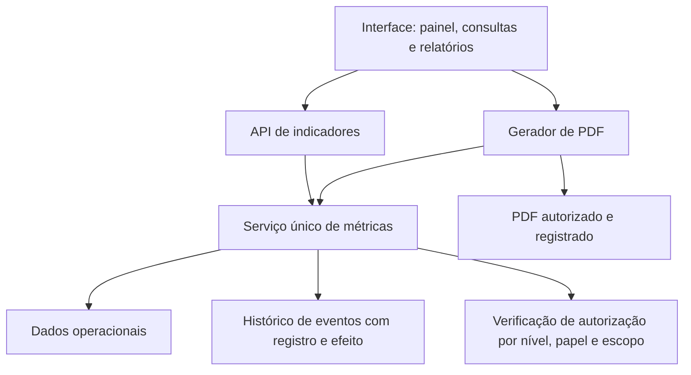

# Plano técnico — Central de Estatísticas e Relatórios

**Projeto:** Gestor de Portarias — Instituto Federal Catarinense (IFC), Campus Videira
**Documento:** Planejamento funcional, visual e técnico do módulo de estatísticas e relatórios
**Versão:** 1.1
**Data:** 11/11/2026
**Substitui:** versão 1.0, de 11/11/2026
**Situação:** Planejamento. O protótipo do Gestor de Portarias já existe no Figma; não há software implementado.

> **Versão substituída.** Esta é a v1.1, mantida como histórico. A versão vigente é a **v1.2** (`PLANO_ESTATISTICAS_RELATORIOS_v1.2.md`, 15/11/2026), que incorpora a ampliação de 15/11/2026 e permite pizza e rosca por pedido expresso.

---

## 0. Controle de versão

### 0.1 Documentos de referência

Este plano complementa as fontes abaixo e não as substitui. Quando houver conflito, prevalecem as decisões confirmadas e, em seguida, o plano v3.2.

| Documento | Uso neste plano |
|---|---|
| Documento-fonte "Gestor de Portarias (Regras de Negócio)", 07/04/2026 | RF7, RF8, RN7, RC8, RC9 e RC10 |
| `PLANO_INTERFACE_GESTOR_PORTARIAS_v3.2.md` | Vocabulário de situações (§6.1), painel T03 (§8.1), relatórios T13 (§8.2), decisões D01–D24, lançamentos L1–L3, CA19, CA20, CA25, CA27, CA37 e CA54 |
| `PRODUCT.md` e `UX-CONTRACT.md` | Decisão de quatro níveis e quatro logins (11/11/2026) |
| `DESIGN.md` | Tokens, tipografia e componentes existentes |
| `ENTREGA-2-DOCUMENTACAO/` | RF-021, RF-022, RN-007 e Matriz de Rastreabilidade |
| Arquivo Figma `yHEP1gOormT6A2nBhLhT3b` | Telas existentes, entre elas T03 (Início/painel) e T13 (Relatórios) |

### 0.2 Mudanças em relação à versão 1.0

| Nº | Mudança | Motivo |
|---|---|---|
| 1 | O plano parte das telas T03, T13, Vencimentos e Servidores já existentes no Figma, em vez de criar uma seção do zero | O arquivo já existe e já tem os itens Relatórios, Vencimentos e Servidores no menu |
| 2 | Matriz de acesso refeita sobre os quatro níveis | Decisão confirmada em 11/11/2026; a versão 1.0 omitia o Vice, a conta externa e o escopo do administrador |
| 3 | "Três dimensões de status" substituídas pelos dois níveis e pela tabela de decisão do v3.2 §6.1 | A "situação administrativa" não estava definida; o projeto já tem vocabulário homologável (H-D05) |
| 4 | Carga horária expressa em horas semanais atribuídas; o limite de 10 h é verificado por participação, não sobre a soma | RN-007 e hipótese H-D06; o *bullet chart* da versão 1.0 contradizia a regra |
| 5 | "Somente PDF" registrado como proposta de mudança (D25), não como premissa confirmada | O v3.2 §8.2 e o RF-021 preveem PDF e CSV |
| 6 | Os relatórios Portarias anuais e Portarias por situação voltam a ser separados | O RF7 tem três relatórios distintos, mais o RC9 |
| 7 | As decisões pendentes passam a citar D05–D24; só temas realmente novos recebem D25–D27 | Evita uma lista paralela de pendências |
| 8 | Data de referência com data de registro e data de efeito | v3.2 §6.1, recorte histórico |
| 9 | Tempo de tramitação definido também para atos sem solicitação; publicação medida pela publicação de referência (D11) | Os níveis 3 e 4 elaboram atos diretamente; há publicação parcial |
| 10 | Comunicações medidas pelos três resultados do CA54 | "Entregue" não é verificável por e-mail |
| 11 | Núcleo reduzido a 11 telas, 18 visualizações, 24 indicadores e 5 relatórios; o restante vira acervo com destino registrado (Apêndices A–C) | Volume de um único campus, custo de estados no Figma e foco nos requisitos da fonte |
| 12 | Indicadores de telemetria (latência, acessos, buscas, usuários ativos) saem do módulo | Não são estatísticas de portarias e têm implicações de LGPD |
| 13 | Prioridades P0–P2 mapeadas aos lançamentos L1–L3 | O projeto já define lançamentos |
| 14 | Novo estado obrigatório "Dados desatualizados" | CA25 |
| 15 | Paleta de gráficos, celular e limites do Figma especificados | Não existiam em `DESIGN.md` nem na versão 1.0 |

---

## 1. Objetivo e contexto

Projetar, sobre o protótipo existente, a área de **estatísticas e relatórios** do Gestor de Portarias. Ela deve atender integralmente RF7, RF8, RC9 e RC10 e oferecer indicadores complementares que só serão ativados quando houver regras homologadas e histórico suficiente.

Perguntas que o módulo responde, em uma data de referência:

- Quantos atos existem em cada situação e quantos registros estão em produção, em cada etapa?
- Quais atos vencem nos próximos dias e quais estão vencidos sem encerramento?
- Quais servidores participam de quais portarias, em que função e com quantas horas semanais atribuídas?
- Como as participações e as horas se distribuem entre departamentos?
- Quanto tempo os registros passam em cada etapa e onde estão parados? (Depende do histórico de eventos.)
- As comunicações aos membros foram cumpridas por e-mail, por meio alternativo ou por exceção autorizada?

### 1.1 Premissas

| Item | Situação |
|---|---|
| Protótipo | **Existe no Figma** (`yHEP1gOormT6A2nBhLhT3b`): 497 quadros, computador e celular, com T03 (Início/painel) e T13 (Relatórios) prototipadas. O menu já tem Relatórios, Vencimentos e Servidores. |
| Acesso | Quatro níveis e quatro logins, decisão confirmada em 11/11/2026 (§9) |
| Backend e banco | Não definidos. Não escolher tecnologia para prototipar gráficos. |
| Histórico de eventos | Previsto no v3.2 (§6.4), mas inexistente em software. Indicadores de tempo dependem dele. |
| Lançamentos | L1 (primeiro lançamento), L2 (atendimento integral: relatórios RF7/RC9 e painel RF8) e L3 (melhorias: XLSX, painel de carga acumulada, acervo, SIPAC) |
| Exportação | O pedido atual é **PDF**. O v3.2 §8.2 e o RF-021 também preveem CSV. A remoção do CSV só vale depois de registrada como D25 e refletida no RF-021. |
| Prazos por etapa | Não existem. Sem eles não há classificação de atraso (D26). |
| SIPAC | Integração futura, conforme D23. Não é pré-requisito. |

Todos os dados mostrados no Figma são **fictícios e identificados como demonstrativos**. Nenhum número do protótipo representa registros reais.

### 1.2 Requisitos de origem

| Requisito | Conteúdo | Lançamento |
|---|---|---|
| RF7 / RF-021 | Três relatórios: Servidor × portarias; Portarias anuais; Portarias por situação | L2 |
| RC9 / RF-021 | Relatório de carga horária atribuída aos servidores | L2 |
| RC10 | Visões anuais com Em edição, Em vigência, Revogadas, Atualizadas, Encerradas; RF7 cita também Vencidas e Em andamento | L2 |
| RF8 / RF-022 | Painel com informações "em tempo real" do acompanhamento (D18) | L2 (parcial no L1, pelo Início) |
| RC8 / RN-019 | Monitoramento de vigência com alertas (D13) | L1/L2 |
| RN7 / RN-007 | Teto de 10 h para docente em portaria administrativa (H-D06) | L1 |
| CA19 | Relatórios e painel no mesmo recorte conferem; contagem por ato | L2 |
| CA20 | Exportações respeitam escopo e restrições de dados pessoais | L1/L2 |
| CA25 | Falha na atualização do painel é informada; dado antigo não aparece como atual | L2 |
| CA27 | Substituição de membro: relatório de horas respeita as datas de saída e entrada | L1 |
| CA37 | Rascunho com data final passada não aparece como Vencida | L1 |
| CA54 | Comunicações: e-mail enviado, comunicação alternativa e exceção autorizada contadas separadamente | L1 |

---

## 2. Vocabulário e regras de contagem

Esta seção é a base de todos os gráficos, tabelas e PDFs. Nenhuma visualização pode usar termos fora dela.

### 2.1 Data de referência e base de registros

- Todo indicador é calculado em uma **data de referência R** (padrão: hoje; relatório anual: escolha do usuário).
- Cada evento guarda **data de registro** e **data de efeito**. Um evento registrado depois, com efeito retroativo, muda o resultado de uma data passada. Por isso, todo painel e todo PDF informa: "Calculado com os registros existentes em dd/mm/aaaa às hh:mm".
- Eventos futuros conhecidos (efeito > R) não mudam a situação; geram marcadores ("Revogação agendada").
- Datas de vigência são datas civis e não mudam de dia por fuso. Instantes de evento usam fuso explícito (`America/Sao_Paulo`, a confirmar).
- Indicadores de período (mês, ano, intervalo) declaram qual data usam: envio da solicitação, emissão, publicação de referência, início de vigência, término ou efeito do evento.

### 2.2 Situações (v3.2 §6.1)

**Nível 1 — etapa da versão em produção** (registros ainda não publicados, independentemente das datas):
Rascunho · Em validação · Devolvida · Aguardando assinatura · Assinatura em verificação · Aguardando publicação · Publicação parcial.

**Nível 2 — situação do ato publicado em R**, avaliada em ordem; a primeira condição verdadeira define a situação:

| Ordem | Situação | Condição em R |
|---|---|---|
| 1 | Revogada | Revogação total com efeito ≤ R |
| 2 | Encerrada | Encerramento registrado com data ≤ R (H-D14; variante a homologar) |
| 3 | Vigência futura | Início de vigência > R |
| 4 | Vencida — sem encerramento | Término < R |
| 5 | Vigente | Início ≤ R ≤ término |
| 6 | Vigente — sem término | Início ≤ R e sem término |

**Marcadores cumulativos** (não substituem a situação): Revogação parcial · Revogação agendada · Alterada por · Renovada por · Retificada por · Alteração em preparação.

Um ato só conta como publicado em R se a **publicação de referência** (D11) tem data ≤ R. Rascunho com término passado continua no nível 1 (CA37).

### 2.3 Categorias dos relatórios (mapeamento H-D05)

| Categoria da fonte | Contagem |
|---|---|
| Em edição | Registros no nível 1 em R |
| Em vigência / Em andamento | Vigente + Vigente — sem término (o significado de "Em andamento" ainda deve ser homologado) |
| Vigência futura | Categoria própria, nunca somada a Em vigência |
| Vencidas | Vencida — sem encerramento |
| Encerradas | Encerrada |
| Revogadas | Revogada (total); revogações parciais em contagem complementar |
| Atualizadas | Atos com marcador Alterada por ou Renovada por; **sobrepõe-se** às demais e é sempre exibida à parte, com nota |

**Regra de reconciliação:** Revogada + Encerrada + Vigência futura + Vencida + Vigente + Vigente sem término = total de atos publicados até R. Atualizadas e revogações parciais nunca entram nessa soma.

### 2.4 Outras regras de contagem

- Contar **atos**, não versões nem membros. Retificação, nova versão e republicação não criam atos novos. Alteração, renovação e substituição de membro **criam** ato novo vinculado (H-D14).
- Distinguir **tipo do ato** (nova, normativa, revogação), **finalidade** (designação de trabalho, lotação, normatização) e **operação sobre outro ato** (altera, renova, revoga, retifica). Filtros e gráficos dizem qual dos três usam.
- Distinguir três unidades: **departamento do solicitante**, **departamento validador** (DEPE, DAP) e **operador** (Gabinete ou CGP). A autoridade que assina é a Direção, por isso "unidade emissora" não serve como dimensão de comparação.
- Usar identificadores estáveis para pessoas e participações, nunca o nome.
- Registros em andamento não entram em médias de tempo de registros concluídos. São mostrados à parte.
- Dado indisponível é exibido como "não disponível", nunca como zero.

### 2.5 Carga horária

- A unidade é sempre **horas semanais atribuídas** (não trabalhadas).
- Uma participação conta em R quando R está no período da participação (entrada e saída do membro, CA27) **e** o ato está Vigente ou Vigente — sem término em R.
- **Horas semanais do servidor em R** = soma das participações que contam em R. Essa soma é **informativa** (H-D06): não há teto sobre ela.
- **RN-007:** o teto de 10 h vale **por participação**, para docente em portaria administrativa (comissões, núcleos e afins). Exatamente 10 h é permitido. Técnicos e outras finalidades não têm teto automático. Nenhum gráfico compara a soma de um servidor com 10 h.
- Em relatórios de período, listar as participações que intersectam o período, com suas datas. O agregado é dado em R (padrão: fim do período) e, opcionalmente, como **pico no período** (maior soma diária). A precisão decimal das horas ainda deve ser homologada (B06b do v3.2).
- Portarias de lotação e normativas não têm carga horária (D07/D20) e ficam fora desses indicadores.

### 2.6 Tempos de tramitação

| Medida | Início | Fim |
|---|---|---|
| Tempo até publicação — com solicitação | Envio da solicitação | Data da publicação de referência (D11) |
| Tempo até publicação — sem solicitação | Criação do registro de elaboração pelo nível 3 ou 4 | Data da publicação de referência |
| Tempo por etapa | Entrada na etapa | Saída da etapa (cada passagem; revisitas somadas ou separadas, conforme declarado) |
| Tempo sem movimentação | Último evento relevante | R |

As duas origens nunca são misturadas na mesma mediana. Publicação parcial não conta como publicação concluída. Enquanto D26 não definir prazos, mostrar duração observada e tempo sem movimentação, **sem rotular registros como atrasados**.

---

## 3. Estratégia e prioridades

### 3.1 Ordem de trabalho

1. Fechar a §2 com os responsáveis (D05, D06, D11, D14, D17, D25).
2. Desenhar no Figma o núcleo (§4), estendendo as telas existentes.
3. Testar o núcleo com Gabinete/CGP, diretores e servidores, nas rodadas exploratórias já previstas (v3.2 §13.3).
4. Definir arquitetura, banco e contratos (§11).
5. Implementar conforme os lançamentos.
6. Homologar com registros reais conhecidos (§14).

### 3.2 Prioridades e lançamentos

| Prioridade | Conteúdo | Lançamento | Origem |
|---|---|---|---|
| P0 | Painel por perfil (E1), Servidor × portarias, horas por servidor, Portarias anuais, Portarias por situação, prévia e PDF | L2 (o Início com contadores já é L1) | RF7, RF8, RC9, RC10 |
| P0 | Relatório de cumprimento das comunicações | L1 | CA54 |
| P1 | Vencimentos com gráfico, resumo do painel em PDF, tramitação descritiva | L2 | RC8, RF8 |
| P2 | Gestão institucional, governança e auditoria, painel de carga acumulada, comparativos plurianuais | L3 | Propostas deste plano e v3.2 L3 |
| Futuro | Projeções, coortes, detecção de atípicos | Sem lançamento | Só com base histórica e metodologia aprovadas |

P0 não significa implementar backend agora. Primeiro vêm o desenho e a homologação das regras.

---

## 4. Arquitetura da informação

O módulo **estende** a navegação existente. Não cria uma seção paralela.

| Item do menu existente | O que recebe |
|---|---|
| Início (T03) | Bloco de painel por perfil, conforme v3.2 §8.1 |
| Relatórios (T13) | Painel completo, catálogo de relatórios, configuração, prévia e consultas tabulares |
| Vencimentos | Visualização dos vencimentos e atos vigentes no tempo |
| Servidores | Aba "Participações e horas" no detalhe do servidor |

### 4.1 Onze telas

**Núcleo (8):**

| Nº | Tela | Base existente | Perfis |
|---|---|---|---|
| E1 | Painel de acompanhamento (RF8) | T03 e T13 | Níveis 2 (escopo próprio ou departamental), 3 e 4 |
| E2 | Central de relatórios: catálogo e histórico de gerações | T13 | Níveis 2 (escopo), 3 e 4 |
| E3 | Configurar relatório | Nova | Idem |
| E4 | Prévia paginada do PDF | Nova | Idem |
| E5 | Consulta Servidor × portarias | T13 | Níveis 3 e 4; DEPE/DAP (H-D17); servidor: só os próprios dados |
| E6 | Consulta de carga horária | T13 | Idem |
| E7 | Detalhe do servidor — Participações e horas | Servidores | Idem |
| E8 | Vencimentos com visualização | Vencimentos | Níveis 3 e 4; DEPE/DAP conforme D17 |

**Complementares (3), P1–P2:**

| Nº | Tela | Perfis |
|---|---|---|
| E9 | Tramitação: tempos por etapa, registros parados, devoluções | Níveis 3 e 4 |
| E10 | Gestão institucional: comparação por departamento e período | Níveis 3 e 4; DEPE/DAP conforme D17 |
| E11 | Governança: validações, assinaturas e gerações de relatório | Níveis 3 e 4; administrador técnico só para eventos técnicos, sem conteúdo |

Inteligência (projeções, coortes, atípicos) **não** recebe tela nesta etapa.

### 4.2 Painel por perfil (E1, conforme v3.2 §8.1)

| Perfil | Primeiro bloco | Segundo bloco |
|---|---|---|
| Gabinete/CGP | Pendências de fluxo, publicações parciais, comunicações pendentes | Vencimentos e vencidas sem encerramento |
| DG/Vice | Assinaturas pendentes | Validações finais e panorama do ano (V01, V12) |
| DEPE/DAP | Validações do departamento | Distribuição de horas do departamento (V08, agregado) |
| Servidor | Minhas solicitações | Minhas participações vigentes e horas semanais |
| Administrador técnico | Estado dos serviços (LDAP, e-mail, assinatura, sincronização) | Contas pendentes de habilitação |

Todo indicador do painel é clicável e abre a lista já filtrada com o mesmo recorte.

### 4.3 Componentes

- Cartão de indicador: valor, unidade, data de referência e tooltip metodológico (fórmula, inclusões, hipóteses vigentes).
- Contêiner de visualização com título, pergunta respondida, legenda, unidade e alternância **gráfico/tabela**.
- Barra de filtros com data de referência obrigatória e resumo dos filtros aplicados.
- Tabela paginada e ordenável com pesquisa e cabeçalho fixo.
- Selo "Calculado com os registros existentes em…".
- Selo "Hipótese em homologação" para indicadores que dependem de Dxx.
- Controles de configuração, prévia, geração e impressão de PDF.

### 4.4 Estados obrigatórios

Os estados ficam em **um único componente contêiner** com variantes. Não se desenha cada gráfico seis vezes.

1. Com dados.
2. Sem registros: "Sem registros no período selecionado". Não exibir eixos zerados.
3. Carregando.
4. Erro, com ação de nova tentativa.
5. Acesso restrito: explica o motivo sem revelar o conteúdo.
6. **Dados desatualizados** (CA25): mostra a hora da última atualização válida e não apresenta o dado antigo como atual.

---

## 5. Visualizações do núcleo (18)

As 56 visualizações da versão 1.0 foram avaliadas uma a uma; o destino de cada uma está no Apêndice A.

| Nº | Visualização | Tipo | Pergunta | Tela | Prior. |
|---|---|---|---|---|---|
| V01 | Atos por situação em R | Barras horizontais (categorias da §2.3; Atualizadas separada) | Quantos atos há em cada situação? | E1, R4 | P0 |
| V02 | Registros em produção por etapa | Barras horizontais | Onde estão os registros não publicados? | E1 | P0 |
| V03 | Solicitações enviadas e atos publicados por mês | Linha, 12 meses | Como varia o volume? | E1 | P0 |
| V04 | Vencimentos nos próximos dias | Colunas por faixa (faixas de D13; exemplo 0–7, 8–30, 31–60) | Quantos atos vencem em breve? | E1, E8 | P0 |
| V05 | Participações vigentes por departamento | Barras horizontais | Como as participações se distribuem? | E1, E5 | P0 |
| V06 | Servidores por número de participações vigentes | Colunas (1, 2, 3, 4 ou mais) | Quantas participações cada servidor acumula, sem expor nomes? | E5 | P0 |
| V07 | Funções nas composições vigentes | Barras (presidência, vice, membro) | Como se distribuem as funções? | E5 | P1 |
| V08 | Distribuição das horas semanais atribuídas em R | Colunas por faixa de horas | Há concentração de horas? | E1, E6 | P0 |
| V09 | Horas semanais atribuídas por departamento | Barras horizontais | Como as horas se distribuem entre setores? | E6 | P0 |
| V10 | Linha do tempo das participações do servidor | Gantt individual | Quais participações ocorrem ao mesmo tempo? | E7, R2 | P0 |
| V11 | Horas semanais do servidor ao longo do tempo | Linha em degraus | Como evoluíram as horas atribuídas? | E7, R2 | P0 |
| V12 | Atos emitidos por ano | Colunas | Como os anos se comparam? | E1, R3 | P0 |
| V13 | Atos do ano por finalidade | Barras horizontais | Quais finalidades predominam? | R3 | P0 |
| V14 | Agenda de vencimentos | Lista agrupada por semana, com calendário mensal opcional | Quais atos vencem em cada período? | E8 | P1 |
| V15 | Atos vigentes ao longo do tempo | Linha | Quantos atos estavam vigentes em cada data? | E8 | P1 |
| V16 | Tempo por etapa | Barras com mediana e marca do P90 | Onde se gasta mais tempo? | E9 | P1 |
| V17 | Registros sem movimentação por faixa de dias | Colunas | Quantos registros estão parados, e há quanto tempo? | E9 | P1 |
| V18 | Devoluções por mês | Colunas | As devoluções aumentaram? | E9 | P1 |

**Regras de forma:**

- Barras são o padrão. Rosca e pizza não são usadas.
- Nenhum ranking nominal de pessoas aparece em painel. Listas nominais ficam em tabelas de relatório, sob D16/D17.
- Quando uma série tiver poucos registros, mostrar a tabela em vez do gráfico.
- V16–V18 dependem do histórico de eventos e só aparecem com dados reais em software quando ele existir.

---

## 6. Indicadores do núcleo (24)

O dicionário de métricas é **único** para painel, tabelas e PDFs. Os 70 indicadores da versão 1.0 têm destino registrado no Apêndice B.

| Nº | Indicador | Definição | Unidade | Depende de |
|---|---|---|---|---|
| I01 | Atos por situação | Contagem de atos em cada categoria da §2.3 em R | atos | D05, D14 |
| I02 | Registros em produção por etapa | Registros no nível 1 em R, por etapa | registros | — |
| I03 | Solicitações enviadas | Solicitações com envio no período | solicitações | — |
| I04 | Atos publicados | Atos cuja publicação de referência ocorreu no período | atos | D11 |
| I05 | Atos emitidos no ano | Atos com ano de emissão = ano escolhido | atos | D17 |
| I06 | Vigência futura | Atos publicados com início de vigência > R | atos | — |
| I07 | Vencidas sem encerramento | Atos com término < R sem encerramento nem revogação | atos | D14 |
| I08 | Vencimentos próximos | Atos vigentes com término em R…R+N, por faixa | atos | D13 |
| I09 | Atualizadas | Atos com marcador Alterada por ou Renovada por | atos (sobreposto) | D05 |
| I10 | Revogações parciais | Atos com revogação parcial eficaz em R | atos (complementar) | D14 |
| I11 | Servidores com participação vigente | `COUNT(DISTINCT servidor_id)` entre participações que contam em R | servidores | — |
| I12 | Participações vigentes | Participações que contam em R | participações | — |
| I13 | Média de participações por servidor participante | I12 / I11 | participações por servidor | — |
| I14 | Presidências e vice-presidências vigentes | Participações vigentes com essas funções | participações | D07 |
| I15 | Horas semanais do servidor | Soma informativa da §2.5 em R | h/semana | D06 |
| I16 | Distribuição de horas semanais | Servidores por faixa de horas em R | servidores | D06 |
| I17 | Horas semanais por departamento | Soma de I15 dos servidores lotados no departamento em R (histórico de lotação) | h/semana | D06, D15 |
| I18 | Tempo até publicação | Mediana e P90, separados por origem (§2.6), só registros concluídos | dias | Histórico, D26 |
| I19 | Tempo por etapa | Mediana e P90 por etapa | dias | Histórico, D26 |
| I20 | Tempo sem movimentação | R − último evento relevante, por faixa | dias | Histórico |
| I21 | Taxa de devolução | Registros que passaram por Devolvida / registros que passaram por Em validação × 100, na mesma coorte | % | Histórico |
| I22 | Cumprimento das comunicações | Por membro: e-mail enviado · comunicação alternativa · exceção autorizada · pendente (CA54) | membros | D12 |
| I23 | Validações pendentes | Registros Em validação, por departamento validador | registros | D04 |
| I24 | Assinaturas pendentes | Registros Aguardando assinatura ou Assinatura em verificação | registros | D03, D10 |

"Dias" significa dias corridos até que D26 defina o calendário. Indicadores que dependem de hipótese exibem o selo "Hipótese em homologação".

---

## 7. Filtros e interações

### 7.1 Filtros

- **Data de referência R** (obrigatória) e período: mês, trimestre, semestre, ano ou intervalo.
- Data usada no período: envio, emissão, publicação de referência, início de vigência, término ou efeito.
- Tipo do ato, finalidade e operação (§2.4).
- Situação (nível 2) ou etapa (nível 1). Os dois níveis nunca aparecem no mesmo seletor.
- Departamento do solicitante, departamento validador ou lotação do servidor, declarando qual.
- Vínculo funcional (docente, técnico, aluno, externo) e função na composição.
- Servidor: só em E5, E6, E7 e nos relatórios autorizados.

Um filtro incompatível com a métrica fica desabilitado e explica por quê. Nunca é ignorado em silêncio. Para DEPE/DAP, o filtro de departamento já vem preenchido quando o painel prioriza o departamento (§4.2), sem impedir os relatórios completos previstos em H-D17.

### 7.2 Interações

1. **Detalhamento:** clicar em um agregado abre a lista filtrada com o mesmo recorte.
2. **Registro:** da lista se abre o ato completo.
3. **Comparação temporal:** apenas entre períodos de mesma duração e mesma data de referência relativa.
4. **Tooltip metodológico** em todo indicador.
5. **Alternância gráfico/tabela** em toda visualização.
6. **Geração de PDF** reproduz exatamente os filtros e a data de referência da tela.
7. **Última atualização** sempre visível; atualização periódica do painel conforme D18 (proposta técnica: 60 s e ao voltar à aba).

---

## 8. Relatórios PDF

### 8.1 Formato

PDF é o formato pedido para este módulo. O v3.2 §8.2 e o RF-021 incluem CSV (e XLSX no L3). **D25** decide se o CSV sai do escopo. Até a decisão, o design cobre só o PDF e a documentação mantém o CSV como requisito em aberto.

### 8.2 Relatórios do núcleo

| Nº | Relatório | Conteúdo mínimo | Filtros | Origem | Prior. |
|---|---|---|---|---|---|
| R1 | Servidor × portarias | Servidor, identificação autorizada (D21), departamento, portarias, função, período de participação e situação | Servidor, departamento, período, situação | RF7/Rel.1 | P0 |
| R2 | Horas por servidor | Participações e horas semanais atribuídas, com datas (V10, V11). Variantes: **individual** e **consolidada** por departamento | Servidor, departamento, período, R | RC9 | P0 |
| R3 | Portarias anuais | Quantidade e relação dos atos do ano (V12, V13) | Ano de emissão | RF7/Rel.2 | P0 |
| R4 | Portarias por situação | Categorias da §2.3 com relação dos atos, nota sobre Atualizadas e Vigência futura (V01) | Ano, R | RF7/Rel.3, RC10 | P0 |
| R5 | Cumprimento das comunicações | Resultado por membro e por ato (I22) | Período, ato | CA54 | P0 (L1) |

O catálogo completo, com 14 modelos, está no Apêndice C.

### 8.3 Estrutura editorial

1. Identificação institucional, nome e versão do modelo.
2. Data de referência, período, filtros e critério de contagem.
3. Data e hora de geração, "calculado com os registros existentes em…", e perfil de quem gerou.
4. Resumo dos números principais.
5. Gráficos com título, eixos, unidades e legenda, **cada um seguido da tabela equivalente**.
6. Tabelas de apoio com cabeçalho repetido em cada página.
7. Metodologia, hipóteses vigentes (Dxx) e limitações.
8. Paginação "página X de Y" e identificação do modelo.

**Apresentação:** A4; legível impresso em tons de cinza; nenhuma informação transmitida só por cor; PDF com marcação de acessibilidade (estrutura de títulos, tabelas e texto alternativo nos gráficos) na implementação; identidade visual do `DESIGN.md`.

**Dados pessoais:** nenhum relatório inclui CPF, telefone, endereço ou e-mail (RNF de privacidade; v3.2 §10). A identificação do servidor segue D21 e D16. No protótipo, toda prévia traz a marca "Dados demonstrativos".

### 8.4 Regras de geração

- Usa o mesmo serviço de métricas do painel; mesmos filtros resultam nos mesmos números (CA19).
- A autorização é verificada ao gerar e ao baixar. O PDF não amplia o acesso da consulta de origem (CA20).
- Registra autor, momento, modelo, filtros e data de referência no log (RNF de auditoria).
- Gerado no servidor; não depende da impressão do navegador.
- Arquivos com prazo de retenção definido em D27.

---

## 9. Acesso por nível

A autorização efetiva é feita no backend; esconder telas não é controle de acesso.

| Nível | Perfis | Acesso analítico |
|---|---|---|
| 1 | Conta externa / consultor | **Nenhum.** Não vê painel, relatórios, indicadores nem contagens internas. Só consulta atos publicados. |
| 2 | Docente, técnico | Só os próprios dados: minhas solicitações, minhas participações, minhas horas e R2 individual de si mesmo. |
| 2 | DEPE, DAP | Painel centrado no departamento (§4.2). Relatórios completos conforme H-D17 (a fonte dá consulta total a DEPE/DAP), com dados nominais limitados por D16. |
| 2 | Administrador técnico | Estado dos serviços e eventos técnicos de geração de relatórios (quem, quando, modelo), **sem** conteúdo dos relatórios, indicadores de negócio ou dados pessoais. |
| 3 | Gabinete, CGP/DGP | Painel, todos os relatórios e consultas, no escopo concedido. |
| 4 | Direção-Geral | Painel, todos os relatórios e consultas. |
| 4 | Vice-Diretor autorizado | Igual à DG, somente com autorização e no período registrados (RN-020). |

Pontos a homologar em D17: quem vê listas nominais de participações e horas de outros servidores, e se DEPE/DAP veem nominalmente servidores de outros departamentos.

---

## 10. Modelo conceitual de dados

São necessidades de informação, não um esquema físico.

| Entidade | Campos e relações centrais |
|---|---|
| `atos` | ID, série e número (D09), ano, tipo, finalidade, assunto, datas de emissão e vigência |
| `versoes` | Ato, versão, documento, hash da versão assinada (RN-015) |
| `operacoes_entre_atos` | Ato de origem, ato afetado, operação (altera, renova, revoga total/parcial, retifica), data de efeito |
| `solicitacoes` | ID, solicitante, departamento, envio, ato resultante (opcional) |
| `eventos` | Registro, tipo, etapa anterior e nova, ator, **data de registro**, **data de efeito**, justificativa |
| `publicacoes` | Ato, canal, natureza da obrigação, data, evidência, indicador de publicação de referência (D11) |
| `comunicacoes` | Ato, membro, resultado (e-mail enviado, alternativa, exceção autorizada, pendente), data, justificativa (D12) |
| `pessoas` | ID interno, vínculo funcional, situação cadastral |
| `lotacoes` | Pessoa, departamento, início, fim (histórico) |
| `departamentos` | ID, nome, sigla, departamento superior |
| `participacoes` | Ato, pessoa, função, horas semanais, entrada, saída |
| `contas_papeis` | Conta, nível, papel, escopo, departamento, autorização e período (Vice) |
| `regras_prazos` | Etapa, prazo, calendário, versão da regra (D26) |
| `relatorios_gerados` | Modelo, filtros, R, autor, data, arquivo, retenção (D27) |

Guardar só a situação atual impede reconstruir situações passadas, tempos por etapa e devoluções. O histórico de eventos é pré-requisito de I18–I21.

---

## 11. Arquitetura lógica



### 11.1 Contratos ilustrativos

```http
GET  /api/estatisticas/situacoes?data_referencia=AAAA-MM-DD
GET  /api/estatisticas/producao?data_referencia=...
GET  /api/estatisticas/participacoes?data_referencia=...&departamento=...
GET  /api/estatisticas/carga-horaria?data_referencia=...&inicio=...&fim=...
GET  /api/estatisticas/vencimentos?data_referencia=...&faixas=...
GET  /api/estatisticas/tramitacao?inicio=...&fim=...
GET  /api/estatisticas/comunicacoes?inicio=...&fim=...

POST /api/relatorios
GET  /api/relatorios/{id}
GET  /api/relatorios/{id}/pdf
```

São sugestões, não rotas existentes. Toda resposta inclui `data_referencia`, `calculado_em`, os filtros efetivamente aplicados e as hipóteses vigentes.

### 11.2 Requisitos de backend

- Autorização por nível, papel e escopo em cada chamada e em cada download.
- Validação de filtros na API, inclusive na geração de PDF.
- Paginação, agregações pré-calculadas quando necessário e cache com `calculado_em`.
- Limites de geração simultânea e de tamanho de PDF.
- Testes automatizados das fórmulas, com casos-limite: término igual a R, revogação com efeito futuro, efeito retroativo, substituição de membro, ato sem término, publicação parcial, 10 h exatas.

---

## 12. Representação no Figma

- Os gráficos são **vetores estáticos** desenhados com componentes; filtros e estados são demonstrados por variantes e percursos predefinidos, como no resto do protótipo.
- **Cenário demonstrativo único:** uma página de documentação no arquivo lista os atos, participações e eventos fictícios de onde saem todos os números. Os indicadores do protótipo devem obedecer à regra de reconciliação da §2.3, e o mesmo recorte deve dar o mesmo número em E1, E5, E6 e na prévia do PDF.
- **Celular:** cartões de indicador, listas e tabelas resumidas. Gráficos só na forma de barras simples; Gantt e linhas temporais aparecem como lista. Configuração e prévia de PDF podem ser restritas ao computador, desde que o celular explique isso.
- **Paleta de gráficos:** criar em `DESIGN.md` e nas variáveis do Figma uma escala categórica de até 5 cores, uma escala sequencial e cores de alerta, todas com contraste mínimo de 3:1 contra o fundo e reforçadas por rótulo direto, padrão ou posição.
- Prever a variante "Dados demonstrativos" em toda prévia de PDF.
- O protótipo não comprova teclado, leitor de tela, PDF acessível, desempenho nem autorização em execução.

---

## 13. Decisões pendentes

### 13.1 Decisões existentes que afetam este módulo

| ID | Tema | Efeito aqui |
|---|---|---|
| D03 | Condição de assinatura do Vice | I24; acesso de nível 4 do Vice |
| D05 | Vocabulário de situações | §2.2, §2.3, I01, R4 |
| D06 | RN7: finalidade administrativa, acúmulo, precisão das horas | §2.5, I15–I17, R2 |
| D07 | Campos por finalidade | I14; atos sem carga horária |
| D08 | Prazo indeterminado, retroatividade, dia final | Vigência, I06–I08 |
| D09 | Séries e numeração | Identificação dos atos |
| D11 | Publicação de referência | I04, I18, situação em R |
| D12 | Comunicação aos membros | I22, R5 |
| D13 | Alertas: antecedência e destinatários | Faixas de V04 e I08 |
| D14 | Renovação, alteração, encerramento | Encerrada, Atualizadas, contagem de atos |
| D15 | Origem dos dados funcionais e lotação | I17 |
| D16 | Dados pessoais por perfil | Listas nominais, R1, R2 |
| D17 | Escopo e contagem dos relatórios | §9, ano de emissão, DEPE/DAP |
| D18 | "Tempo real" do painel | Atualização de E1, CA25 |
| D21 | Identificação de pessoas | R1, R2 |
| D23 | SIPAC | Origem futura de dados |

### 13.2 Novas decisões propostas

Numeração proposta; confirmar que não colide com outra lista do projeto.

| ID | Pergunta | Proposta | Responsáveis |
|---|---|---|---|
| D25 | O CSV sai do escopo, ficando só o PDF? | PDF como único formato no L2; se aprovado, atualizar RF-021 e v3.2 §8.2 | Gabinete, CGP e TI |
| D26 | Quais os prazos por etapa? Contagem em dias corridos ou úteis, e como tratar feriados e suspensões? | Sem prazos, nenhum atraso é classificado; dias corridos como unidade provisória | Gabinete, DG e áreas validadoras |
| D27 | Por quanto tempo guardar PDFs gerados e logs de geração? | Arquivo temporário com expiração curta; log conforme política arquivística | Arquivo, Gabinete e TI |

### 13.3 Inconsistência documental fora deste módulo

A Entrega 2 (`ENTREGA-2-DOCUMENTACAO/`) ainda descreve três níveis de acesso (RN-009, RN-010 e RN-020, entre outros). A decisão vigente é de quatro níveis. A atualização daqueles documentos é necessária, mas não faz parte deste plano.

---

## 14. Roteiro

| Fase | Atividades | Entregas |
|---|---|---|
| 1 — Especificação | Homologar §2 e as decisões da §13 que bloqueiam o núcleo | Dicionário de métricas aprovado; matriz indicador × dado × decisão |
| 2 — Figma | Estender T03, T13, Vencimentos e Servidores; contêiner com 6 estados; cenário demonstrativo; paleta de gráficos | Telas E1–E8, computador e celular |
| 3 — Prévias de PDF | Modelos R1–R5: capa, páginas internas, poucos e muitos dados, quebras de página | Prévias paginadas |
| 4 — Teste exploratório | Rodadas do v3.2 §13.3 com Gabinete/CGP, diretores e servidores | Relatório de teste e ajustes |
| 5 — Arquitetura | Stack, banco, histórico de eventos, contratos e autorização | Modelo lógico, contratos, matriz de acesso aprovada |
| 6 — Implementação | L1: I22/R5 e contadores do Início. L2: E1–E8 e R1–R4. L3: E9–E11 e complementares | Software por lançamento |
| 7 — Homologação | Reconciliar com registros reais; testar casos-limite da §11.2, permissões e PDF | Evidências e matriz de correções |

---

## 15. Critérios de aceitação

### 15.1 Protótipo Figma

- [ ] E1–E8 estendem as telas existentes e respeitam `DESIGN.md`.
- [ ] Todos os termos de situação seguem a §2.2 e a §2.3.
- [ ] Os números do cenário demonstrativo obedecem à regra de reconciliação e conferem entre painel, consulta e prévia.
- [ ] Toda visualização tem título, pergunta, unidade, legenda e tabela equivalente.
- [ ] O contêiner tem os 6 estados da §4.4.
- [ ] Nenhum gráfico compara a soma de horas de um servidor com 10 h.
- [ ] A conta externa (nível 1) não tem nenhum percurso até estatísticas internas.
- [ ] O administrador técnico não chega ao conteúdo de relatórios nem a dados pessoais.
- [ ] As prévias de R1–R5 estão paginadas, marcadas como demonstrativas e sem CPF, telefone, endereço ou e-mail.
- [ ] O celular tem versão de E1, E5, E6, E7 e E8.

### 15.2 Implementação

- [ ] CA19, CA20, CA25, CA27, CA37 e CA54 aprovados.
- [ ] Atos contados uma vez, sem duplicar por versão ou membro.
- [ ] Situação em uma data passada reconstruída corretamente a partir do histórico, inclusive com efeito retroativo.
- [ ] Horas calculadas por interseção de datas, com 10 h aceito e soma apenas informativa.
- [ ] Indicadores sem dados suficientes mostram "não disponível".
- [ ] Autorização verificada no backend em consulta, geração e download.
- [ ] Toda geração de PDF registrada no log.

---

## 16. Próximos passos

1. Levar a §2 e as decisões D05, D06, D11, D14, D17 e D25 aos responsáveis.
2. Obter uma estimativa do volume anual de portarias do campus, para calibrar faixas, períodos e a viabilidade dos indicadores de tempo.
3. Desenhar E1 e o contêiner de visualização no Figma e validar com Gabinete/CGP antes das demais telas.

**Não compartilhar** para esta etapa: senhas, tokens, CPF, SIAPE ou dados pessoais reais.

---

## Apêndice A — Destino das 56 visualizações da versão 1.0

**Legenda:** *Incorporada* (entra no núcleo, possivelmente em outra forma) · *Adiada* (P2 ou futuro, com condição) · *Removida* (com motivo).

| Painel da v1.0 | Visualização | Destino |
|---|---|---|
| 1 Visão Geral | Evolução mensal | Incorporada — V03 |
| | Distribuição por etapa | Incorporada — V02 |
| | Tipos de portaria (rosca) | Incorporada como barras — V13 |
| | Comparativo anual | Incorporada — V12 |
| | Volumes por unidade | Adiada — E10 |
| | Tendência de publicações | Removida — repete V03 |
| | Calendário de movimentações | Adiada — L3 |
| 2 Tramitação | Funil | Removida — o fluxo tem devoluções e não é um funil; V02 e V18 cobrem |
| | Duração por etapa | Incorporada — V16 |
| | Histograma de duração | Adiada — depende de volume |
| | Box plot | Removida — público não especialista; P90 em V16 |
| | Heatmap unidade × etapa | Adiada — E10 |
| | Sankey | Adiada como matriz de transições — P2 |
| | Retrabalho no tempo | Incorporada — V18 |
| 3 Servidores | Ranking por servidor | Restrita a tabela em R1; sem gráfico nominal |
| | Por unidade | Incorporada — V05 |
| | Docentes × técnicos | Incorporada como filtro de vínculo em V05 e V06 |
| | Funções (rosca) | Incorporada como barras — V07 |
| | Evolução das participações | Adiada — P2 |
| | Heatmap servidor × tipo | Removida — exposição nominal, pouca utilidade |
| | Distribuição de vínculos | Incorporada — V06 |
| 4 Carga Horária | Ranking de horas | Restrita a tabela em R2; sem gráfico nominal |
| | Distribuição de horas | Incorporada — V08 |
| | Horas por unidade | Incorporada — V09 |
| | *Bullet chart* do limite | **Removida** — contradiz H-D06 |
| | Evolução temporal | Incorporada no nível individual — V11 |
| | Gantt de sobreposição | Incorporada — V10 |
| | Horas por função | Adiada — P2 |
| 5 Vigências | Calendário de vencimentos | Incorporada — V14 |
| | Gantt de vigências | Adiada — P2 |
| | Intervalos até vencimento | Incorporada — V04, com faixas de D13 |
| | Evolução das renovações | Adiada — depende de D14 |
| | Duração dos atos | Adiada — P2 |
| | Vencimentos por unidade | Adiada — E10 |
| | Vigentes no tempo | Incorporada — V15 |
| 6 Gestão | Solicitações por departamento | Adiada — E10 |
| | Treemap | Removida — barras equivalentes e mais legíveis |
| | Tipos por unidade | Adiada — E10 |
| | Comparativo entre anos | Incorporada — repete V12 |
| | Sazonalidade | Adiada — exige vários anos de dados |
| | Comissões por unidade | Adiada — E10 |
| | Alterações e revogações | Adiada — E10 e R11 |
| 7 Governança | Histórico de eventos | Incorporada no histórico do ato, fora do painel |
| | Pareto de inconsistências | Adiada — P2 |
| | Validações pendentes/concluídas | Incorporada como indicador — I23 |
| | Motivos de devolução | Adiada — exige motivo codificado |
| | Ações bloqueadas | Adiada — P2 |
| | Completude cadastral | Adiada — P2 |
| | Revisões documentais | Incorporada no histórico do ato |
| 8 Inteligência | Tendências históricas | Incorporada — V03 e V12 |
| | Coortes | Removida — volume insuficiente |
| | Projeção de solicitações | Removida até haver base e metodologia aprovadas |
| | Previsão de vencimentos | Incorporada — V04 usa datas conhecidas, sem previsão |
| | Qualidade dos cadastros | Adiada — P2 |
| | Evolução dos tempos | Adiada — P2 |
| | Valores atípicos | Removida para pessoas; adiada para tempos de atos |

V01 (atos por situação) e V17 (registros sem movimentação) são novas e vêm de RF7/Rel.3 e do indicador "tempo parado" da versão 1.0.

## Apêndice B — Destino dos 70 indicadores da versão 1.0

| Categoria da v1.0 | Destino |
|---|---|
| Volume e situação (10) | Incorporados em I01–I10. "Normativas" vira filtro de tipo. "Futuras" passa a "Vigência futura" e "vencidas" a "Vencida — sem encerramento". |
| Produtividade e fluxo (10) | Tempo total, por etapa, mediana, P90, parados e devolução em I18–I21. Cumprimento de prazos bloqueado por D26. Taxa de conclusão por coorte adiada. Pendências por etapa em I02. |
| Servidores (8) | Participantes, participações, média e presidências/vice em I11–I14. Concentração por setor em V05. "Sem vínculos vigentes" adiado (P2, CGP). |
| Carga horária (8) | Horas, distribuição e unidade em I15–I17. "Proximidade do limite" removido (H-D06). "Bloqueios por excesso" adiado para governança (P2), contado como tentativa bloqueada. |
| Vigência (8) | Vencimentos próximos, vencidas e vigência futura em I06–I08. Sobreposições em V10. Renovações e durações adiadas (D14, P2). |
| Governança (8) | Validações e assinaturas pendentes em I23 e I24. Os demais, em E11 (P2). |
| Gestão institucional (6) | Adiados para E10 (P2). |
| Comunicações (6) | Substituídos por I22, com os quatro resultados do CA54. "Entregue" removido por não ser verificável. Alertas tratados/pendentes adiados para a central de notificações (D13). |
| Sistema e qualidade (6) | Latência, falhas, acessos, buscas e usuários ativos **saem do módulo**: pertencem ao monitoramento técnico da administração e exigem avaliação de LGPD. Completude cadastral adiada para E11. |

## Apêndice C — Catálogo de relatórios (14 modelos)

A versão 1.0 tinha 15 modelos. O "Balanço anual" foi dividido em R3 e R4; os dois relatórios de carga horária viraram variantes de R2; "Portarias vigentes" passou a ser um recorte de R4.

| Nº | Relatório | Origem na v1.0 | Prior. |
|---|---|---|---|
| R1 | Servidor × portarias | Nº 3 | P0 |
| R2 | Horas por servidor (individual e consolidada) | Nº 4 e 5 | P0 |
| R3 | Portarias anuais | Nº 2 (parte) | P0 |
| R4 | Portarias por situação (inclui recorte de vigentes) | Nº 2 (parte) e 6 | P0 |
| R5 | Cumprimento das comunicações | Nº 14 (reformulado) | P0 (L1) |
| R6 | Vencimentos e renovações | Nº 7 | P1 |
| R7 | Tramitação e tempos | Nº 8 | P1 |
| R8 | Resumo do painel | Nº 1 | P1 |
| R9 | Composições e membros | Nº 10 | P1 |
| R10 | Comparação departamental | Nº 9 | P2 |
| R11 | Alterações e revogações | Nº 11 | P2 |
| R12 | Validações e assinaturas | Nº 12 | P2 |
| R13 | Auditoria (níveis 3 e 4) | Nº 13 | P2 |
| R14 | Qualidade cadastral | Nº 15 | P2 |
